# Sugestões do jogo

Feitas dentro do jogo com a tecla **Q**. Peça ao Claude: *"aplique minhas sugestões pendentes"*.

## Pendentes (0)

_Nenhuma._

## Feitas (11)

### S-001 · Área do mapa: Área de 6×4 tiles
- **Status:** feito · **Quando:** 2026-11-07T15:20:32 · **Mapa:** Vila de Alvorada (tile [29, 11])
- **Onde no código:** js/world.js (geração de vila) · js/data.js → MAPS.vila
- **Sugestão:** isso é so um teste mesmo
- 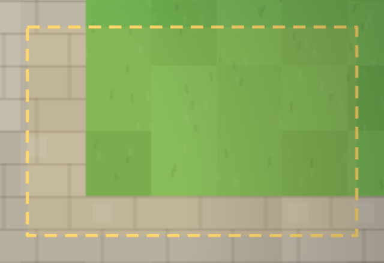
- **Resposta do Claude:** Era um teste do modo sugestão — funcionou! Nada a mudar no jogo.

### S-002 · Área do mapa: Área de 6×3 tiles
- **Status:** feito · **Quando:** 2026-11-07T15:35:55 · **Mapa:** Campos de Verdelume (tile [26, 12])
- **Onde no código:** js/world.js (geração de campos) · js/data.js → MAPS.campos
- **Sugestão:** ignora o print mas percebi que a musica que eu entrei aqui se sobrepos com a utra. Nao pode ser as duas. Tem que ser so a do mapa viegente

Outra coisa. QUando eu clicar em enter aqui na sugestao tem que ir direto e nao dar um salto de linha
- 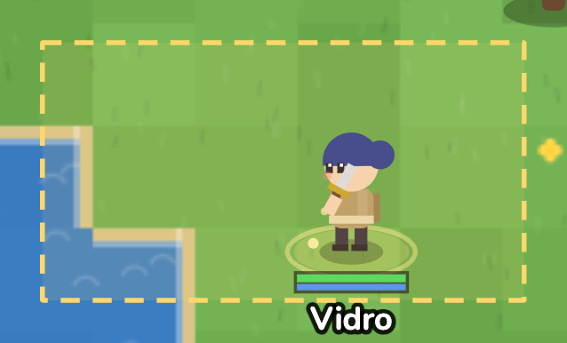
- **Resposta do Claude:** Música: ao trocar de mapa a música anterior agora baixa e é cortada em 0,6s, então só toca a do mapa atual; e o jogo silencia quando a aba não está visível (evita duas abas tocando juntas). Sugestão: Enter agora envia direto; Shift+Enter pula linha.

### S-003 · Área do mapa: Área de 8×5 tiles
- **Status:** feito · **Quando:** 2026-11-07T15:42:56 · **Mapa:** Campos de Verdelume (tile [10, 29])
- **Onde no código:** js/world.js (geração de campos) · js/data.js → MAPS.campos
- **Sugestão:** gostaria de ter alguma forma de minimizar esse chat pra ele nao me atrapalhar quando eu nao o quisesse
- 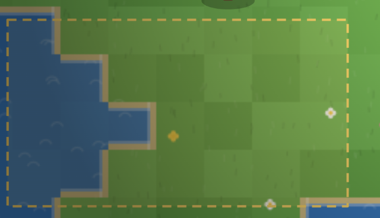
- **Resposta do Claude:** Chat agora tem botão "—" para minimizar: vira um botãozinho "💬 Chat" que mostra quantas mensagens novas chegaram. Clique nele ou aperte Enter para abrir. A escolha fica lembrada.

### S-004 · Área do mapa: Área de 9×3 tiles
- **Status:** feito · **Quando:** 2026-11-07T15:43:41 · **Mapa:** Campos de Verdelume (tile [19, 31])
- **Onde no código:** js/world.js (geração de campos) · js/data.js → MAPS.campos
- **Sugestão:** gostaria que isso aqui ficasse la em cima ao lado do card pricipal do meu nome e não aqui embaixo
- 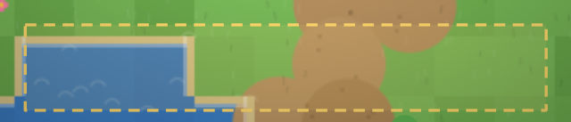
- **Resposta do Claude:** A barra de atalhos (1–9) foi para o topo, ao lado do card com seu nome; os ícones de buff ficam logo abaixo dela. Obs.: ao marcar uma área por cima da interface, a sugestão agora também registra quais partes da interface estavam dentro.

### S-005 · Área do mapa: Área de 21×21 tiles
- **Status:** feito · **Quando:** 2026-11-07T15:44:52 · **Mapa:** Campos de Verdelume (tile [13, 13])
- **Onde no código:** js/world.js (geração de campos) · js/data.js → MAPS.campos
- **Sugestão:** gostaria que o god mode permitisse que eu fosse qualquer classe. EU pudesse facilmente escolher ali a minha classe quando entrasse no menu do god mode
- 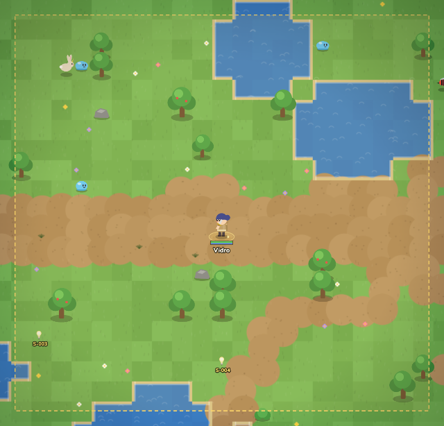
- **Resposta do Claude:** No Painel do Mestre (⌘+Z) há a seção "Classe": clique em qualquer uma das 13 classes para virar ela na hora (recebe a arma típica da classe). O botão "Todas as habilidades da classe no máximo" libera tudo para testar.

### S-006 · Área do mapa: Área da tela (108×45 px)
- **Status:** feito · **Quando:** 2026-11-07T16:32:01 · **Mapa:** Campos de Verdelume (tile [12, 22])
- **Onde no código:** js3d/main3d.js → buildWorld (cenário) · js3d/world3d.js (terreno)
- **Sugestão:** quero que meu hp tbm apareça abaixo do personagem. SP também
- 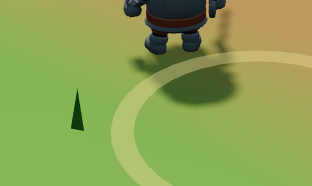
- **Resposta do Claude:** No 3D agora há barras de HP (verde, fica vermelha abaixo de 30%) e SP (azul) logo abaixo dos pés do seu personagem, acompanhando ele. Obs.: o retângulo de seleção do Q também passou a aparecer enquanto você arrasta.

### S-007 · Área do mapa: Área da tela (192×141 px)
- **Status:** feito · **Quando:** 2026-11-07T16:46:33 · **Mapa:** Ruínas de Kael (tile [-27, -43])
- **Onde no código:** js3d/main3d.js → buildWorld (cenário) · js3d/world3d.js (terreno)
- **Sugestão:** Isso é um teste para entender se o comando de voz está funcionando
- 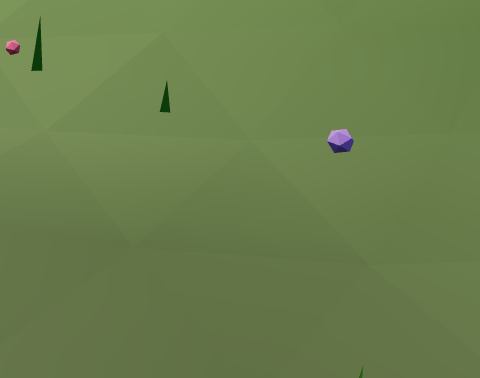
- **Resposta do Claude:** O ditado por voz funcionou! Era um teste — nada a mudar.

### S-008 · Área do mapa: Área da tela (333×201 px)
- **Status:** feito · **Quando:** 2026-11-07T16:47:16 · **Mapa:** Ruínas de Kael (tile [-34, -42])
- **Onde no código:** js3d/main3d.js → buildWorld (cenário) · js3d/world3d.js (terreno)
- **Sugestão:** Eu entendo que a ideia desse monte de Pino em grama era deixar o gráfico leve e o jogo bacana mas eu entendo que você consegue tornar uma grama muito mais bonita e interessante e não toda a ponte aguda e esquisita assim então eu quero que você já melhore o gráfico em geral do terreno deste jogo
- 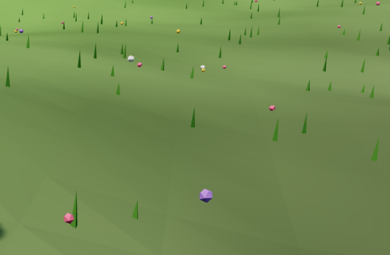
- **Resposta do Claude:** Grama refeita: no lugar dos "pinos", tufos de lâminas curvas (bem mais densos) que balançam com o vento, flores de verdade e tons por região (bosque mais escuro, ruínas mais secas). O chão ganhou textura e sombreado suave, e as ruínas têm lajes de pedra e pedregulhos.

### S-009 · Área do mapa: Área da tela (205×226 px)
- **Status:** feito · **Quando:** 2026-11-07T16:48:10 · **Mapa:** Ruínas de Kael (tile [-134, 62])
- **Onde no código:** js3d/main3d.js → buildWorld (cenário) · js3d/world3d.js (terreno)
- **Sugestão:** Aqui no mapa Ficou esquisito essas bordas em cima e dos lados tá meio estranha aproveite e também melhore a aparência do mapa percebi agora que o print que eu tirei não pegou o mapa e sim o local mas acredito que você seja inteligente o suficiente para compreender que me refiro a um mapa que está no canto direito superior do jogo
- 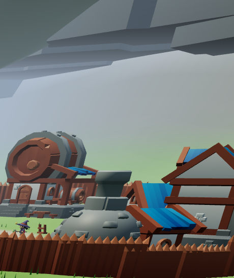
- **Resposta do Claude:** Minimapa novo estilo WoW: redondo, moldura dourada, "N" no topo, nome da região numa faixa, botões + e − de zoom, e mostra só a região ao seu redor sobre um mapa pintado (relevo, estradas, lago, árvores, prédios). Sem as bordas estranhas.

### S-010 · Área do mapa: Área da tela (700×604 px) (sobre: Janela "👑 Painel do Mestre")
- **Status:** feito · **Quando:** 2026-11-07T16:49:00 · **Mapa:** Ruínas de Kael (tile [0, -77])
- **Onde no código:** js3d/main3d.js → buildWorld (cenário) · js3d/world3d.js (terreno) · interface: js/ui.js, style.css, index.html
- **Sugestão:** Aqui também eu tentei tirar um print da tela de eu ter feito control Z Ou seja a tela do painel mestre custaria que ela fosse muito mais estética e com um ex mais interessante e não com esse mapa todo esquisito e feio
- 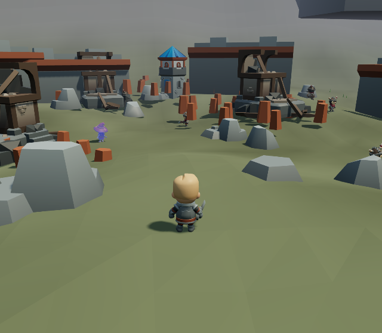
- **Resposta do Claude:** Painel do Mestre redesenhado: cartões, God Mode como interruptor, classes em pílulas por nível e um mapa-múndi pintado (relevo, estradas, bosque, lago, nomes das regiões, chefes, NPCs, rosa dos ventos). Também ganhou "Mascote +5 níveis".

### S-011 · Área do mapa: Área da tela (145×136 px)
- **Status:** feito · **Quando:** 2026-11-07T16:50:38 · **Mapa:** Ruínas de Kael (tile [-1, -59])
- **Onde no código:** js3d/main3d.js → buildWorld (cenário) · js3d/world3d.js (terreno)
- **Sugestão:** Essa é minha sugestão de agora não se refere ao terreno e sim há uma ideia que eu tive uma das inspirações que eu quero por esse jogo é o Pokémon Então eu quero que ao criar o personagem eu tenho algum onboard Logo no início do jogo que me faça escolher entre 3 mascotes e esses mascotes precisam ter características diferentes para um deles eu proponho que ele ataque os inimigos para outro eu proponho que ele seja mais suporte que consiga fazer alguns buffs em você ou melhor no jogador principal mesmo que simples e uma terceira opção eu deixo a seu critério mas o fato é que todos esses três devem se comportar de forma análoga aos Pokémons no sentido de todos terem pelo menos uma evolução e isso eu preciso poder conferir em algum local talvez no mesmo local que o jogo mostre a evolução das classes também mostre a evolução dos mascotes
- 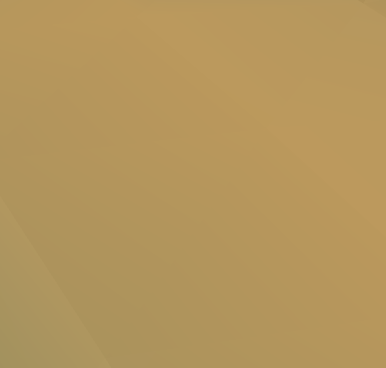
- **Resposta do Claude:** Mascotes! Ao criar o personagem você escolhe entre Faísca (ataque, raposa de fogo), Bolhinha (suporte: cura e escudo de água) e Pedrinho (guardião: reduz dano e atordoa). Cada um evolui no Nv. 10 e no Nv. 25 (Labareda/Solaris, Maré/Aquária, Rochedo/Monolito), ganha EXP com você e te segue pelo mundo. A evolução aparece na Árvore de Classes (T). Personagens antigos, como o Vidro, escolhem o mascote ao entrar.
