# Sugestões do jogo

Feitas dentro do jogo com a tecla **Q**. Peça ao Claude: *"aplique minhas sugestões pendentes"*.

## Pendentes (6)

### S-320 · Área do mapa: Área da tela (895×550 px)
- **Status:** pendente · **Quando:** 2026-11-10T21:38:01 · **Mapa:** Vila de Alvorada (tile [809, 11])
- **Onde no código:** js3d/main3d.js → buildWorld (cenário) · js3d/world3d.js (terreno)
- **Sugestão:** Eu gosto dessas roupas de aprendiz porém caso você tenha pegado de forma Idêntica de algum modelo online eu peço que você faça alguns leves ajustes para que o meu jogo fique original e claro você precisa garantir que tudo fique congruente e nada esquisito nas roupas desses personagens Porém uma coisa nítida desse print é que está absolutamente esquisito essa pose que os aprendizes estão fazendo com pernas abertas parecendo pererecas e olhando para o chão de uma forma muito bizarra Então o que mais me incomodou neles foi tanto a forma na qual eles se posicionam como também a forma como eles seguram a espada e eu Gostaria de reforçar para que os aprendizes tivessem como padrão uma Adaga e não uma espada maior
- 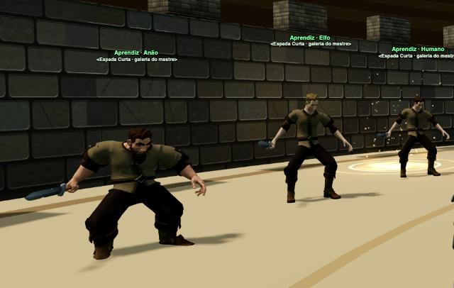

### S-321 · Área do mapa: Área da tela (850×508 px)
- **Status:** pendente · **Quando:** 2026-11-10T21:40:25 · **Mapa:** Vila de Alvorada (tile [802, 14])
- **Onde no código:** js3d/main3d.js → buildWorld (cenário) · js3d/world3d.js (terreno)
- **Sugestão:** Eu não gostaria que os arruaceiros tivessem esse nome Gostaria que você se inspirasse em outros jogos de MMO para criar o arruaceiro e outra coisa que não gosto neles é tanto a forma como eles seguram essa arma que por sua vez não faz sentido ser um machado e sim deve ser inspirado nas armas também e na classe também do desordeiro do Ragnarok online porém como falei o nome é importante que seja diferente e a estética dessa classe precisa dialogar de certa forma como se fosse a evolução do ladino em resumo o que eu espero para essa vertente de ladino Executor e arruaceiro é a seguinte eu quero que você se inspire mas mercenária do Skyrim pois eu sei que eles têm tudo a ver com s tipo de classe inclusive gosto da presença de gorros não colocados na cabeça e sim atrás ali das costas inspirados muito também em Assassin's Creed porém é importante que cada uma das duas evoluções do ladino tivessem personalidades específicas Ou seja eu quero sim que O Executor seja absolutamente inspirado no algoz do Ragnarok online ao passo que essa outra classe que eu não nomeei tem assim uma inspiração tanto no desordeiro porém quero que você se inspire mais no Assassin's Creed e nas referências que eu falei do Skyrim
- 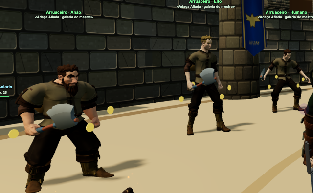

### S-322 · Área do mapa: Área da tela (1113×407 px)
- **Status:** pendente · **Quando:** 2026-11-10T21:41:59 · **Mapa:** Vila de Alvorada (tile [795, 14])
- **Onde no código:** js3d/main3d.js → buildWorld (cenário) · js3d/world3d.js (terreno)
- **Sugestão:** Sobre essa classe eu não quero que tenha essas bolas roxas saindo deles e eu também quero deixar claro que eu odiei essas pernas abertas tá mais parecendo um Jack Estripador do que qualquer coisa quando eu falo que quero que se inspire nos algozes de Ragnarok online é como o conceito como um todo de forma um pouco mais imponente sendo sim uma classe de batalha física e ele tem a elegância e sutileza de atacar como se fosse uma dança não necessariamente uma dança ridícula como ditongo mas sim uma classe que tenha relação com esquiva com assassinato e com essas armas silenciosas que estão na mão deles então gostaria de inclusive garantir que essas armas fossem melhor posicionadas pois assim como o Ragnarok online eu gostaria que eles pudessem ter dois tipos de builds tanto uma com duas adagas quanto outra com a catar
- 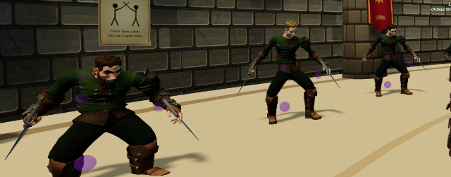

### S-323 · Área do mapa: Área da tela (959×369 px)
- **Status:** pendente · **Quando:** 2026-11-10T21:43:34 · **Mapa:** Vila de Alvorada (tile [789, 10])
- **Onde no código:** js3d/main3d.js → buildWorld (cenário) · js3d/world3d.js (terreno)
- **Sugestão:** De todos esse ladino foi um que a postura não me incomodou muito e acho que você chegou mais próximo de acertar quanto a segurar a arma de forma adequada porém acredito que essas roupas podem e devem ser mudadas por completo de tal modo que seja inspirada no gatuno do Ragnarok online porém sim tenho toda uma mistura de ladrões e outros jogos MMORPG Ou seja você deve se perguntar como seria a roupa de Um Ladrão de um jogo online e a partir dela você deve construir essas roupas e não fazer de uma forma completamente aleatória já te adianto que essas botas não casam em nada com o que eu espero de Um Ladrão
- 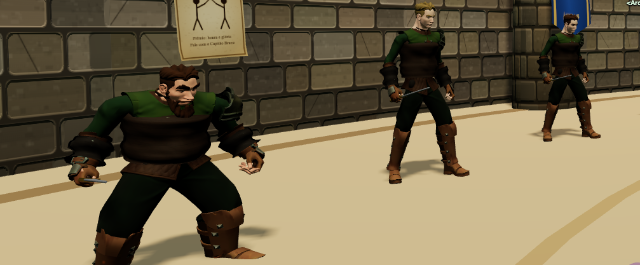

### S-324 · Área do mapa: Área da tela (865×459 px)
- **Status:** pendente · **Quando:** 2026-11-10T21:45:50 · **Mapa:** Vila de Alvorada (tile [785, 4])
- **Onde no código:** js3d/main3d.js → buildWorld (cenário) · js3d/world3d.js (terreno)
- **Sugestão:** Amarok online eles podem e devem utilizar o arco e flecha como arma porém eu quero que você represente aqui também as duas possibilidades ou seja tanto Arcos quanto os instrumentos musicais e eu preciso que eles tenham também animações de tocar esses instrumentos pois algumas canções ou melhor Skills deles serão canções assim como existe no bardo de Ragnarok online Então eu preciso que tudo o que você criar em termos de instrumento não só tenha uma estética perfeita para encaixar no corpo como também na prática do uso deste instrumento Eu preciso que você veja de uma forma muito acurada para que não tenhamos do res de cabeças futuras e outro ponto que eu gostaria que você trabalhasse de uma forma muito mais interessante seria a roupa deles Pois deveria ter um pouco mais relação com pardos de mmorpgs que nós sabemos que usam roupas absolutamente diferentes do que essas que foram apresentadas por esses personagens e quero sim que você se inspire no Ministério do Ragnarok online e também do bar do Ragnarok online como também de barrados como um todo de RPG investigue também como são os bardos do Skyrim e cheguem a uma solução bacana e não forçada e não que sou como gambiarra
- 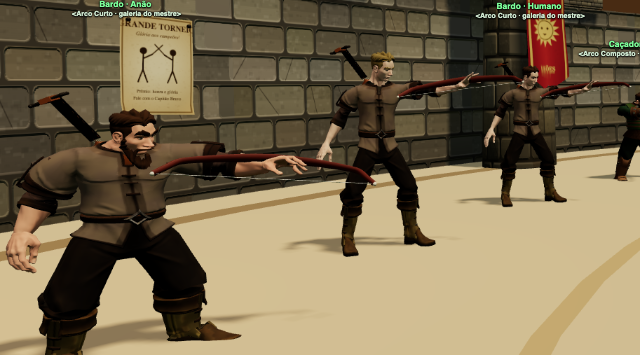

### S-325 · Área do mapa: Área da tela (1073×596 px)
- **Status:** pendente · **Quando:** 2026-11-10T21:48:20 · **Mapa:** Vila de Alvorada (tile [786, -4])
- **Onde no código:** js3d/main3d.js → buildWorld (cenário) · js3d/world3d.js (terreno)
- **Sugestão:** Álvares eu gostaria que ele estivessem a possibilidade de utilizar arco e flecha e eu preciso que você tenha uma clareza absoluta quanto ao posicionamento dos arco e flechas na mão desses Caçadores porém eles também podem ter as bestas em suas mãos ou seja já estamos falando sobre outros movimentos de ataque que também precisam ser adaptados Além disso um ponto nevrálgico seria as roupas desses caçadores que precisam ter mais a ver com caçadores de verdade e outro ponto absolutamente formidável e essencial é que eles tenham uma criatura parceira que eu adoraria que fosse muito inspirada naqueles Lobos gigantes do Game of Thrones E você já conhece o meu gosto e entende que eu não permitiria um lobo meia boca e sim um lobo absolutamente realista com movimentos fluidos e interessantes que fosse o fiel escudeiro deste caçador e sim você deve ser inspirar e muito nos Lobos do Game of Thrones
- 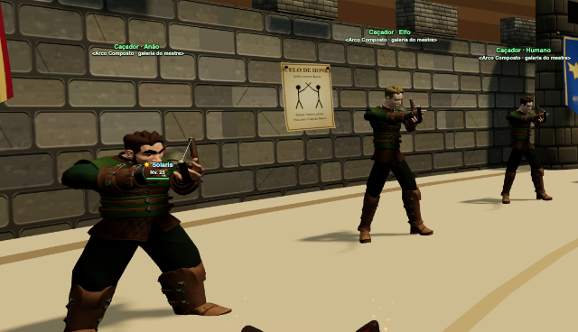

## Feitas (319)

### S-001 · Área do mapa: Área de 6×4 tiles
- **Status:** feito · **Quando:** 2026-11-07T15:20:32 · **Mapa:** Vila de Alvorada (tile [29, 11])
- **Onde no código:** js/world.js (geração de vila) · js/data.js → MAPS.vila
- **Sugestão:** isso é so um teste mesmo
- 
- **Resposta do Claude:** Era um teste do modo sugestão — funcionou! Nada a mudar no jogo.

### S-002 · Área do mapa: Área de 6×3 tiles
- **Status:** feito · **Quando:** 2026-11-07T15:35:55 · **Mapa:** Campos de Verdelume (tile [26, 12])
- **Onde no código:** js/world.js (geração de campos) · js/data.js → MAPS.campos
- **Sugestão:** ignora o print mas percebi que a musica que eu entrei aqui se sobrepos com a utra. Nao pode ser as duas. Tem que ser so a do mapa viegente

Outra coisa. QUando eu clicar em enter aqui na sugestao tem que ir direto e nao dar um salto de linha
- 
- **Resposta do Claude:** Música: ao trocar de mapa a música anterior agora baixa e é cortada em 0,6s, então só toca a do mapa atual; e o jogo silencia quando a aba não está visível (evita duas abas tocando juntas). Sugestão: Enter agora envia direto; Shift+Enter pula linha.

### S-003 · Área do mapa: Área de 8×5 tiles
- **Status:** feito · **Quando:** 2026-11-07T15:42:56 · **Mapa:** Campos de Verdelume (tile [10, 29])
- **Onde no código:** js/world.js (geração de campos) · js/data.js → MAPS.campos
- **Sugestão:** gostaria de ter alguma forma de minimizar esse chat pra ele nao me atrapalhar quando eu nao o quisesse
- 
- **Resposta do Claude:** Chat agora tem botão "—" para minimizar: vira um botãozinho "💬 Chat" que mostra quantas mensagens novas chegaram. Clique nele ou aperte Enter para abrir. A escolha fica lembrada.

### S-004 · Área do mapa: Área de 9×3 tiles
- **Status:** feito · **Quando:** 2026-11-07T15:43:41 · **Mapa:** Campos de Verdelume (tile [19, 31])
- **Onde no código:** js/world.js (geração de campos) · js/data.js → MAPS.campos
- **Sugestão:** gostaria que isso aqui ficasse la em cima ao lado do card pricipal do meu nome e não aqui embaixo
- 
- **Resposta do Claude:** A barra de atalhos (1–9) foi para o topo, ao lado do card com seu nome; os ícones de buff ficam logo abaixo dela. Obs.: ao marcar uma área por cima da interface, a sugestão agora também registra quais partes da interface estavam dentro.

### S-005 · Área do mapa: Área de 21×21 tiles
- **Status:** feito · **Quando:** 2026-11-07T15:44:52 · **Mapa:** Campos de Verdelume (tile [13, 13])
- **Onde no código:** js/world.js (geração de campos) · js/data.js → MAPS.campos
- **Sugestão:** gostaria que o god mode permitisse que eu fosse qualquer classe. EU pudesse facilmente escolher ali a minha classe quando entrasse no menu do god mode
- 
- **Resposta do Claude:** No Painel do Mestre (⌘+Z) há a seção "Classe": clique em qualquer uma das 13 classes para virar ela na hora (recebe a arma típica da classe). O botão "Todas as habilidades da classe no máximo" libera tudo para testar.

### S-006 · Área do mapa: Área da tela (108×45 px)
- **Status:** feito · **Quando:** 2026-11-07T16:32:01 · **Mapa:** Campos de Verdelume (tile [12, 22])
- **Onde no código:** js3d/main3d.js → buildWorld (cenário) · js3d/world3d.js (terreno)
- **Sugestão:** quero que meu hp tbm apareça abaixo do personagem. SP também
- 
- **Resposta do Claude:** No 3D agora há barras de HP (verde, fica vermelha abaixo de 30%) e SP (azul) logo abaixo dos pés do seu personagem, acompanhando ele. Obs.: o retângulo de seleção do Q também passou a aparecer enquanto você arrasta.

### S-007 · Área do mapa: Área da tela (192×141 px)
- **Status:** feito · **Quando:** 2026-11-07T16:46:33 · **Mapa:** Ruínas de Kael (tile [-27, -43])
- **Onde no código:** js3d/main3d.js → buildWorld (cenário) · js3d/world3d.js (terreno)
- **Sugestão:** Isso é um teste para entender se o comando de voz está funcionando
- 
- **Resposta do Claude:** O ditado por voz funcionou! Era um teste — nada a mudar.

### S-008 · Área do mapa: Área da tela (333×201 px)
- **Status:** feito · **Quando:** 2026-11-07T16:47:16 · **Mapa:** Ruínas de Kael (tile [-34, -42])
- **Onde no código:** js3d/main3d.js → buildWorld (cenário) · js3d/world3d.js (terreno)
- **Sugestão:** Eu entendo que a ideia desse monte de Pino em grama era deixar o gráfico leve e o jogo bacana mas eu entendo que você consegue tornar uma grama muito mais bonita e interessante e não toda a ponte aguda e esquisita assim então eu quero que você já melhore o gráfico em geral do terreno deste jogo
- 
- **Resposta do Claude:** Grama refeita: no lugar dos "pinos", tufos de lâminas curvas (bem mais densos) que balançam com o vento, flores de verdade e tons por região (bosque mais escuro, ruínas mais secas). O chão ganhou textura e sombreado suave, e as ruínas têm lajes de pedra e pedregulhos.

### S-009 · Área do mapa: Área da tela (205×226 px)
- **Status:** feito · **Quando:** 2026-11-07T16:48:10 · **Mapa:** Ruínas de Kael (tile [-134, 62])
- **Onde no código:** js3d/main3d.js → buildWorld (cenário) · js3d/world3d.js (terreno)
- **Sugestão:** Aqui no mapa Ficou esquisito essas bordas em cima e dos lados tá meio estranha aproveite e também melhore a aparência do mapa percebi agora que o print que eu tirei não pegou o mapa e sim o local mas acredito que você seja inteligente o suficiente para compreender que me refiro a um mapa que está no canto direito superior do jogo
- 
- **Resposta do Claude:** Minimapa novo estilo WoW: redondo, moldura dourada, "N" no topo, nome da região numa faixa, botões + e − de zoom, e mostra só a região ao seu redor sobre um mapa pintado (relevo, estradas, lago, árvores, prédios). Sem as bordas estranhas.

### S-010 · Área do mapa: Área da tela (700×604 px) (sobre: Janela "👑 Painel do Mestre")
- **Status:** feito · **Quando:** 2026-11-07T16:49:00 · **Mapa:** Ruínas de Kael (tile [0, -77])
- **Onde no código:** js3d/main3d.js → buildWorld (cenário) · js3d/world3d.js (terreno) · interface: js/ui.js, style.css, index.html
- **Sugestão:** Aqui também eu tentei tirar um print da tela de eu ter feito control Z Ou seja a tela do painel mestre custaria que ela fosse muito mais estética e com um ex mais interessante e não com esse mapa todo esquisito e feio
- 
- **Resposta do Claude:** Painel do Mestre redesenhado: cartões, God Mode como interruptor, classes em pílulas por nível e um mapa-múndi pintado (relevo, estradas, bosque, lago, nomes das regiões, chefes, NPCs, rosa dos ventos). Também ganhou "Mascote +5 níveis".

### S-011 · Área do mapa: Área da tela (145×136 px)
- **Status:** feito · **Quando:** 2026-11-07T16:50:38 · **Mapa:** Ruínas de Kael (tile [-1, -59])
- **Onde no código:** js3d/main3d.js → buildWorld (cenário) · js3d/world3d.js (terreno)
- **Sugestão:** Essa é minha sugestão de agora não se refere ao terreno e sim há uma ideia que eu tive uma das inspirações que eu quero por esse jogo é o Pokémon Então eu quero que ao criar o personagem eu tenho algum onboard Logo no início do jogo que me faça escolher entre 3 mascotes e esses mascotes precisam ter características diferentes para um deles eu proponho que ele ataque os inimigos para outro eu proponho que ele seja mais suporte que consiga fazer alguns buffs em você ou melhor no jogador principal mesmo que simples e uma terceira opção eu deixo a seu critério mas o fato é que todos esses três devem se comportar de forma análoga aos Pokémons no sentido de todos terem pelo menos uma evolução e isso eu preciso poder conferir em algum local talvez no mesmo local que o jogo mostre a evolução das classes também mostre a evolução dos mascotes
- 
- **Resposta do Claude:** Mascotes! Ao criar o personagem você escolhe entre Faísca (ataque, raposa de fogo), Bolhinha (suporte: cura e escudo de água) e Pedrinho (guardião: reduz dano e atordoa). Cada um evolui no Nv. 10 e no Nv. 25 (Labareda/Solaris, Maré/Aquária, Rochedo/Monolito), ganha EXP com você e te segue pelo mundo. A evolução aparece na Árvore de Classes (T). Personagens antigos, como o Vidro, escolhem o mascote ao entrar.

### S-012 · Área do mapa: Área da tela (725×201 px)
- **Status:** feito · **Quando:** 2026-11-07T17:06:46 · **Mapa:** Campos de Verdelume (tile [12, 15])
- **Onde no código:** js3d/main3d.js → buildWorld (cenário) · js3d/world3d.js (terreno)
- **Sugestão:** Essas árvores aqui convenhamos Ficaram bem feias né Elas estão totalmente pontio agudas e parecendo muito de desanimado Gostaria de algo um pouco mais realista
- 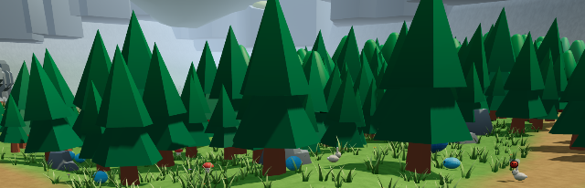
- **Resposta do Claude:** Árvores novas feitas em código: carvalhos de copa volumosa e pinheiros em camadas, com variações e cores mais naturais (nada de espinhos).

### S-013 · Área do mapa: Área da tela (289×303 px)
- **Status:** feito · **Quando:** 2026-11-07T17:07:45 · **Mapa:** Campos de Verdelume (tile [5, 17])
- **Onde no código:** js3d/main3d.js → buildWorld (cenário) · js3d/world3d.js (terreno)
- **Sugestão:** Um outro jogo de câmera aqui para mim é muito importante é um que eu consiga segurar a tecla shift e escolar o mouse e dessa forma eu altero o ângulo Ou seja eu consigo ver algo muito mais de cima ou consigo ver algo muito mais chegando perto dos pés do meu jogador Ou seja eu altero o ângulo entre 0 e 90 graus digamos assim
- 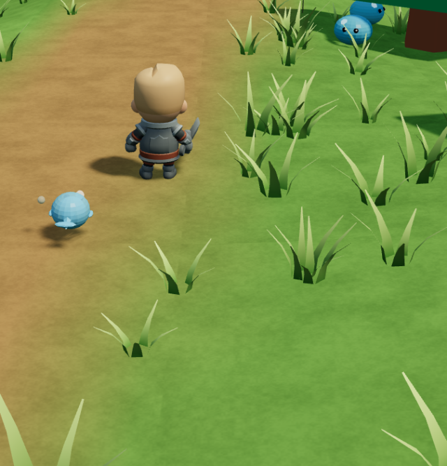
- **Resposta do Claude:** Shift + rodinha do mouse agora muda o ângulo da câmera (de quase rente ao chão até olhar de cima).

### S-014 · Área do mapa: Área da tela (403×166 px)
- **Status:** feito · **Quando:** 2026-11-07T17:08:48 · **Mapa:** Ruínas de Kael (tile [114, -82])
- **Onde no código:** js3d/main3d.js → buildWorld (cenário) · js3d/world3d.js (terreno)
- **Sugestão:** Nessa parte aqui a estética ficou bastante comprometida parece que existe uma sombra invadindo algo que chega a um fim isso é muito estranho e não desejável
- 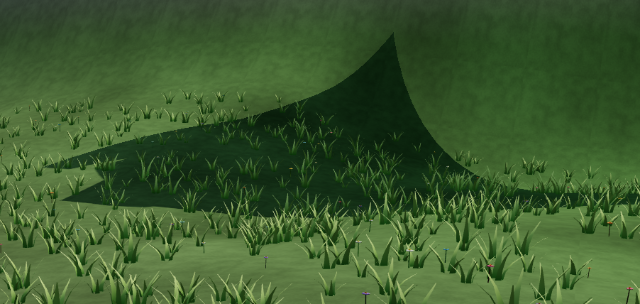
- **Resposta do Claude:** A sombra gigante vinha das montanhas e nuvens; elas não projetam mais sombra, então o corte sumiu.

### S-015 · Área do mapa: Área da tela (94×55 px)
- **Status:** feito · **Quando:** 2026-11-07T17:09:29 · **Mapa:** Ruínas de Kael (tile [69, -75])
- **Onde no código:** js3d/main3d.js → buildWorld (cenário) · js3d/world3d.js (terreno)
- **Sugestão:** Eu não gostei dessa mascote ele está muito redondo e muito artificial eu gostaria que ele tivesse movimentos muito muito mais fluidos e tridimensionais e também perceber que ele é meio trucado os movimentos dele não são tão interessantes eu gostaria inclusive que os próprios movimentos do meu personagem ele tivesse uma leve desaceleração enquanto eu estou andando e paro para que ele seja mais realista de forma como o próprio World of Warcraft é
- 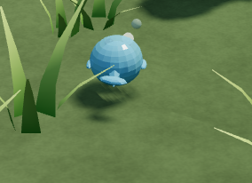
- **Resposta do Claude:** Bolhinha virou uma salamandra d'água (estilo axolote) com brânquias e cauda que ondula. Todos os mascotes agora aceleram, freiam, inclinam nas curvas e acompanham o terreno. Seu personagem também desacelera de leve ao parar.

### S-016 · Área do mapa: Área da tela (256×186 px)
- **Status:** feito · **Quando:** 2026-11-07T17:10:56 · **Mapa:** Ruínas de Kael (tile [57, -58])
- **Onde no código:** js3d/main3d.js → buildWorld (cenário) · js3d/world3d.js (terreno)
- **Sugestão:** O tamanho do arqueiro ficou completamente bugado gigantesco você precisa entender isso e corrigir para que não seja assim tão estranho Além disso eu gostaria de que ao trocar os meus ou melhor ao trocar de classe do mantivesse a mesma estética de cabelo e aparência e mudasse apenas a roupa dos meus personagens
- 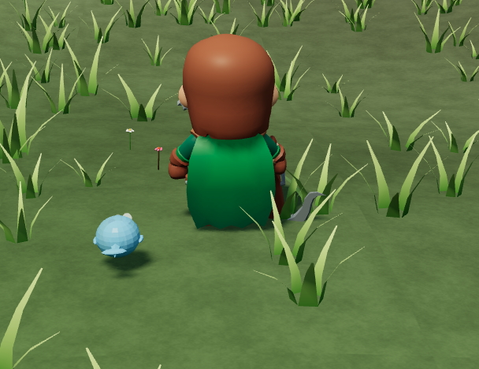
- **Resposta do Claude:** Corrigido o tamanho gigante (todas as classes usam a mesma escala). Ao mudar de classe, rosto e cabelo continuam os mesmos; só a roupa e os equipamentos mudam.

### S-017 · Área do mapa: Área da tela (268×222 px)
- **Status:** feito · **Quando:** 2026-11-07T17:11:30 · **Mapa:** Ruínas de Kael (tile [57, -58])
- **Onde no código:** js3d/main3d.js → buildWorld (cenário) · js3d/world3d.js (terreno)
- **Sugestão:** O ladino também ficou completamente horroroso no sentido de além dessa Pontinha na cabeça dele ter ficado muito pequena e não ter parecido um gorro também ele ficou gigantesco assim como o Arqueiro ficou
- 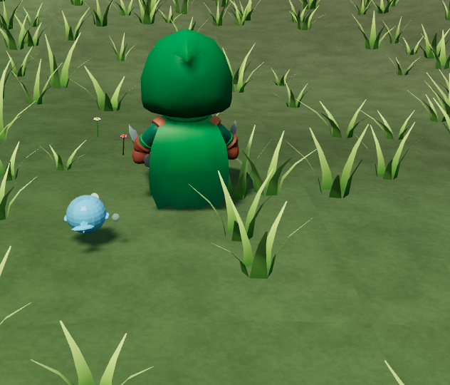
- **Resposta do Claude:** Ladino agora tem tamanho normal, bandana e cachecol no lugar do capuz pontudo.

### S-018 · Área do mapa: Área da tela (250×164 px)
- **Status:** feito · **Quando:** 2026-11-07T17:12:23 · **Mapa:** Ruínas de Kael (tile [52, -57])
- **Onde no código:** js3d/main3d.js → buildWorld (cenário) · js3d/world3d.js (terreno)
- **Sugestão:** O Guardião sagrado ficou com a mesma estética do cavaleiro único e isso não é desejável preciso que reveja os seus conceitos e inclusive quero que alguma das classes seja paladino
- 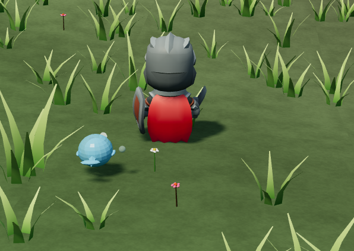
- **Resposta do Claude:** Guardião Sagrado virou Paladino: armadura branca e dourada, auréola, asas de luz, tabardo e espada e escudo brilhantes. Bem diferente do Cavaleiro Rúnico, que agora tem armadura escura e runas azuis.

### S-019 · Área do mapa: Área da tela (185×135 px)
- **Status:** feito · **Quando:** 2026-11-07T17:12:43 · **Mapa:** Ruínas de Kael (tile [52, -57])
- **Onde no código:** js3d/main3d.js → buildWorld (cenário) · js3d/world3d.js (terreno)
- **Sugestão:** Esse chapéu do arquimago ficou muito grande e completamente desproporcional
- 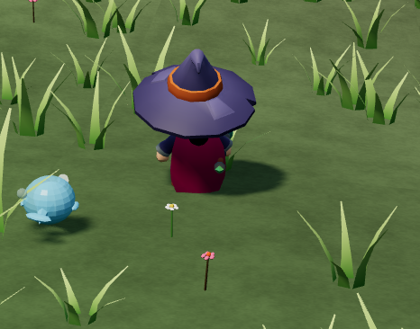
- **Resposta do Claude:** Chapéu do Arquimago reduzido, e ele ganhou anéis arcanos e faíscas flutuando.

### S-020 · Área do mapa: Área da tela (197×150 px)
- **Status:** feito · **Quando:** 2026-11-07T17:13:21 · **Mapa:** Ruínas de Kael (tile [53, -58])
- **Onde no código:** js3d/main3d.js → buildWorld (cenário) · js3d/world3d.js (terreno)
- **Sugestão:** O sábio ficou com o mesmo chapéu do arquimago e ficou praticamente igual isso não é desejável também
- 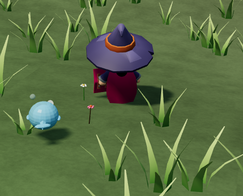
- **Resposta do Claude:** Sábio agora usa varinha, livro aberto, tiara e orbes elementais girando, sem chapéu de mago.

### S-021 · Área do mapa: Área da tela (212×135 px)
- **Status:** feito · **Quando:** 2026-11-07T17:13:41 · **Mapa:** Ruínas de Kael (tile [50, -56])
- **Onde no código:** js3d/main3d.js → buildWorld (cenário) · js3d/world3d.js (terreno)
- **Sugestão:** Aparentemente o caçador ficou idêntico ao arqueiro e também está com problema de estar gigantesco
- 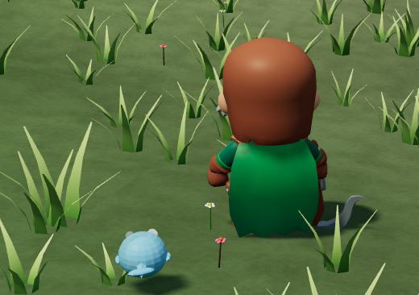
- **Resposta do Claude:** Caçador tem tamanho normal, roupa de caçador, besta, aljava, faixa de penas e um falcão no ombro.

### S-022 · Área do mapa: Área da tela (278×188 px)
- **Status:** feito · **Quando:** 2026-11-07T17:14:10 · **Mapa:** Ruínas de Kael (tile [53, -58])
- **Onde no código:** js3d/main3d.js → buildWorld (cenário) · js3d/world3d.js (terreno)
- **Sugestão:** O menestrel ficou bugado também ficou gigante assim como o Arqueiro e também ficou gigantesco assim como caçador e eu preciso que ele seja muito mais na pegada de um bardo inclusive pode mudar o nome dele para bardo
- 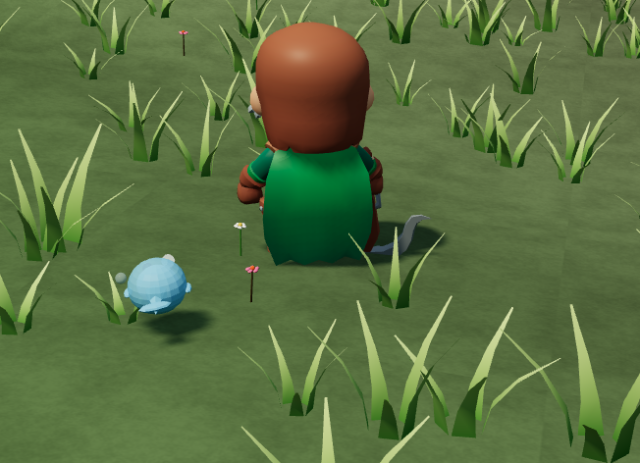
- **Resposta do Claude:** Menestrel virou Bardo: tamanho normal, alaúde, chapéu de bardo com pena e notas musicais flutuando.

### S-023 · Área do mapa: Área da tela (324×232 px)
- **Status:** feito · **Quando:** 2026-11-07T17:14:51 · **Mapa:** Ruínas de Kael (tile [53, -58])
- **Onde no código:** js3d/main3d.js → buildWorld (cenário) · js3d/world3d.js (terreno)
- **Sugestão:** Esse lâmina sombria ficou com o mesmo problema do ladinho e ele precisa ser esteticamente melhor por ser uma evolução natural do ladino e esse meu conselho das evoluções serem mais fodas até esteticamente você precisa destrinchar para todas as outras classes
- 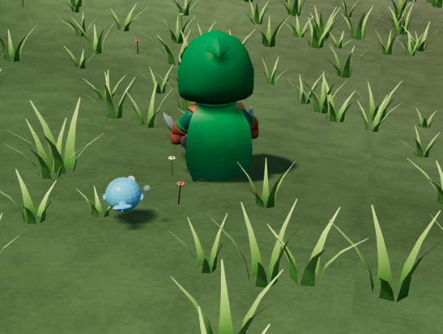
- **Resposta do Claude:** Lâmina Sombria tem capuz sombrio, ombreiras com espinhos, fumaça roxa e adagas brilhantes. As evoluções de todas as classes ganharam efeitos e acessórios próprios.

### S-024 · Área do mapa: Área da tela (370×240 px)
- **Status:** feito · **Quando:** 2026-11-07T17:16:09 · **Mapa:** Ruínas de Kael (tile [53, -58])
- **Onde no código:** js3d/main3d.js → buildWorld (cenário) · js3d/world3d.js (terreno)
- **Sugestão:** O saqueador também de Corsa está com a mesma estética dos companheiros como o lá como o ladino e outro e eu preciso que ele de costas também seja bem diferente e Inclusive eu gostaria de uma seguinte funcionalidade eu gostaria de que ao apertar a bolinha do mouse ou melhor ao segurar a bolinha do mouse a câmera automaticamente ficasse invertida enquanto eu pressiono o botão para que eu consiga ver a parte da frente do meu personagem também e não só as costas Isso é apenas para que eu consiga fazer uma conferência melhor
- 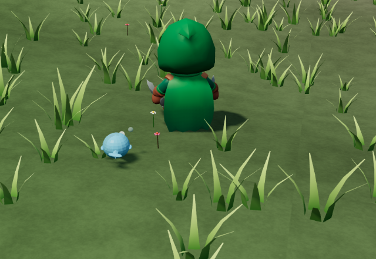
- **Resposta do Claude:** Saqueador tem visual próprio (machados duplos, tricórnio, saco de saque e moedas). Segurar o botão do meio do mouse vira a câmera para ver o personagem de frente.

### S-025 · Área do mapa: Área da tela (427×121 px)
- **Status:** feito · **Quando:** 2026-11-07T17:19:18 · **Mapa:** Ruínas de Kael (tile [-7, -42])
- **Onde no código:** js3d/main3d.js → buildWorld (cenário) · js3d/world3d.js (terreno)
- **Sugestão:** troncos muito bugados e flutuantes. Alem de feitos e aleatorios, tao bugados. Aprobveite pra melhorar a estetica desses elementos se,pre que eles aparecem
- 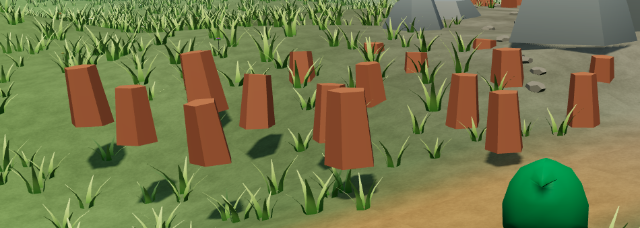
- **Resposta do Claude:** Os tocos do pacote (que flutuavam) foram trocados por tocos feitos em código, com raízes enterradas no chão, anéis da madeira e musgo, além de troncos caídos meio enterrados. Aparecem nas Ruínas e no Bosque.

### S-026 · Área do mapa: Área da tela (329×345 px) (sobre: Ícones de buff, Janela "Equipamento")
- **Status:** feito · **Quando:** 2026-11-07T17:21:03 · **Mapa:** Ruínas de Kael (tile [-7, -42])
- **Onde no código:** js3d/main3d.js → buildWorld (cenário) · js3d/world3d.js (terreno) · interface: js/ui.js, style.css, index.html
- **Sugestão:** Gostaria que esse menu de equipamentos se parece muito com o que existia do Ragnarok ou seja com o personagem no meio de frente e ter ali todos os equipamentos como a parte de cima do meio da boca acessórios botas escudo esse tipo de coisa por padrão realmente muito parecido com que existia no Ragnarok online
- 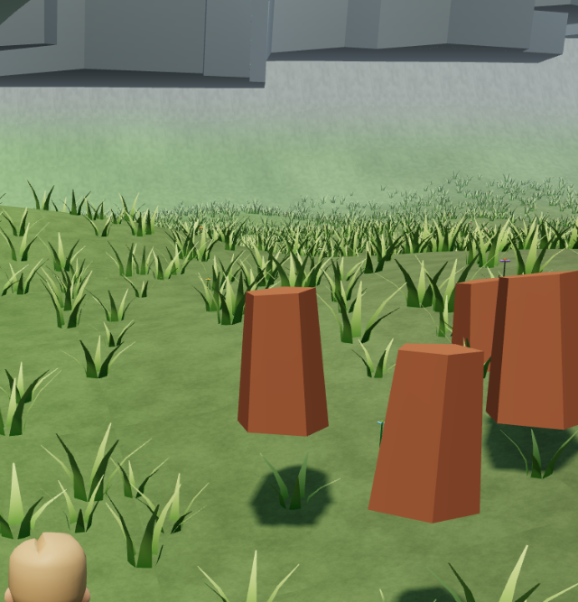
- **Resposta do Claude:** A janela de Equipamento ficou no estilo clássico: seu personagem de frente no meio e os espaços dos dois lados (topo, meio e baixo da cabeça, armadura, arma, escudo, capa, botas e 2 acessórios). Há itens novos na loja do Bento (máscara, folha de hortelã, escudo, capa, sandálias, botas). Arco usa as duas mãos e não deixa usar escudo.

### S-027 · Área do mapa: Área da tela (895×616 px) (sobre: Janela "Árvore de Classes")
- **Status:** feito · **Quando:** 2026-11-07T17:23:12 · **Mapa:** Ruínas de Kael (tile [-11, -34])
- **Onde no código:** js3d/main3d.js → buildWorld (cenário) · js3d/world3d.js (terreno) · interface: js/ui.js, style.css, index.html
- **Sugestão:** Peço que você tenha capacidade de quando eu clicar no q e selecionar algo você não pegue algo só do mundo e sim quaisquer janelas que estiverem abertas na minha tela pois há muito comum que eu queira mexer em janelas e não apenas no mundo
- 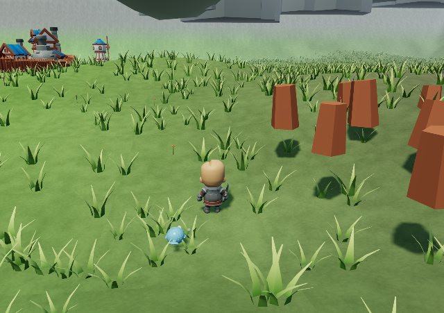
- **Resposta do Claude:** No modo Q, o print agora inclui as janelas e a interface abertas na tela (não só o mundo). Clicar numa janela também gera um print dela.

### S-028 · Área do mapa: Área da tela (916×608 px) (sobre: Ícones de buff, Janela "Árvore de Classes")
- **Status:** feito · **Quando:** 2026-11-07T17:24:16 · **Mapa:** Ruínas de Kael (tile [-11, -34])
- **Onde no código:** js3d/main3d.js → buildWorld (cenário) · js3d/world3d.js (terreno) · interface: js/ui.js, style.css, index.html
- **Sugestão:** Uma coisa que eu gostaria de fazer com a árvore de classes é melhorar o whilex de forma com que sim por padrão apareça a dos personagens mas existem um switcher na parte superior da janela tal que eu consiga mudar entre a árvore do personagem e árvore dos mascotes e outra coisa que eu não gostei foi o fato de eu entrar na tela e ter que escalar para a esquerda ou para a direita para ver todas as classes Sinto que elas poderiam ser organizadas de forma melhor
- 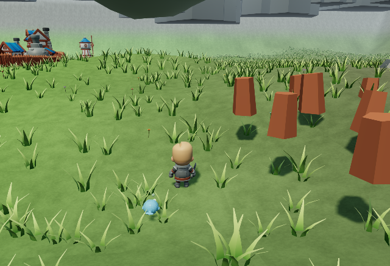
- **Resposta do Claude:** A Árvore de Classes ganhou abas no topo (🧍 Personagem / 🐾 Mascotes). As classes ficam numa grade 2×2, sem precisar rolar para os lados. Clicar no mascote no painel abre direto a aba dos mascotes.

### S-029 · Área do mapa: Área da tela (51×34 px)
- **Status:** feito · **Quando:** 2026-11-07T17:28:16 · **Mapa:** Campos de Verdelume (tile [2, 36])
- **Onde no código:** js3d/main3d.js → buildWorld (cenário) · js3d/world3d.js (terreno)
- **Sugestão:** Eu gostaria que essa Esse comando de som estivesse atrelado a algo de configurações que por sua vez ficasse dentro da tela ASC e não ali no canto direito poluindo de forma desnecessária
- 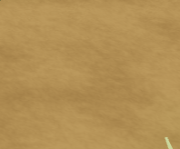
- **Resposta do Claude:** O botão de som saiu do canto. Agora fica em Esc → ⚙️ Configurações, com som ligado/desligado e volumes de música e efeitos (lembrados entre sessões). A tecla N continua funcionando.

### S-030 · Área do mapa: Área da tela (770×166 px)
- **Status:** feito · **Quando:** 2026-11-07T17:30:06 · **Mapa:** Campos de Verdelume (tile [17, 13])
- **Onde no código:** js3d/main3d.js → buildWorld (cenário) · js3d/world3d.js (terreno)
- **Sugestão:** Gostaria que os nomes dos Monstros Só aparecessem quando eu estivesse mais próximo a eles e não nessa distância toda
- 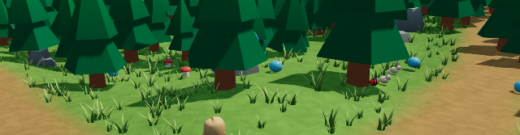
- **Resposta do Claude:** Os nomes dos monstros só aparecem de perto (até ~13 m), surgindo suavemente. O alvo selecionado e quem está brigando com você continuam sempre com nome.

### S-031 · Área do mapa: Área da tela (542×183 px)
- **Status:** feito · **Quando:** 2026-11-07T17:31:07 · **Mapa:** Ruínas de Kael (tile [-42, -40])
- **Onde no código:** js3d/main3d.js → buildWorld (cenário) · js3d/world3d.js (terreno)
- **Sugestão:** A verdade é que eu achei essas gramas muito exageradas no sentido de que é melhor você fazer algo mais minimalistas com gramas menores do que ficar enfiando essas gramas maiores em todos os lugares sabe eu gostaria de gramas mais realistas e menores linhas para que não ficasse assim tão esquisito vários tufos idênticos saindo do chão
- 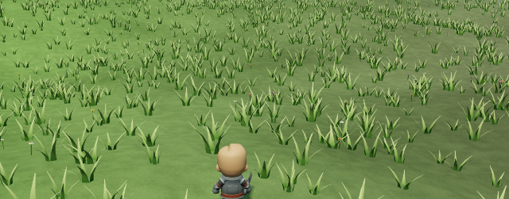
- **Resposta do Claude:** Grama mais baixa e fina, com 3 formatos diferentes de tufo (nada de carimbos iguais) e cor mais próxima do chão. As flores também ficaram menores.

### S-032 · Área do mapa: Área da tela (234×176 px)
- **Status:** feito · **Quando:** 2026-11-07T17:34:29 · **Mapa:** Ruínas de Kael (tile [-23, -43])
- **Onde no código:** js3d/main3d.js → buildWorld (cenário) · js3d/world3d.js (terreno)
- **Sugestão:** sino que ta com 2 musicas simultaneas sobrepostas e isso é bug
- 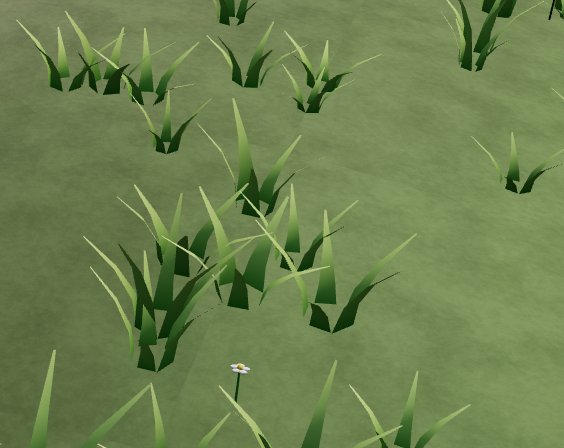
- **Resposta do Claude:** Corrigido: na divisa entre duas regiões a música ficava trocando sem parar e as duas tocavam juntas. Agora há uma margem antes de trocar. Se houver duas janelas do jogo abertas, só a última que você usou toca som.

### S-033 · Área do mapa: Área da tela (277×82 px)
- **Status:** feito · **Quando:** 2026-11-07T17:35:49 · **Mapa:** Campos de Verdelume (tile [12, 15])
- **Onde no código:** js3d/main3d.js → buildWorld (cenário) · js3d/world3d.js (terreno)
- **Sugestão:** ficou aparecendo 'alvo fora do alcance' como arqueiro o tempo todo mesmo que eu tenha afastado muito do monstro. Deveria depois de certo ponto parar a posicao de combate por padrao como no wow
- 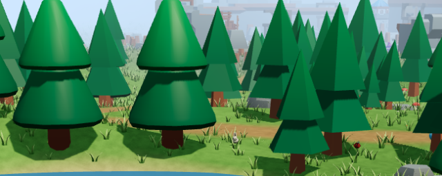
- **Resposta do Claude:** Se você se afastar bastante do alvo (como no WoW), o personagem sai do modo de combate e a mensagem "Alvo fora de alcance" para. Muito longe, o alvo também é desmarcado.

### S-034 · Área do mapa: Área da tela (497×105 px)
- **Status:** feito · **Quando:** 2026-11-07T17:36:30 · **Mapa:** Campos de Verdelume (tile [19, 52])
- **Onde no código:** js3d/main3d.js → buildWorld (cenário) · js3d/world3d.js (terreno)
- **Sugestão:** este lago ficou muito artificial, muito perfeitinho, muito fake. Queria agua mais real. mas tbm quruia vitorias regias que eu pudessse pular em cima delas
- 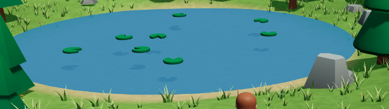
- **Resposta do Claude:** O lago ficou com margem irregular, fundo mais fundo no meio, água com ondas, brilho, cor rasa perto da beira, espuma e juncos nas margens. As vitórias-régias agora são grandes e boiam: dá para pular de uma para outra, até o meio do lago.

### S-035 · Área do mapa: Área da tela (82×54 px)
- **Status:** feito · **Quando:** 2026-11-07T17:38:36 · **Mapa:** Vila de Alvorada (tile [-91, 12])
- **Onde no código:** js3d/main3d.js → buildWorld (cenário) · js3d/world3d.js (terreno)
- **Sugestão:** gostaria que ALGUMAS das cases tivessem portais tipo do ragnarok, onde a pessoa entra e vai pra outra tela. Nesse ambiente interno podem ter NPCs um npc importante que eu queria era o da montaria. Conversando com ele, ele me daria a opção de uma montaria, pra que eu subisse em cima de um bicho e pudesse andar mais rapido entre o lugares
- 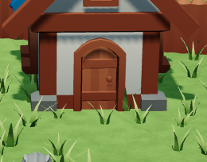
- **Resposta do Claude:** Duas casas da vila agora têm portal na porta: a Taverna Caneca Alegre (Dona Rosa vende suco que recupera SP, e o Velho Gui conta histórias) e o Estábulo do Tomé. O Tomé te dá uma montaria à escolha (Corcel Lanudo, da Noite ou Ruivo). Lá fora, aperte M para montar ou desmontar (≈70% mais rápido; atacar desmonta).

### S-036 · Área do mapa: Área da tela (220×151 px)
- **Status:** feito · **Quando:** 2026-11-07T17:44:48 · **Mapa:** Vila de Alvorada (tile [-68, 17])
- **Onde no código:** js3d/main3d.js → buildWorld (cenário) · js3d/world3d.js (terreno)
- **Sugestão:** quero criar a feature de "skin". Preciso criar um local de skins pagas e quero usar como referencia o que existe hoje no CS Go e no league of legends, pois sei que ambos jogos tem um mercdo infinito de skin. Porem serão uma moeda que nao será o zenny e sim terá outro nome tipo gemas mas nao pode ser gemas e sim algo interessante.Essas moedas especiais seriam compradas com dinheiro real, mas so coisas esteticas, nada que dê vantagem pra pessoa. Outra coisa que ela poderia comprar era montaria com cash
- 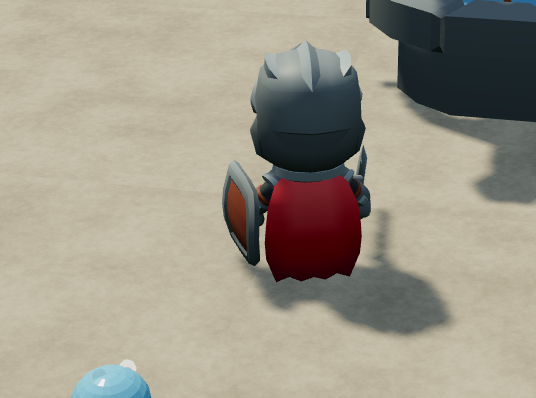
- **Resposta do Claude:** Nova Loja de Auroras ✦ (botão ✦ à direita ou tecla O). Só cosméticos, nada que dê vantagem: 8 skins em 4 raridades (Comum, Rara, Épica e Lendária, algumas com efeitos como pétalas, gelo, fumaça, faíscas, auréola ou estrelas) e 2 montarias exclusivas (Corcel Real e Corcel Estelar). A compra de Auroras com dinheiro real aparece como "em breve": falta um sistema de pagamento e contas online. Para testar, use o Painel do Mestre (+1.000 Auroras).

### S-037 · Área do mapa: Área da tela (588×337 px) (sobre: Barra de atalhos, Ícones de buff)
- **Status:** feito · **Quando:** 2026-11-07T17:49:36 · **Mapa:** Campos de Verdelume (tile [-138, 7])
- **Onde no código:** js3d/main3d.js → buildWorld (cenário) · js3d/world3d.js (terreno) · interface: js/ui.js, style.css, index.html
- **Sugestão:** montanhas muito feias e irreais . Melhore esse mundo aberto por favor esteticamente. Se inspire em skyrim. Nao obviamente com os graficos foda, mas da pra ser bem melhor, especialmente que nao faz sentido arvores em cima de montanha, elas nascem da terra
- 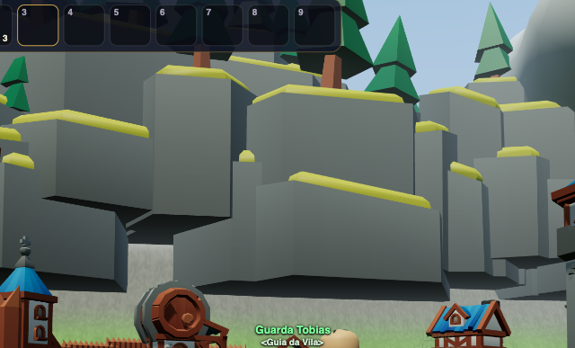
- **Resposta do Claude:** As montanhas agora fazem parte do terreno, com cristas, picos de alturas diferentes, rocha nas encostas e neve no topo. Os pinheiros nascem só no sopé (nada de árvore no pico), e há uma cordilheira distante no horizonte. A névoa ficou mais longe para dar profundidade, e as nuvens ficaram mais altas e claras.

### S-038 · Área do mapa: Área da tela (102×95 px)
- **Status:** feito · **Quando:** 2026-11-07T17:52:20 · **Mapa:** Vila de Alvorada (tile [-45, 25])
- **Onde no código:** js3d/main3d.js → buildWorld (cenário) · js3d/world3d.js (terreno)
- **Sugestão:** Eu gostaria que no onboard ao criar um novo personagem ele fosse um pouco mais guiado e mais Óbvio o que precisava o que precisaria ser feito escolhido até o personagem ser criado então eu gostaria inclusive de um onboard inspirado em MMO rpgs e eu gostaria que antes de escolher outras coisas eu tivesse que escolher uma raça e pudesse escolher entre três humano elfo e anão as raças elas proporcionariam alguns atributos diferentes sendo que não são muito expressivamente diferentes e sim dão uma leve vantagem entre uma raça e outra e também Eles teriam fins mais estéticos do que qualquer coisa aliás por enquanto eu quero que eles sejam apenas estéticos
- 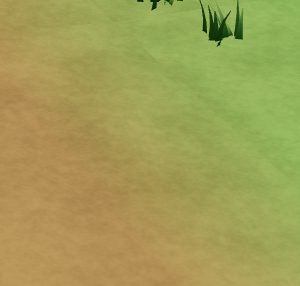
- **Resposta do Claude:** A criação de personagem ficou guiada, em 4 etapas com barra de progresso: 1) Raça (Humano, Elfo ou Anão, com prévia 3D), 2) Aparência (4 rostos e cabelos), 3) Companheiro, 4) Nome, com um resumo de tudo. Por enquanto as raças são só visuais: o elfo tem orelhas pontudas e é mais esguio, e o anão é mais baixo, forte e barbudo.

### S-039 · Área do mapa: Área da tela (66×49 px)
- **Status:** feito · **Quando:** 2026-11-07T17:53:14 · **Mapa:** Bosque Sussurrante (tile [60, -29])
- **Onde no código:** js3d/main3d.js → buildWorld (cenário) · js3d/world3d.js (terreno)
- **Sugestão:** Esse lobo ficou muito Quadradão muito horrível muito com cara de Minecraft Assim como as pedras ficaram muito quadradonas eu quero que você leve a essência desse meu feedback sobre as coisas serem muito quadradonas ou muito artificiais e leve para tudo de forma com que a gente consiga Ir melhorando continuamente os monstros e os gráficos eu não quero algo que seja tão escancaradamente com o formato geométrico
- 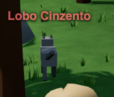
- **Resposta do Claude:** O lobo foi refeito com formas arredondadas (tronco, juba de pelo, focinho, patas com joelho e rabo felpudo) e anda com passo suave. As pedras quadradas foram trocadas por rochas arredondadas e irregulares, com musgo em cima. Todos os monstros e as copas das árvores agora têm sombreado suave, sem facetas.

### S-040 · Área do mapa: Área da tela (303×178 px)
- **Status:** feito · **Quando:** 2026-11-07T17:54:29 · **Mapa:** Campos de Verdelume (tile [-9, -27])
- **Onde no código:** js3d/main3d.js → buildWorld (cenário) · js3d/world3d.js (terreno)
- **Sugestão:** Eu preciso que um dos menus à direita seja uma verdadeira Wiki a respeito dos Monstros onde eu consiga consultar facilmente todos os monstros como um grande Pokédex digamos assim e eu consiga ver todas as informações sobre eles como os drops as possibilidades de drops no quesito chances o que a carta deles faz e tudo o que é pertinente sobre eles desde habilidades desde HP desde tudo de nível Ou seja todos os portos que são pertinentes aos Monstros raça e etc eu preciso que esteja tudo em uma Wiki e ela seja facilmente encontrada por um dos Comandos do canto direito da tela
- 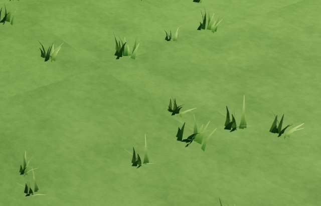
- **Resposta do Claude:** Novo Bestiário 📖 (botão no menu à direita ou tecla B): a lista de todos os monstros tem busca. Cada um mostra nível, HP, ataque, defesas, precisão e esquiva, elemento e fraquezas, raça, tamanho, comportamento, EXP, onde aparece, a chance de cada drop e o que a carta faz.

### S-041 · Área do mapa: Área da tela (245×204 px)
- **Status:** feito · **Quando:** 2026-11-07T17:54:49 · **Mapa:** Campos de Verdelume (tile [-6, -23])
- **Onde no código:** js3d/main3d.js → buildWorld (cenário) · js3d/world3d.js (terreno)
- **Sugestão:** todos os bonecos ficaram com rosto muuuito feio de cu e nao quero essa careta tao feia assim
- 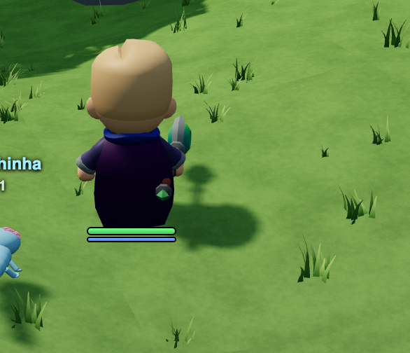
- **Resposta do Claude:** Rostos refeitos em todos os bonecos (jogador e NPCs): as sobrancelhas franzidas viraram retas e simpáticas, e o nariz ficou menor. Acabou a cara de bravo.

### S-042 · Área do mapa: Área da tela (275×234 px)
- **Status:** feito · **Quando:** 2026-11-07T18:21:17 · **Mapa:** Campos de Verdelume (tile [3, -28])
- **Onde no código:** js3d/main3d.js → buildWorld (cenário) · js3d/world3d.js (terreno)
- **Sugestão:** gostaria que as 3 montarias oferecidas tivessem gráficos muuuuit melhores, pq ta muito feio
- 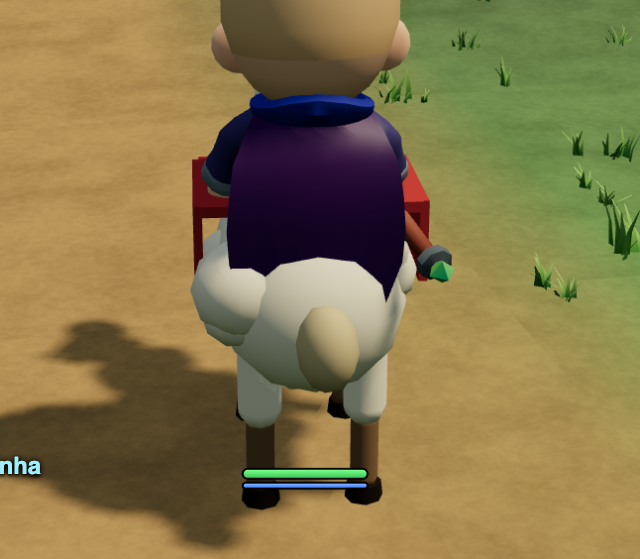
- **Resposta do Claude:** Os 3 corcéis foram refeitos com corpo de cavalo: pescoço comprido, cabeça alongada com orelhas e chifrinhos, pernas longas com joelho e casco, crina e rabo esvoaçantes, sela de couro com estribos e manta caída nos lados. A lã continua como marca, na gola e acima dos cascos. Também pulam com as patas recolhidas.

### S-043 · Área do mapa: Área da tela (266×271 px)
- **Status:** feito · **Quando:** 2026-11-07T18:21:52 · **Mapa:** Campos de Verdelume (tile [27, 23])
- **Onde no código:** js3d/main3d.js → buildWorld (cenário) · js3d/world3d.js (terreno)
- **Sugestão:** quando eu pulo com a montaria, meus bracos ficam pra cima e pra baixo mto bugado e isso nao é legal
- 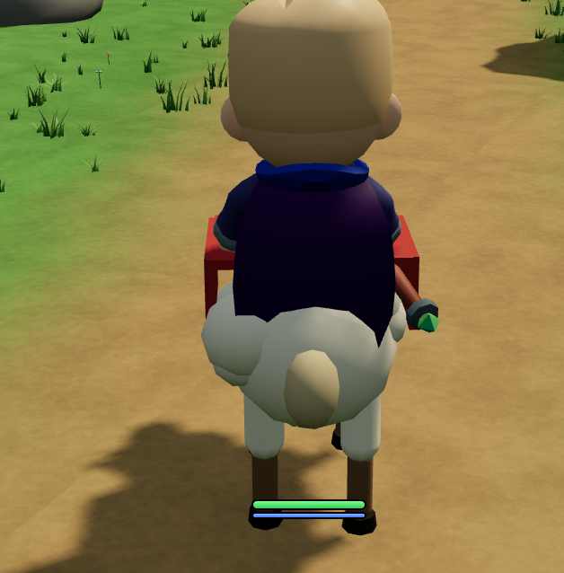
- **Resposta do Claude:** Corrigido: montado, você fica sempre sentado na sela, também no pulo (os braços não sobem e descem mais).

### S-044 · Área do mapa: Área da tela (213×217 px)
- **Status:** feito · **Quando:** 2026-11-07T18:22:49 · **Mapa:** Bosque Sussurrante (tile [77, 35])
- **Onde no código:** js3d/main3d.js → buildWorld (cenário) · js3d/world3d.js (terreno)
- **Sugestão:** o ataque dos monstros tem que ter algum tipo de animacao e nao o bicho ficando tudo parado. Eles tem que ser 3ds tbm,. Esse lobo melhorou mas ainda ta feio
- 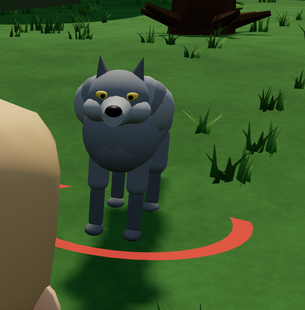
- **Resposta do Claude:** Os monstros agora têm animação de ataque: o lobo prepara, dá o bote e abre a boca para morder; o coelho dá cabeçada com o chifre; a abelha mergulha e ferroa; a gosma se estica; o cogumelo dá cabeçada. O lobo foi refeito mais realista (costas escuras, peito profundo, focinho com mandíbula, rabo felpudo).

### S-045 · Interface: Janela "Equipamento" — "—Cabeça (meio) —Cabeça (baixo) —Escudo —Botas —Acessório 2"
- **Status:** feito · **Quando:** 2026-11-07T18:24:52 · **Mapa:** Campos de Verdelume (tile None)
- **Onde no código:** js/ui.js (janelas/HUD), style.css (aparência), index.html (estrutura)
- **Sugestão:** quero ser capaz de, dentro de uma janela, eu conseguir tbm selecionar a parte exata que eu quero selecionar e nao ter meio que uma autoselecao. Tbm quero poder mexer o meu personagem do centro com o botao esquerdo do mouse e mexendo nele pra dar voltinha e nesse caso do meu ficou com arma cortando pro lado de fora e isso nao é legal ter pedeçao dele prro lado de fora. E ja falei que esse rosto é horrendo, precisa melhorar muito pra parecer mais humano
- 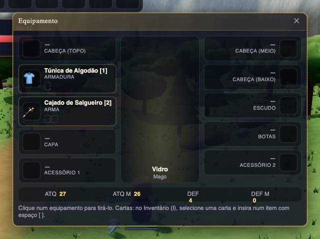
- **Resposta do Claude:** No modo Q, dentro das janelas, o clique pega o elemento exato e arrastar marca exatamente a área que você quer (com print). Na janela do personagem, arraste o boneco do centro para girá-lo, e ele cabe inteiro (a arma não sai mais pra fora). Os rostos ganharam olhos humanos, com parte branca, íris redonda e brilho.

### S-046 · Área do mapa: Área da tela (289×220 px)
- **Status:** feito · **Quando:** 2026-11-07T18:34:52 · **Mapa:** Campos de Verdelume (tile [4, -24])
- **Onde no código:** js3d/main3d.js → buildWorld (cenário) · js3d/world3d.js (terreno)
- **Sugestão:** Gostaria que o mago mesmo sem nenhum spell tivesse uma alta ataque que fosse ranged ranged melhor dizendo porém Claro com um Range menor do que o do arqueiro eu quero que você inspire o auto ataque dele inclusive bem como as demais habilidades em Skyrim e quando eu digo habilidade de uma água não só de uma água e sim como das evoluções do Mago você se inspire com um bom senso no Skyrim
- 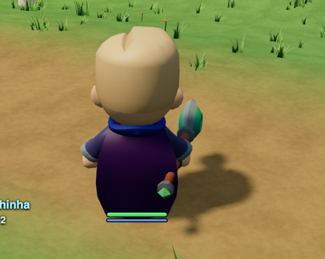
- **Resposta do Claude:** Mago com cajado agora ataca à distância com um projétil arcano (alcance 4,5 m, menor que o do arqueiro, 6 m). Magias inspiradas em Skyrim: Mago tem Rajada de Fogo, Estilhaço de Gelo, Relâmpago e Barreira Arcana (novo escudo). Arquimago tem Bola de Fogo (explode em área, nova), Chuva de Meteoros, Nevasca (nova, congela) e Tempestade de Raios. Sábio tem Pilar de Terra, Runa de Fogo (nova, armadilha no chão) e Cura Maior.

### S-047 · Interface: Janela "Habilidades" — "Pontos de habilidade: 4 (1 por Nv. de Classe)🌱 Aprendiz🩹 P"
- **Status:** feito · **Quando:** 2026-11-07T18:35:47 · **Mapa:** Campos de Verdelume (tile None)
- **Onde no código:** js/ui.js (janelas/HUD), style.css (aparência), index.html (estrutura)
- **Sugestão:** as habilidades tem que vir de forma analoga, tanto as habilidades do personagem quanto do mascote
- 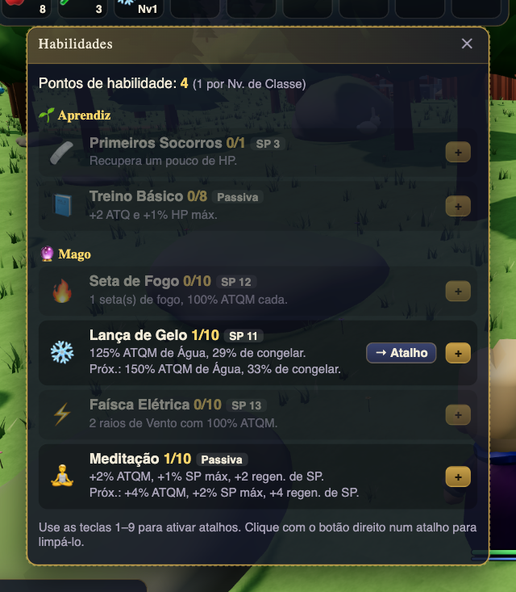
- **Resposta do Claude:** A janela de Habilidades ganhou abas 🧍 Personagem / 🐾 Mascote, no mesmo formato: o mascote mostra suas habilidades por estágio de evolução (liberadas ou com o nível em que liberam).

### S-048 · Interface: Janela "Árvore de Classes" — "Árvore de Classes✕"
- **Status:** feito · **Quando:** 2026-11-07T18:36:40 · **Mapa:** Campos de Verdelume (tile None)
- **Onde no código:** js/ui.js (janelas/HUD), style.css (aparência), index.html (estrutura)
- **Sugestão:** enquanto estou com o god mode ativado eu posso escolher quais quer masxoscotes e evolucoes e vai mudando na hora. So nao pode fazer isso o usuario comum
- 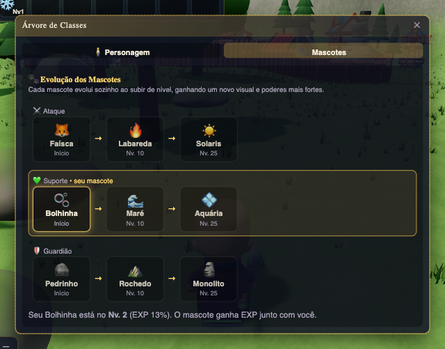
- **Resposta do Claude:** Com God Mode ligado, na Árvore de Classes → aba Mascotes, clique em qualquer mascote ou estágio para trocar na hora. Jogadores comuns não veem essa opção.

### S-049 · Interface: Janela "📖 Bestiário" — "💧GotinhaNv. 1🍄FungolinoNv. 3🐇Coelho-ChifreNv. 5🐝Abelha R"
- **Status:** feito · **Quando:** 2026-11-07T18:38:21 · **Mapa:** Campos de Verdelume (tile None)
- **Onde no código:** js/ui.js (janelas/HUD), style.css (aparência), index.html (estrutura)
- **Sugestão:** preciso queaqui no bestiario nao apareça emoji e sim carregasse o proprio monstro na miniatura e aqui do lado. Na miniatura do lado esquerdo fica como imagem e ali do lado do nome , maior, seria o monstro se mexendo, mesmo que parado
- 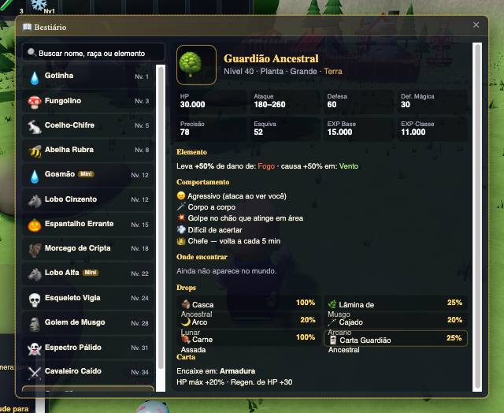
- **Resposta do Claude:** O Bestiário agora mostra o monstro de verdade: miniatura 3D na lista e, ao lado do nome, o monstro se mexendo (respira, gira devagar e de vez em quando ataca).

### S-050 · Área do mapa: Área da tela (288×253 px)
- **Status:** feito · **Quando:** 2026-11-07T18:39:34 · **Mapa:** Campos de Verdelume (tile [-10, -18])
- **Onde no código:** js3d/main3d.js → buildWorld (cenário) · js3d/world3d.js (terreno)
- **Sugestão:** o mago ainda ficou gigantesco, nao sei se vc mudou o tamanho dos personagems padronizando
- 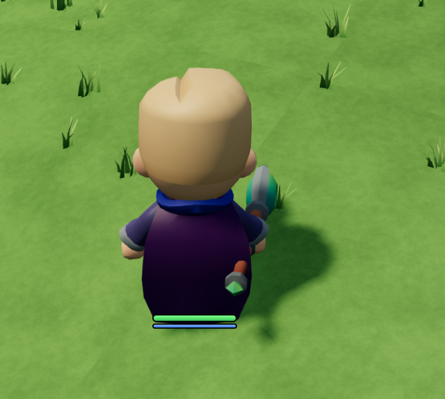
- **Resposta do Claude:** Medi: todas as classes tinham a mesma altura, mas 1,8 m com cabeça grande parecia gigante perto do mundo. Agora os personagens têm 1,5 m e as árvores ficaram maiores, deixando a proporção bem mais natural.

### S-051 · Interface: Janela "Como Jogar" — "Como Jogar✕"
- **Status:** feito · **Quando:** 2026-11-07T18:40:28 · **Mapa:** Campos de Verdelume (tile None)
- **Onde no código:** js/ui.js (janelas/HUD), style.css (aparência), index.html (estrutura)
- **Sugestão:** esse help tbm tem que ficar dentro de algum lugar como confgiguracoes
- 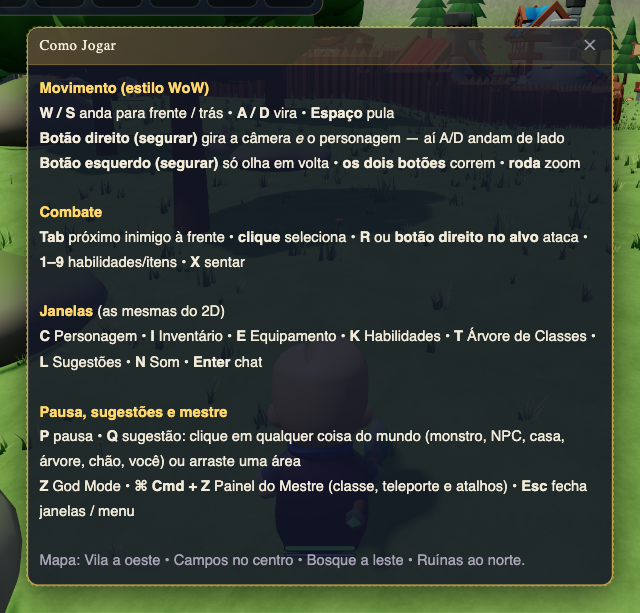
- **Resposta do Claude:** O botão de ajuda saiu do menu da direita. "Como jogar" fica no menu do Esc, junto de Configurações (a tecla H continua funcionando).

### S-052 · Interface: Janela "Personagem" — "Personagem✕"
- **Status:** feito · **Quando:** 2026-11-07T18:41:18 · **Mapa:** Campos de Verdelume (tile None)
- **Onde no código:** js/ui.js (janelas/HUD), style.css (aparência), index.html (estrutura)
- **Sugestão:** essa tela de atributos pode ser unificada à de equipamentos, fazendo parte de um unico comando, uma unica janela organizada. Pode ser aba de equipamentos e atributos como switcher pra uma boa ui/ux
- 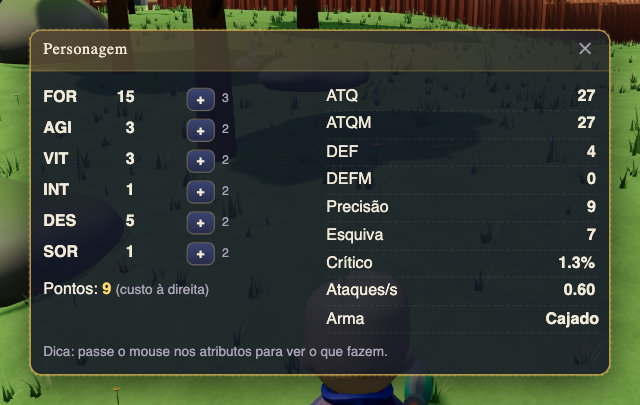
- **Resposta do Claude:** Atributos e Equipamento viraram uma janela só, "Personagem", com abas 🛡️ Equipamento e 📊 Atributos (tecla C abre em Atributos e E em Equipamento; um único botão no menu).

### S-053 · Área do mapa: Área da tela (58×67 px)
- **Status:** feito · **Quando:** 2026-11-07T18:41:49 · **Mapa:** Campos de Verdelume (tile [-22, -7])
- **Onde no código:** js3d/main3d.js → buildWorld (cenário) · js3d/world3d.js (terreno)
- **Sugestão:** coelho ficou mtt feio , muito falso, gosto de bichos mais realistas em geral. Melhores os monstros que tao mais fakes
- 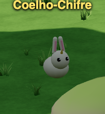
- **Resposta do Claude:** O coelho foi refeito com proporções reais: anca grande, patas traseiras longas, orelhas compridas, olhos nas laterais, focinho que fuça e bigodes. O lobo e a abelha (tórax peludo, listras, olhos compostos, antenas, 6 patas e 4 asas) também ficaram mais realistas.

### S-054 · Área do mapa: Área da tela (320×62 px)
- **Status:** feito · **Quando:** 2026-11-07T18:42:15 · **Mapa:** Vila de Alvorada (tile [-119, -47])
- **Onde no código:** js3d/main3d.js → buildWorld (cenário) · js3d/world3d.js (terreno)
- **Sugestão:** parecem meio flutuando. Melhore isso e outros elementos que parecem flutuar no jogo
- 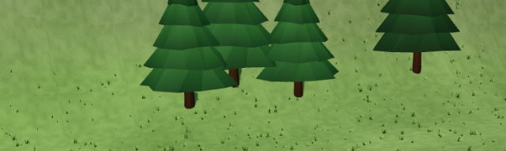
- **Resposta do Claude:** As árvores não flutuam mais: os troncos continuam para dentro da terra e, em encostas, assentam no ponto mais baixo do chão.

### S-055 · Área do mapa: Área da tela (69×39 px)
- **Status:** feito · **Quando:** 2026-11-07T18:44:00 · **Mapa:** Campos de Verdelume (tile [17, 30])
- **Onde no código:** js3d/main3d.js → buildWorld (cenário) · js3d/world3d.js (terreno)
- **Sugestão:** efeito de morte dos monstros tem que ser mais real e nao so sumir igual a abelha ficou pequena e sumiu. Todos tem que ter animacoes de morte. Uma default e outra mais rara
- 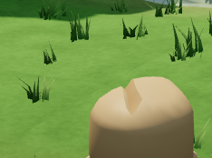
- **Resposta do Claude:** Os monstros agora morrem com animação: na morte comum, caem de lado (as abelhas despencam) e depois afundam devagar no chão. Na morte rara (~15%), brilham e se desfazem em faíscas de luz que sobem.

### S-056 · Área do mapa: Área da tela (357×111 px)
- **Status:** feito · **Quando:** 2026-11-07T18:45:04 · **Mapa:** Campos de Verdelume (tile [22, 71])
- **Onde no código:** js3d/main3d.js → buildWorld (cenário) · js3d/world3d.js (terreno)
- **Sugestão:** agua meio bugada aqui. evite bugs de aguas nas extremidades
- 
- **Resposta do Claude:** Corrigido: a água só existe dentro do lago e some suavemente na margem (nada de "poças" de água em buracos do terreno fora dele).

### S-057 · Área do mapa: Área da tela (130×111 px)
- **Status:** feito · **Quando:** 2026-11-07T18:45:55 · **Mapa:** Campos de Verdelume (tile [39, -66])
- **Onde no código:** js3d/main3d.js → buildWorld (cenário) · js3d/world3d.js (terreno)
- **Sugestão:** o afegao medio sem ser o master tbm preisa conseguir ver o mapa geral, muito importante. Com algum comando, pra que ele saiba onde está indo
- 
- **Resposta do Claude:** Novo mapa para todos os jogadores: tecla G, botão 🗺️ no menu ou clique no minimapa. Mostra regiões, NPCs, chefes e onde você está (atualiza enquanto você anda).

### S-058 · Área do mapa: Área da tela (150×93 px)
- **Status:** feito · **Quando:** 2026-11-07T18:46:18 · **Mapa:** Campos de Verdelume (tile [7, -25])
- **Onde no código:** js3d/main3d.js → buildWorld (cenário) · js3d/world3d.js (terreno)
- **Sugestão:** importante eu como master tbm possa trocar de raça em algum local, de alguma forma, mesmo depois de ja ter o personagem criado
- 
- **Resposta do Claude:** No Painel do Mestre (⌘Z) há um cartão "Raça e aparência" para trocar raça (Humano, Elfo, Anão) e rosto/cabelo a qualquer momento.

### S-059 · Área do mapa: Área da tela (449×521 px)
- **Status:** feito · **Quando:** 2026-11-07T23:07:36 · **Mapa:** Vila de Alvorada (tile [-41, 26])
- **Onde no código:** js3d/main3d.js → buildWorld (cenário) · js3d/world3d.js (terreno)
- **Sugestão:** gostaria de montarias mais erealistas e tbm ue o salto fizesse as pernas da montaria se mexerem de forma diferente. Pois ta muito esdruxulo
- 
- **Resposta do Claude:** O salto das montarias ficou realista: as patas da frente dobram sob o peito, as de trás esticam para trás, o corpo empina na subida e abaixa o focinho na descida, e o rabo levanta. Os corcéis já tinham ganhado corpo de cavalo de verdade.

### S-060 · Área do mapa: Área da tela (51×57 px)
- **Status:** feito · **Quando:** 2026-11-08T09:31:48 · **Mapa:** Vila de Alvorada (tile [-58, 16])
- **Onde no código:** js3d/main3d.js → buildWorld (cenário) · js3d/world3d.js (terreno)
- **Sugestão:** preciso que haja aqui um NPC de pvp, e conversando com ele ele nos leve pra um mapa em que eu possa cair na porrada com outro playr. Aí preciso que vc crie tudo desse novo local, torne possivel uma briga entre players, descer hp, etc etc
- 
- **Resposta do Claude:** Nova Arena PvP! O Capitão Bravo (perto do Guarda Tobias, na vila) leva você à Arena de Aethra: um coliseu redondo com areia, muralha, tochas e estandartes. Lá você enfrenta outros jogadores com Tab/clique para escolher o adversário, R para atacar, golpes e magias de alvo único, e até o mascote ajuda. O servidor controla o HP de todos; derrotado, você volta em 5 s. Há placar de abates/derrotas e você não perde EXP nem itens. Sai pelo portal dourado. Para testar sozinho, abra o jogo em outra janela com outro personagem.

### S-061 · Área do mapa: Área da tela (229×202 px)
- **Status:** feito · **Quando:** 2026-11-08T09:33:02 · **Mapa:** Vila de Alvorada (tile [-90, 26])
- **Onde no código:** js3d/main3d.js → buildWorld (cenário) · js3d/world3d.js (terreno)
- **Sugestão:** gostaria de um efeito mais real desse portal, ele ta muito 'perfeitinho'. Gostaria de ele ser melhor trabalhado com as ondas ali da pate de baixo aumentando e as particulas fluidas indo subindo e sumindo meio como se evaporassem. Preciso de algo mais legal e bem trabalhado aqui no portal
- 
- **Resposta do Claude:** O portal foi refeito: redemoinho animado no chão, ondas que nascem na base e se espalham, uma névoa de luz que some no alto e dezenas de partículas que sobem em espiral e evaporam.

### S-062 · Área do mapa: Área da tela (700×409 px)
- **Status:** feito · **Quando:** 2026-11-08T09:34:24 · **Mapa:** Vila de Alvorada (tile [-44, 24])
- **Onde no código:** js3d/main3d.js → buildWorld (cenário) · js3d/world3d.js (terreno)
- **Sugestão:** preciso que o god mode nao me torne inalvejavel, no sentido dos monstros nao me colocarem como target, e sim so indestrutivel, com hp infinito
- 
- **Resposta do Claude:** God Mode agora só deixa você indestrutível: os monstros te enxergam e atacam normalmente, mas o HP não desce (aparece o dano com "imune").

### S-063 · Área do mapa: Área da tela (204×162 px)
- **Status:** feito · **Quando:** 2026-11-08T09:34:54 · **Mapa:** Vila de Alvorada (tile [-76, 6])
- **Onde no código:** js3d/main3d.js → buildWorld (cenário) · js3d/world3d.js (terreno)
- **Sugestão:** tornar mais redondidnho aqui e mais realsta, e nao meio quadrado
- 
- **Resposta do Claude:** O alvo de treino agora é redondo e feito em código: disco de palha com anéis coloridos, aro, tripé de madeira e flechas cravadas.

### S-064 · Área do mapa: Área da tela (325×259 px)
- **Status:** feito · **Quando:** 2026-11-08T09:36:03 · **Mapa:** Vila de Alvorada (tile [-59, 30])
- **Onde no código:** js3d/main3d.js → buildWorld (cenário) · js3d/world3d.js (terreno)
- **Sugestão:** minha cabeça ta dentro dos objetos e isso nao é desejavel. Seja mais rigoroso no que da pra minha box entrar ou nao entrar nos objetos ao meu redor
- 
- **Resposta do Claude:** Colisão mais rigorosa: tendas, caixotes, barris, casas, muros e cercas agora têm uma "caixa" do tamanho real do objeto (girada junto), então você não entra mais neles.

### S-065 · Área do mapa: Área da tela (1014×750 px)
- **Status:** feito · **Quando:** 2026-11-08T09:36:41 · **Mapa:** Vila de Alvorada (tile [-56, 37])
- **Onde no código:** js3d/main3d.js → buildWorld (cenário) · js3d/world3d.js (terreno)
- **Sugestão:** torne isso mais bonito com frutas mais reais eproporcionais. E inclua uma feirante aquitbm em que eu possa comprar frutas
- 
- **Resposta do Claude:** A feira ficou bonita: saíram os caixotes quadradões e entrou uma barraca de frutas realistas (maçãs com cabinho e folha, laranjas, peras, cachos de uva, bananas e melancias, uma cortada ao meio). Nova feirante, a Dona Flora, vende maçã, laranja, pera, banana, uvas, melancia e frutinha azul, e cada fruta cura HP e/ou SP.

### S-066 · Área do mapa: Área da tela (437×445 px)
- **Status:** feito · **Quando:** 2026-11-08T09:39:18 · **Mapa:** Vila de Alvorada (tile [-43, 24])
- **Onde no código:** js3d/main3d.js → buildWorld (cenário) · js3d/world3d.js (terreno)
- **Sugestão:** Nessa classe Além Deste chapéu não está conectando a cabeça eu gostaria de fazer um combinado com você nenhuma classe inclusive nem o Mago e evoluções deve ter por padrão um chapéu eu quero que assim como o Ragnarok online o chapéu seja a única coisa que eu consiga customizar o meu personagem e portanto ele precisa ser um equipamento ou visual e não algo por padrão da classe isso vale para todas as classes
- 
- **Resposta do Claude:** Combinado! Nenhuma classe tem mais chapéu fixo (nem os magos). O chapéu agora é o equipamento do topo da cabeça e aparece no boneco: bandana, chapéu de palha, coroa de flores, elmo de ferro e, novos na loja do Bento, chapéu de mago, chapéu de bardo, tricórnio, capuz sombrio e faixa de penas. A tiara arcana também existe como item. O cabelo se ajusta debaixo do chapéu.

### S-067 · Área do mapa: Área da tela (347×172 px)
- **Status:** feito · **Quando:** 2026-11-08T09:41:19 · **Mapa:** Campos de Verdelume (tile [15, 50])
- **Onde no código:** js3d/main3d.js → buildWorld (cenário) · js3d/world3d.js (terreno)
- **Sugestão:** Gostaria de tornar as vitórias régias mais realistas e principalmente perceba que existe um triângulo ali aberto e esse triângulo não pode ser fechado com o perímetro Ou seja a parte externa é como se fosse uma pizza que tem um pedacinho aí e isso obviamente está incorreto e precisa ser corrigido Em resumo eu prefiro que você melhore o acabamento dessas vitórias Régia para que seja muito mais
- 
- **Resposta do Claude:** As vitórias-régias foram refeitas no estilo das amazônicas: folha redonda e inteira com a borda levantada (avermelhada por fora), nervuras e só uma fendinha estreita na borda. Nada mais de "pedaço de pizza".

### S-068 · Área do mapa: Área da tela (271×152 px)
- **Status:** feito · **Quando:** 2026-11-08T09:42:00 · **Mapa:** Campos de Verdelume (tile [17, 62])
- **Onde no código:** js3d/main3d.js → buildWorld (cenário) · js3d/world3d.js (terreno)
- **Sugestão:** vi que tem monstros que entraram na agua, mas os monstros nao podem entrar na agua. Tem que ter regra que impeça deles se aproximarem demais dos lagos sempre
- 
- **Resposta do Claude:** Os monstros não entram mais no lago: eles não escolhem passeios perto da água e, se chegarem na beira, são empurrados de volta para a margem.

### S-069 · Interface: Área de 911×756 px em Palco do personagem — "‹ · arraste para girar · rodinha aproxima"
- **Status:** feito · **Quando:** 2026-11-08T13:10:52 · **Tela:** Seleção de personagens
- **Onde no código:** js3d/main3d.js → chooseCharacter (vitrine, makeStage) · style.css (.cs-*)
- **Sugestão:** aqui está com muito lag no personagem. Além disso percebo que partes tanto do personagem quanto do mascote estão invadindo o lado externo da box e cortando parte de ambos eu preciso que você garante aqui nada será cortado
- 
- **Resposta do Claude:** Vitrine sem lag: o palco do personagem ganhou um renderizador próprio (antes copiava pixel a pixel do mundo a cada quadro) e o mundo atrás da vitrine/criador nem é mais desenhado. O enquadramento agora mede o personagem, a arma e o mascote girando em qualquer ângulo: nada fica cortado (palco também mais largo).

### S-070 · Interface: Área de 429×573 px em Palco do personagem
- **Status:** feito · **Quando:** 2026-11-08T13:11:23 · **Tela:** Seleção de personagens
- **Onde no código:** js3d/main3d.js → chooseCharacter (vitrine, makeStage) · style.css (.cs-*)
- **Sugestão:** Gostaria que fosse possível virar o personagem com a tecla a e tecla de da mesma forma com que eu consigo mexer nele a partir do mouse
- 
- **Resposta do Claude:** Na vitrine e no criador, A e D giram o personagem (como arrastar com o mouse). ← e → continuam trocando de personagem.

### S-071 · Área do mapa: Área da tela (340×291 px)
- **Status:** feito · **Quando:** 2026-11-08T13:12:50 · **Mapa:** Vila de Alvorada (tile [-60, 23])
- **Onde no código:** js3d/main3d.js → buildWorld (cenário) · js3d/world3d.js (terreno)
- **Sugestão:** Eu vi que o instrumento do Barro está totalmente quadriculado e isso eu acho horroroso eu prefiro o melhor eu preciso que você melhore a estética do instrumento e leve essa consideração de elementos quadriculados feios para todos os locais onde os gráficos estiverem assim pois quero que você resolva pois são algo que eu detesto
- 
- **Resposta do Claude:** Alaúde refeito: caixa em forma de pera com costas abauladas, tampo claro, roseta, escala com trastes, cravelhal dobrado para trás e 6 cordas. E acabei com o quadriculado em todo o jogo: acessórios das classes, mascotes, monstros, montarias, móveis e pedrinhas agora têm sombreamento liso e mais detalhe; o cabelo também deixou de ter facetas.

### S-072 · Área do mapa: Área da tela (1089×260 px)
- **Status:** feito · **Quando:** 2026-11-08T13:13:45 · **Mapa:** Vila de Alvorada (tile [-48, 11])
- **Onde no código:** js3d/main3d.js → buildWorld (cenário) · js3d/world3d.js (terreno)
- **Sugestão:** Esse muros estão muito mal acabados eu gostaria que se a ideia fosse que eles fossem feitos de madeira que assim seja e sim troncos que estivesse interligados de uma forma mais harmoniosa e bonita e não parecessem com vários lápis grudados um no outro e um outro ponto que me incomodou foi a conexão entre esse elemento e o chão pois eles parecem estar flutuando e inclusive repare que um está dentro do outro com acabamento tenebroso
- 
- **Resposta do Claude:** A cerca da vila virou uma paliçada de troncos de verdade: troncos encostados (nenhum entra no outro), topo serrado e arredondado (nada de lápis), enterrados no chão (não flutuam), com duas travessas amarradas por cordas por dentro e colisão do tamanho real.

### S-073 · Área do mapa: Área da tela (188×173 px)
- **Status:** feito · **Quando:** 2026-11-08T13:14:58 · **Mapa:** Vila de Alvorada (tile [-57, 11])
- **Onde no código:** js3d/main3d.js → buildWorld (cenário) · js3d/world3d.js (terreno)
- **Sugestão:** Eu já falei para você que o personagem padrão está com muita cara de bunda e isso é muito feio eu preciso que tenha traços muito mais humanos e semelhantes a uma pessoa real e não tão figurativa Como está o boneco ele está muito feio sem nariz e esquisito Inclusive eu quero que durante a criação do personagem eu possa selecionar entre cinco rostos diferentes e todos obviamente melhores do que este padrão atual
- 
- **Resposta do Claude:** Rostos novos em 3D, bem mais humanos: nariz de verdade (dorso, ponta, asas e narinas), olhos com íris, pupila, brilho, pálpebra e cílios, sobrancelhas curvas na cor do cabelo e lábios. No criador há 5 rostos para escolher (Sereno, Valente, Alegre, Astuto e Gentil) e a câmera aproxima no rosto ao escolher. Os NPCs (Capitão Bravo, Tobias, Bento, Ivra, Clara, Flora...) também usam os rostos novos, e personagens antigos ganham o rosto Sereno.

### S-074 · Área do mapa: Área da tela (157×96 px)
- **Status:** feito · **Quando:** 2026-11-08T13:16:07 · **Mapa:** Vila de Alvorada (tile [-29, 24])
- **Onde no código:** js3d/main3d.js → buildWorld (cenário) · js3d/world3d.js (terreno)
- **Sugestão:** Percebi que você fez uma cópia muito escrachada do poring do Ragnarok online e tudo bem ter gosmas pois elas são muito comuns aos jogos de MMO RPG porém ficou muito escancarado que você copiou poring Então eu preciso que você crie algum outro tipo de monstro característica deste meu jogo que não seja simplesmente uma bola Idêntica ao boring e também quero que seja possível outras cores desse mesmo monstro de forma análoga ao que existe em Ragnarok com o porém com o drops com o mar em azul e diversos outros também
- 
- **Resposta do Claude:** A Gotinha virou uma criatura própria: uma gota d'água viva com a ponta virada para trás como crista, base derretida escorrendo em ondinhas, núcleo brilhante com bolhas subindo e nadadeiras; ela desliza em vez de quicar. E ganhou variantes por elemento: Musguinho (terra, com brotinho), Brasinha (fogo, soltando brasas), Geadinha (gelo, com cristais) e Gotinha Sombria (sombra), cada uma com drops e carta próprios.

### S-075 · Área do mapa: Área da tela (651×1050 px) (sobre: Janela "👑 Painel do Mestre")
- **Status:** feito · **Quando:** 2026-11-08T13:17:31 · **Mapa:** Vila de Alvorada (tile [-51, 29])
- **Onde no código:** js3d/main3d.js → buildWorld (cenário) · js3d/world3d.js (terreno) · interface: js/ui.js, style.css, index.html
- **Sugestão:** Aqui no meu painel de mestre Também senti falta de eu conseguir mudar Qual é o meu mascote tanto a nível um dos três mascotes quanto as evoluções deles eu preciso ser capaz de trocar isso também no painel de Mestre
- 
- **Resposta do Claude:** Painel do Mestre ganhou o card 🐾 Mascote: os 3 bichos com as 3 evoluções cada; um clique troca na hora (funciona mesmo sem o God Mode ligado).

### S-076 · Área do mapa: Área da tela (662×604 px) (sobre: Janela "👑 Painel do Mestre")
- **Status:** feito · **Quando:** 2026-11-08T13:18:42 · **Mapa:** Vila de Alvorada (tile [-47, 43])
- **Onde no código:** js3d/main3d.js → buildWorld (cenário) · js3d/world3d.js (terreno) · interface: js/ui.js, style.css, index.html
- **Sugestão:** Agora vou te fazer um pedido maior e isso certamente vai requerer um pouco mais de processamento o que eu quero é começar a expandir a quantidade de cidades de Campos e de Dungeons e eu quero que você se inspire muito no mundo aberto primeiro do jogo Shadow of the Colossus e também do próprio World of Warcraft
- 
- **Resposta do Claude:** O mundo ficou 9× maior (900×900 m). A serra do vale ganhou passagens e, além dela: Colinas de Âmbar e a Cidadela de Pedraclara (2ª cidade, muralha de pedra) a leste; Dunas de Sal-Rubro com cactos ao sul; Vale da Geada com neve e lago congelado a oeste; e ao norte a Planície dos Colossos (gigantes de pedra ajoelhados, monólitos, arcos e uma calçada antiga) até o Santuário Silente, entrada da masmorra Catacumbas do Santuário, com a chefe Sentinela Silente. Mestres-grifo (estilo WoW) levam você entre os pontos que já conheceu, e cada região nova tem música própria.

### S-077 · Área do mapa: Área da tela (438×298 px)
- **Status:** feito · **Quando:** 2026-11-08T13:20:13 · **Mapa:** Vila de Alvorada (tile [659, -5])
- **Onde no código:** js3d/main3d.js → buildWorld (cenário) · js3d/world3d.js (terreno)
- **Sugestão:** nao tem como ela ficar assim so com a cabeça de fora. Preciso ver o rosto dela. Talvz ela estar em cima de um balcao que dê altura pra eu ver o rosto
- 
- **Resposta do Claude:** A Dona Rosa agora fica num estrado de madeira atrás do balcão, que também ficou mais baixo: dá para ver o rosto dela (que ganhou o rosto 3D novo).

### S-078 · Área do mapa: Área da tela (352×117 px)
- **Status:** feito · **Quando:** 2026-11-08T13:20:25 · **Mapa:** Vila de Alvorada (tile [658, 0])
- **Onde no código:** js3d/main3d.js → buildWorld (cenário) · js3d/world3d.js (terreno)
- **Sugestão:** trazer algo aqui em cima da mesa mais realista que esses copos
- 
- **Resposta do Claude:** As mesas ganharam canecas de vidro de verdade (com cerveja e espuma), pão com cortes na casca sobre uma tábua com queijo e uma vela; o balcão tem garrafas de vidro com rolha.

### S-079 · Área do mapa: Área da tela (350×298 px)
- **Status:** feito · **Quando:** 2026-11-08T13:20:47 · **Mapa:** Vila de Alvorada (tile [664, 2])
- **Onde no código:** js3d/main3d.js → buildWorld (cenário) · js3d/world3d.js (terreno)
- **Sugestão:** ficou sentado bugado pro lado errado e entrando na mesa
- 
- **Resposta do Claude:** O Velho Gui agora senta no banco virado para a mesa, sem entrar nela, e também ganhou o rosto 3D novo (Tomé e Dona Rosa também).

### S-080 · Área do mapa: Área da tela (594×746 px)
- **Status:** feito · **Quando:** 2026-11-08T13:21:04 · **Mapa:** Vila de Alvorada (tile [659, 1])
- **Onde no código:** js3d/main3d.js → buildWorld (cenário) · js3d/world3d.js (terreno)
- **Sugestão:** fogueira muito bugada que pode e deve ser melhorada
- 
- **Resposta do Claude:** Lareira refeita: alvenaria de pedras irregulares, cornija de madeira com velas e um pote, toras com brasa, chama em três camadas que tremulam e faíscas subindo.

### S-081 · Área do mapa: Área da tela (556×263 px)
- **Status:** feito · **Quando:** 2026-11-08T13:21:32 · **Mapa:** Vila de Alvorada (tile [660, 2])
- **Onde no código:** js3d/main3d.js → buildWorld (cenário) · js3d/world3d.js (terreno)
- **Sugestão:** melhorar detalhes das meses, pao e cervejas. Precisa ser caneca clara na cerveja com o lugar de puxar
- 
- **Resposta do Claude:** Mesas com tampo de três tábuas, pés torneados e travessas; canecas claras de vidro com alça para segurar, cerveja dourada e colarinho de espuma; pão de verdade.

### S-082 · Área do mapa: Área da tela (290×201 px)
- **Status:** feito · **Quando:** 2026-11-08T13:22:41 · **Mapa:** Vila de Alvorada (tile [-79, 27])
- **Onde no código:** js3d/main3d.js → buildWorld (cenário) · js3d/world3d.js (terreno)
- **Sugestão:** melhora o gráfico disso
- 
- **Resposta do Claude:** Carrinho de mão novo feito em código: caçamba de tábuas, cabos curvos com pegadores, pés de apoio e roda com aro de ferro, cubo e raios.

### S-083 · Área do mapa: Área da tela (326×114 px) (sobre: Painel de status, Barra de atalhos, Ícones de buff)
- **Status:** feito · **Quando:** 2026-11-08T13:23:16 · **Mapa:** Vila de Alvorada (tile [-34, 19])
- **Onde no código:** js3d/main3d.js → buildWorld (cenário) · js3d/world3d.js (terreno) · interface: js/ui.js, style.css, index.html
- **Sugestão:** nao quero que apareça o hp dos npcs
- 
- **Resposta do Claude:** NPCs não mostram mais barra de vida: o quadro do alvo mostra só o nome, o título e a dica para conversar (nome numa linha só).

### S-084 · Área do mapa: Área da tela (679×454 px)
- **Status:** feito · **Quando:** 2026-11-08T13:24:48 · **Mapa:** Campos de Verdelume (tile [22, 26])
- **Onde no código:** js3d/main3d.js → buildWorld (cenário) · js3d/world3d.js (terreno)
- **Sugestão:** Melhor o efeito de quando eu aumento de nível gostaria de algum efeito sonoro parecido com Ragnarok online e também aquela aquelas asinhas bem elaboradas em volta do meu personagem quero uma animação bem robusta para quando a gente passar de nível tanto a nível efeito sonoro quanto visual quero deixar algo bastante incrementado mesmo
- 
- **Resposta do Claude:** Subir de nível agora é um evento: asas douradas se abrem e batem nas costas do personagem, coluna de luz, círculo de runas girando no chão, partículas douradas subindo em espiral, auréola e uma fanfarra nova (sopro que sobe, arpejo de sinos, acorde de coro e brilhos).

### S-085 · Área do mapa: Área da tela (295×147 px)
- **Status:** feito · **Quando:** 2026-11-08T13:25:14 · **Mapa:** Bosque Sussurrante (tile [57, 13])
- **Onde no código:** js3d/main3d.js → buildWorld (cenário) · js3d/world3d.js (terreno)
- **Sugestão:** o que eu pedi pra mudar o poring obio que tbm vale pra esse mini-boss aqui
- 
- **Resposta do Claude:** O Gosmão virou o rei das gotas: a forma de gota viva (nada de bola), coroa de coral, três núcleos brilhando em triângulo, gotinhas orbitando e pingos escorrendo.

### S-086 · Área do mapa: Área da tela (583×229 px)
- **Status:** feito · **Quando:** 2026-11-08T13:27:05 · **Mapa:** Bosque Sussurrante (tile [64, 15])
- **Onde no código:** js3d/main3d.js → buildWorld (cenário) · js3d/world3d.js (terreno)
- **Sugestão:** Eu percebi que você sumiu com o botão do Som Mas eu não encontrei ele no esc então preciso que você inclua ele nas configurações que fiquem dentro do esc para que eu possa voltar com o som e eu consigo ouvir a música e também ouvir todos os outros efeitos sonoros você pode dentro desse som desabilitar música de jogo e também desabilitar efeitos sonoros como todo como por exemplo barulhos de saltar barulhos de monstro atacando monstro morrendo e todos os outros efeitos sonoros naturais
- 
- **Resposta do Claude:** Esc → ⚙️ Configurações: liga/desliga o som do jogo, a música e os efeitos (golpes, saltos, monstros, passos) separadamente, cada um com volume. Fica salvo.

### S-087 · Área do mapa: Área da tela (303×309 px)
- **Status:** feito · **Quando:** 2026-11-08T13:27:52 · **Mapa:** Bosque Sussurrante (tile [65, 11])
- **Onde no código:** js3d/main3d.js → buildWorld (cenário) · js3d/world3d.js (terreno)
- **Sugestão:** Vi que você melhorou consideravelmente a estética dos lobos e inclusive fez efeitos de ataques porém eles ainda tem muita a melhorar a nível gráfico pois eu entendo que tá muito pontiagudo e com muitas formas geométricas como as orelhas deles estão esquisitas as bochechas esquisitas não dá para ver os pelos deles o pé deles também está uma bola e poderia ser muito mais interessante o efeito dos movimentos que tudo mais acredito que há muito o que melhorar na construção deste monstro
- 
- **Resposta do Claude:** Lobo refeito: pelagem de verdade (mechas deitadas no corpo, juba, bochechas e rabo peludo), orelhas em concha com o lado de dentro claro, máscara clara no rosto, patas com dedos e unhas. E mais vida: respira, mexe as orelhas sozinho, abaixa para farejar o chão e a pata dobra ao andar.

### S-088 · Área do mapa: Área da tela (336×301 px)
- **Status:** feito · **Quando:** 2026-11-08T13:28:58 · **Mapa:** Bosque Sussurrante (tile [58, 15])
- **Onde no código:** js3d/main3d.js → buildWorld (cenário) · js3d/world3d.js (terreno)
- **Sugestão:** Preciso que os Monstros tenham uma Box própria de forma com que um não consiga ficar dentro do outro eles não podem ocupar o mesmo lugar no espaço preciso que você melhore as físicas desse jogo como um todo
- 
- **Resposta do Claude:** Monstros agora têm corpo: um não entra no outro, nem no jogador, nem no mascote. Cada um tem um peso (chefe e boneco quase não saem do lugar) e ninguém é empurrado para dentro de parede.

### S-089 · Área do mapa: Área da tela (647×508 px)
- **Status:** feito · **Quando:** 2026-11-08T13:29:38 · **Mapa:** Vila de Alvorada (tile [-46, 24])
- **Onde no código:** js3d/main3d.js → buildWorld (cenário) · js3d/world3d.js (terreno)
- **Sugestão:** preciso que aumente a velocidade de andar no god mode, pra eu conseguir ser mais rápido
- 
- **Resposta do Claude:** No God Mode você corre bem mais rápido (3,2× em vez de 1,8×), com a animação de corrida acelerada junto.

### S-090 · Área do mapa: Área da tela (102×81 px)
- **Status:** feito · **Quando:** 2026-11-08T13:31:13 · **Mapa:** Vila de Alvorada (tile [-72, 32])
- **Onde no código:** js3d/main3d.js → buildWorld (cenário) · js3d/world3d.js (terreno)
- **Sugestão:** Preciso que você queria aqui um boneco para testes de forma com que ele tenha HP infinito e eu possa ficar dando golpes neles para testar tanto os meus ataques físicos sejam eles sejam eles ranged e também habilidades e obviamente eles nunca podem morrer faça por favor esse boneco como com um gráfico muito interessante e pode até se inspirar no filme de Hércules
- 
- **Resposta do Claude:** Três bonecos de treino na vila (onde você marcou): espírito de ginásio grego, com elmo de bronze e crista vermelha, escudo com sol pintado, espada de madeira e base com friso grego. Nunca morrem, balançam numa mola e soltam palha ao apanhar; o quadro do alvo mostra o DPS e o dano total.

### S-091 · Área do mapa: Área da tela (128×99 px)
- **Status:** feito · **Quando:** 2026-11-08T13:31:58 · **Mapa:** Campos de Verdelume (tile [-29, 41])
- **Onde no código:** js3d/main3d.js → buildWorld (cenário) · js3d/world3d.js (terreno)
- **Sugestão:** Este monstro ao andar tem que fazer efeitos sonoros bastante parecidos com o do esporo do Ragnarok online e inclusive quando eles morrerem tem que fazer um barulho parecido também reparem que eu digo parecido e não igual para que não seja uma cópia Descarada
- 
- **Resposta do Claude:** O Fungolino faz um 'pufe' macio a cada pulinho quando está perto de você e, ao morrer, um 'pwoop' com nuvem de esporos (parecido no espírito, sem copiar).

### S-092 · Área do mapa: Área da tela (1113×521 px)
- **Status:** feito · **Quando:** 2026-11-08T13:37:48 · **Mapa:** Ruínas de Kael (tile [21, -64])
- **Onde no código:** js3d/main3d.js → buildWorld (cenário) · js3d/world3d.js (terreno)
- **Sugestão:** Esse muro tá muito Chapadão de uma cor só eu gostaria que fosse mais realista para não ser que não sei o que lá
- 
- **Resposta do Claude:** Os muros das Ruínas de Kael viraram alvenaria de pedra de verdade: blocos irregulares de cores variadas, musgo por cima, topo quebrado e pedras caídas ao pé.

### S-093 · Interface: Área de 357×297 px em Palco do personagem
- **Status:** feito · **Quando:** 2026-11-08T15:16:44 · **Tela:** Seleção de personagens
- **Onde no código:** js3d/main3d.js → chooseCharacter (vitrine, makeStage) · style.css (.cs-*)
- **Sugestão:** o nariz ainda ficou horrivel e o rosto como um todo ainda tá com gráfico muito ruim. Preciso que melhore significativamente pra tornar os personagens muito mais realistas e nao parecendo várias formas geométricas. Idem os mascutes, têm muuuito a melhorar pr serem mais realistas
- 
- **Resposta do Claude:** Personagens realistas de verdade (modelos Quaternius, grátis/CC0): rosto humano com nariz, olhos e sobrancelhas, 5 cortes de cabelo, 13 cores, barba, homem ou mulher e pele clara ou morena (no criador). Você, os NPCs, a vitrine e os rivais da Arena usam o corpo novo, com 43 animações reais; cada classe tem a roupa nas cores dela, a arma na mão, capa e os efeitos. Os mascotes ficam para a próxima etapa.

### S-094 · Área do mapa: Área da tela (163×165 px)
- **Status:** feito · **Quando:** 2026-11-08T15:20:55 · **Mapa:** Campos de Verdelume (tile [2, 28])
- **Onde no código:** js3d/main3d.js → buildWorld (cenário) · js3d/world3d.js (terreno)
- **Sugestão:** gostaria que tivesse algum comando (preciso saber qual) no qual eu conseguisse mudar.a view pra primeira pessoa. Quero que ela seja absolutamente inspirada em skyrim.

Tbm quero mudar a forma de batalha, de serem target, pra atacar segurando o botão esquerdo do mouse. Entao vai ser algo de mira com o cursor e nao algo point click. Ou seja a dinamica vai mudar bastante.Inclusive as com armas de arcos e tbm as de magia. Quero que fiquem as maos dos personagens aparentes muito parecido com skyrim.. Pra armas fisicas ou a distancia, ou até magias
- 
- **Resposta do Claude:** Tecla V troca a câmera: 3ª pessoa clássica (com alvo, como antes) → 1ª pessoa estilo Skyrim → 3ª pessoa de ação por cima do ombro. Nos modos de ação: clique para prender o mouse, a mira fica no centro, segure o botão esquerdo para atacar o que está na mira (espada golpeia, arco atira, magia dispara; se não houver ninguém, o golpe vai no vazio), A/D andam de lado e as habilidades 1–9 vão para quem está na mira. Em 1ª pessoa aparecem as mãos com a arma da classe. Esc solta o mouse.

### S-095 · Área do mapa: Área da tela (346×113 px)
- **Status:** feito · **Quando:** 2026-11-08T15:27:00 · **Mapa:** Dunas de Sal-Rubro (tile [130, 325])
- **Onde no código:** js3d/main3d.js → buildWorld (cenário) · js3d/world3d.js (terreno)
- **Sugestão:** vejo que vc deixou grama com padrão em tudo, mas é importante vc ter o bom senso de saber a quantidade de gramas e onde usadas. Exemplo, se for em dunas e deserto, nao pode ser grama e sim areia.... inclusive deixar essa areia mais evidente. E quero que nas zonas de transicao entre áreas haja uma transição gradativ de quantidade de planta, a depender. Tipo gramas junto com neve até na oter mais grama, sabe? Algo assim
- 
- **Resposta do Claude:** A vegetação agora segue a mistura de regiões ponto a ponto: nas dunas quase não há grama (só areia, agora bem mais marcada, com marolas e sombra das dunas), na neve a grama vai rareando e a neve vai cobrindo aos poucos, e nas divisas tudo muda de forma gradual.

### S-096 · Área do mapa: Área da tela (213×72 px)
- **Status:** feito · **Quando:** 2026-11-08T15:31:12 · **Mapa:** Vale da Geada (tile [416, 28])
- **Onde no código:** js3d/main3d.js → buildWorld (cenário) · js3d/world3d.js (terreno)
- **Sugestão:** n faz sentido eu ver os nomes dos vilões dess distancia toda, isso é bug
- 
- **Resposta do Claude:** Nomes de monstros não aparecem mais de longe: até 13 m normalmente e, mesmo em combate ou como alvo, só até 40 m; quem está escondido (longe, outra área, masmorra) nunca mostra nome.

### S-097 · Área do mapa: Área da tela (431×248 px) (sobre: Chat)
- **Status:** feito · **Quando:** 2026-11-08T15:32:51 · **Mapa:** Bosque Sussurrante (tile [94, 62])
- **Onde no código:** js3d/main3d.js → buildWorld (cenário) · js3d/world3d.js (terreno) · interface: js/ui.js, style.css, index.html
- **Sugestão:** o lobo precisa de sons também, assim como todos os outros monstros. Vi que vc melhorou a estética dele, mas o rosto e os pelos e orelhas ainda estão excessivamente geométricos e mal acabados. QQueria que se parecesse mais com um lobo real
- 
- **Resposta do Claude:** Todos os monstros ganharam sons próprios: lobo (passos, rosnado antes do ataque, mordida, ganido quando apanha, gemido ao morrer e uivo distante de vez em quando), abelha (zumbido e ferroada), gotas (plof e splash), esqueletos (ossos batendo e desmontando), espectro (lamento), coelho e cogumelo. O lobo ganhou cabeça esculpida numa peça só (crânio em cunha, focinho, testa, bochechas, máscara clara), focinho com narinas e orelhas grossas com borda arredondada e pelinhos por dentro.

### S-098 · Área do mapa: Área da tela (429×362 px)
- **Status:** feito · **Quando:** 2026-11-08T15:36:09 · **Mapa:** Dunas de Sal-Rubro (tile [136, 154])
- **Onde no código:** js3d/main3d.js → buildWorld (cenário) · js3d/world3d.js (terreno)
- **Sugestão:** quedas de locais altos precisam tirar hp e/ou matar pessoas que saltam de locais altos, pra tornar mais crível com a realidade. E tbm nao deve ser possivel subir em montanhas assim como eu subi. Sei que estou em god mod e ai tudo bem, mas precisa nao ser possivel subir com facilidade em lugares taoingrimes. Pra que seja aplicada uma boa física, estilo skyrim mesmo
- 
- **Resposta do Claude:** Física nova: cair de lugar alto machuca. Até ~5 m nada; daí em diante o dano cresce rápido e a partir de ~19 m mata (água amortece, montado a montaria absorve parte, com aviso "Que queda!"). E encostas acima de ~45° não dão mais para subir, nem pulando: você trava e, se parar numa encosta íngreme demais, escorrega para baixo. No God Mode você continua subindo e não sente a queda, só vê o número "(imune)".

### S-099 · Interface: Área de 112×101 px em Janela "📖 Bestiário"
- **Status:** feito · **Quando:** 2026-11-08T15:36:55 · **Mapa:** Dunas de Sal-Rubro (tile None)
- **Onde no código:** js/ui.js (janelas/HUD), style.css (aparência), index.html (estrutura)
- **Sugestão:** gostaria de poder arrrastar aqui o bicho com o botao esquerdo do mouse tipo o que da pra fazer com o personagem principal la na tela de selecao
- 
- **Resposta do Claude:** No Bestiário, segure o botão esquerdo em cima do bicho e arraste para girá-lo como na vitrine. Solto, ele volta a girar devagar sozinho.

### S-100 · Área do mapa: Área da tela (261×531 px) (sobre: Chat, Janela "📖 Bestiário")
- **Status:** feito · **Quando:** 2026-11-08T15:37:56 · **Mapa:** Dunas de Sal-Rubro (tile [111, 213])
- **Onde no código:** js3d/main3d.js → buildWorld (cenário) · js3d/world3d.js (terreno) · interface: js/ui.js, style.css, index.html
- **Sugestão:** gostara de poder passar por eles aqui apertando a setinha de baixo tambem, nao apenas com o mouse. Quero dar essa outra opcao
- 
- **Resposta do Claude:** Com o Bestiário aberto, as setas ↑/↓ passam pelos monstros da lista (ela rola sozinha para mostrar o escolhido).

### S-101 · Interface: Área de 239×502 px em Chat, Janela "📖 Bestiário" — "— · Gotinha · Nv. 1 · Boneco de Treino · Fungolino · Nv. 3 · Coelho-Chifre · Nv. 5 · Abelha Rubra · Nv. 8"
- **Status:** feito · **Quando:** 2026-11-08T15:38:36 · **Mapa:** Dunas de Sal-Rubro (tile None)
- **Onde no código:** js/ui.js (janelas/HUD), style.css (aparência), index.html (estrutura)
- **Sugestão:** nao quero o bug de que, quando eu clico em algum monstro, volta pro topo. Tem que manter na mesma tela
- 
- **Resposta do Claude:** Corrigido: ao clicar num monstro a lista fica exatamente onde estava, sem voltar para o topo.

### S-102 · Área do mapa: Área da tela (352×344 px)
- **Status:** feito · **Quando:** 2026-11-08T15:42:25 · **Mapa:** Planície dos Colossos (tile [-58, -296])
- **Onde no código:** js3d/main3d.js → buildWorld (cenário) · js3d/world3d.js (terreno)
- **Sugestão:** gostaria de estátuas maiores, e diferentes entre si aqui. Clima de mistério no ar. E elas serem feitas de forma melhor, com mis cuidado. Podem ser de pedra sim, mas com uma pegada meio shadow of colossus com mistura de god of war. E bem detalhistas e irada
- 
- **Resposta do Claude:** A Planície dos Colossos ganhou 5 estátuas gigantes e diferentes entre si, esculpidas com cuidado: o Colosso Sentinela de pé (≈35 m, elmo com chifres, escudo e espada cravada com runas), o Rei de Pedra no trono com machado duplo, a Fera de pedra agachada com chifres e máscara, o Titã caído com o braço erguido ao céu e o Guerreiro sem cabeça (a cabeça caiu aos pés, olhos ainda brilhando). Pedra gasta com musgo, rachaduras e runas azuis fracas, e névoa baixa pela planície para o clima de mistério.

### S-103 · Área do mapa: Área da tela (332×309 px)
- **Status:** feito · **Quando:** 2026-11-08T15:43:03 · **Mapa:** Planície dos Colossos (tile [20, -425])
- **Onde no código:** js3d/main3d.js → buildWorld (cenário) · js3d/world3d.js (terreno)
- **Sugestão:** ideal emlhorar visualmente e tudo isso se fundir à montanha, como se a dungeon fosse dentro da montanha
- 
- **Resposta do Claude:** O Santuário Silente agora fica dentro da montanha: o pátio virou um entalhe na rocha, com paredões dos dois lados e atrás, e a fachada sai do penhasco com rochas abraçando as laterais, um teto de pedra por cima e pedras caídas na base. A entrada das Catacumbas parece escavada no monte.

### S-104 · Área do mapa: Área da tela (156×134 px)
- **Status:** feito · **Quando:** 2026-11-08T15:43:59 · **Mapa:** Planície dos Colossos (tile [111, -281])
- **Onde no código:** js3d/main3d.js → buildWorld (cenário) · js3d/world3d.js (terreno)
- **Sugestão:** ele precisa ter sons de ataques e tbm efeitos sonoros de falas, e tbm eu batendo em bichos de esqueletos (isso vale pra tosoa) precisa er alguns sons de 'ossos' quando eles tomam porrada
- 
- **Resposta do Claude:** Sons novos: o Cavaleiro Caído fala (voz cavernosa, como palavras arrastadas) ao te ver, de vez em quando e às vezes depois de atacar, e o golpe dele tem lufada pesada + lâmina de ferro. Todo monstro de esqueleto (Esqueleto Vigia, Cavaleiro Caído, Sentinela) agora faz um estalo de osso diferente a cada pancada que leva, e os esqueletos batem os dentes ao te ver.

### S-105 · Interface: Área de 564×194 px em Janela "👑 Painel do Mestre" — "Boneco de Treino · Você precisa estar de frente para o alvo · Inicial · Aprendiz · 🌱 · 1ª classe · Guerreiro · ⚔️ · Mag"
- **Status:** feito · **Quando:** 2026-11-08T15:45:08 · **Mapa:** Vila de Alvorada (tile None)
- **Onde no código:** js/ui.js (janelas/HUD), style.css (aparência), index.html (estrutura)
- **Sugestão:** aqui tbm quero no godmode de ver com clareza a arvore de volucao, enquanto escolho, mesmo que de forma mais compacta pra eu selecionar
- 
- **Resposta do Claude:** No Painel do Mestre, "Virar qualquer classe" virou uma árvore de evolução compacta: Aprendiz no topo, cada 1ª classe numa coluna com as suas duas 2ª classes logo abaixo, ligadas por linhas. A classe atual fica dourada e o caminho até ela, destacado.

### S-106 · Área do mapa: Área da tela (229×165 px)
- **Status:** feito · **Quando:** 2026-11-08T15:46:17 · **Mapa:** Vila de Alvorada (tile [-59, 29])
- **Onde no código:** js3d/main3d.js → buildWorld (cenário) · js3d/world3d.js (terreno)
- **Sugestão:** remover essa cabana aleatoria, nao gostei dela
- 
- **Resposta do Claude:** Tenda removida da praça da vila.

### S-107 · Área do mapa: Área da tela (531×74 px) (sobre: Barra de atalhos, Ícones de buff)
- **Status:** feito · **Quando:** 2026-11-08T15:47:58 · **Mapa:** Vila de Alvorada (tile [-124, -9])
- **Onde no código:** js3d/main3d.js → buildWorld (cenário) · js3d/world3d.js (terreno) · interface: js/ui.js, style.css, index.html
- **Sugestão:** sobre essa barra, que eu consiga arrastar o canto direito inferior pra baixo, pra dar maios opcos ali de itens pra eu colocar. E tbm deixar claor que com o comando 0 eu mudo pra novas opcoes ali, pra que tenham 3'pre-sets' ao todo, pra eu ter mai espaços pra outras builds e tals
- 
- **Resposta do Claude:** A barra de atalhos agora cresce: arraste o cantinho dourado de baixo à direita para baixo e ganhe até 3 fileiras de 9 (a 2ª fileira usa Shift+1–9; a 3ª é por clique). E há 3 conjuntos de atalhos: a tecla 0 (ou o quadradinho "1/3 · 0 troca" na ponta da barra) troca entre eles, para suas builds. Saves antigos continuam com os atalhos de antes no conjunto 1.

### S-108 · Área do mapa: Área da tela (248×362 px)
- **Status:** feito · **Quando:** 2026-11-08T15:49:00 · **Mapa:** Vila de Alvorada (tile [-69, 11])
- **Onde no código:** js3d/main3d.js → buildWorld (cenário) · js3d/world3d.js (terreno)
- **Sugestão:** essas notinhas saindo do bardo nao quero que tenha por padrao. Apenas se ele tiver buffado co lguma skill.  E que essa skill traga elementos mais interessantes, mais parecidos com musica, notas diferntes te tals, mas bem trabalhado
- 
- **Resposta do Claude:** O Bardo não solta mais notas por padrão. Elas só aparecem enquanto a Canção de Batalha está ativa, e agora são uma pauta dourada de 5 linhas girando na cintura com notas de formatos diferentes (semínima, colcheia, par de colcheias ligadas e clave de sol), cada uma de uma cor, subindo em espiral como uma melodia, com um brilho suave.

### S-109 · Área do mapa: Área da tela (358×86 px)
- **Status:** feito · **Quando:** 2026-11-08T15:49:30 · **Mapa:** Vila de Alvorada (tile [-89, 27])
- **Onde no código:** js3d/main3d.js → buildWorld (cenário) · js3d/world3d.js (terreno)
- **Sugestão:** casa ficou meio voando, preciso qu e trabalhe melhor pra na oparecer isso. E o portal sempre mais proximo da entrada de fato, melhor posicionado
- 
- **Resposta do Claude:** Prédios em encosta agora assentam no ponto mais baixo do terreno sob eles (nada de base flutuando; vale para todas as casas, taverna, ferraria, igreja, moinho e torres). E os portais da taverna e do estábulo ficam no pé da escada da porta, não mais no meio da fachada.

### S-110 · Área do mapa: Área da tela (224×198 px)
- **Status:** feito · **Quando:** 2026-11-08T15:50:49 · **Mapa:** Vila de Alvorada (tile [-76, 20])
- **Onde no código:** js3d/main3d.js → buildWorld (cenário) · js3d/world3d.js (terreno)
- **Sugestão:** gostei muito da ideia de ser um bicho inspirado em um tatu e que vai evoluindo tipo bulbassauro ou torterra e tudo mais, mas quero muuuuuito mais detalhes na pele, casco, etc pra que seja um bicho bonito de verdade e nao esse monte de peças todo escroto
- 
- **Resposta do Claude:** O tatu foi refeito do zero: casco de verdade com escudo dos ombros e da garupa cobertos de escamas arredondadas e 8 cintas de placas sobrepostas (sulcos escuros, topos gastos), pele de couro com rugas no pescoço, placa de escamas na cabeça, focinho com narinas, olhinhos com pálpebra, patas aneladas e garras compridas. Rochedo ganha cristais nascendo do casco e líquen; Monolito vira uma paisagem que anda (musgo, grama, florzinhas, pedras, um grande cristal brilhante e dois chifres de pedra). Dá para ver de perto no prototipo-mascotes.html.

### S-111 · Área do mapa: Área da tela (209×224 px)
- **Status:** feito · **Quando:** 2026-11-08T15:52:42 · **Mapa:** Vila de Alvorada (tile [-80, 22])
- **Onde no código:** js3d/main3d.js → buildWorld (cenário) · js3d/world3d.js (terreno)
- **Sugestão:** esse bichinho gosto da ideia dele ser de água, mas precisa ter muito mais algo na linha de 'bolha' do que parecer uma salamandra. Ou, se parecesse a alamanra, nao pode parecer tanto aqeuele bpokemon. E o rosto dele eu nao gostei nem um pouco. Ele tem que ter mais indicativos tbm que ele cura as pessoas. Gosto que tenha mais a ver com 'bolha' do que salamandra. Mas precisa ser sim bem trabalhado
- 
- **Resposta do Claude:** Agora é uma bolha de verdade, nada de salamandra: corpo transparente com brilho de arco-íris e borda luminosa, água balançando dentro, rosto novo e delicado (olhos grandes que piscam, bochechas e sorrisinho). Sinais de cura: cruz verde com duas folhas brilhando na testa, gotinhas verdes de cura caindo e bolhinhas em órbita. Maré ganha um anel de água ondulado; Aquária uma coroa de gotas com uma gema e luz própria.

### S-112 · Área do mapa: Área da tela (157×119 px)
- **Status:** feito · **Quando:** 2026-11-08T15:53:44 · **Mapa:** Vila de Alvorada (tile [-79, 22])
- **Onde no código:** js3d/main3d.js → buildWorld (cenário) · js3d/world3d.js (terreno)
- **Sugestão:** de todos o que eu mais gostei foi essa raposinha. So preciso que seja muuuuuuuito mais bem trabalhada, mas vc tá numa excelente linha. Gosto do rabinho pegando fogo tbm. Só preicso que deixe as 3 evolucoes infinitamente mais realistas do que está hj. Ta mto feio o modelo ainnda
- 
- **Resposta do Claude:** A raposa foi refeita com anatomia de verdade: corpo, cabeça e focinho longo e fino numa peça lisa só, pelagem fina por cima (peito e bochechas creme), olhos âmbar amendoados com pupila em fenda, orelhas altas com pelo dentro e pontas pretas, patas finas com "meias" escuras e dedinhos. O rabo é felpudo e termina em chama que tremula sempre para cima (1, 2 e 3 rabos por estágio). Labareda ganha juba de brasas e chaminhas nas orelhas; Solaris, pelagem dourada, marca solar na testa e luz própria.

### S-113 · Área do mapa: Área da tela (81×111 px)
- **Status:** feito · **Quando:** 2026-11-08T15:55:18 · **Mapa:** Vila de Alvorada (tile [-71, 29])
- **Onde no código:** js3d/main3d.js → buildWorld (cenário) · js3d/world3d.js (terreno)
- **Sugestão:** o ataque padrao da faísca tem que ser melee, e parecido com do lobo. Nao tacando coisa de fogo. Pode ser skill futura que ela desenvolve e nao o ataque padrão
- 
- **Resposta do Claude:** O ataque padrão da Faísca agora é corpo a corpo, como o lobo: ela corre até o alvo, se agacha e dá o bote com mordida (com o som da mordida do lobo). O fogo virou habilidade de evolução: a partir da Labareda ela cospe uma brasa a cada ~8 s, e na Solaris a brasa explode em área. Os outros mascotes também ganharam animação de ação (o tatu empina e bate o casco, a bolha solta um anel verde de cura).

### S-114 · Área do mapa: Área da tela (97×92 px)
- **Status:** feito · **Quando:** 2026-11-08T15:56:05 · **Mapa:** Vila de Alvorada (tile [-74, 31])
- **Onde no código:** js3d/main3d.js → buildWorld (cenário) · js3d/world3d.js (terreno)
- **Sugestão:** nosso mascotes tbm tem que ter vida, mas e mvez de sp, precisa ter stamina
- 
- **Resposta do Claude:** Mascotes agora têm vida e stamina (no lugar de SP), com barras no quadro do personagem e em cima do mascote. Correr e atacar gastam stamina; cansado, ele fica mais lento e espera recuperar. Quando o mascote briga de perto, os monstros podem acertá-lo; com a vida a zero ele desmaia, descansa uns segundos e volta. Vida e stamina ficam no save.

### S-115 · Área do mapa: Área da tela (243×206 px)
- **Status:** feito · **Quando:** 2026-11-08T15:59:56 · **Mapa:** Vila de Alvorada (tile [-69, 26])
- **Onde no código:** js3d/main3d.js → buildWorld (cenário) · js3d/world3d.js (terreno)
- **Sugestão:** ao inves do botao da bolinha do mouse permitir que eu visse minha car, eu gostaria que clicar nele e arrastaro mouse permitisse que eu pudesser ver o personagem por outra perspectiva, meio que poder dar um 360 em volta dele
- 
- **Resposta do Claude:** O botão do meio (rodinha) agora gira a câmera: segure e arraste para dar a volta de 360° em volta do personagem (e para cima/baixo). Soltando, a câmera volta suave para trás dele.

### S-116 · Área do mapa: Área da tela (137×76 px)
- **Status:** feito · **Quando:** 2026-11-08T16:00:57 · **Mapa:** Dunas de Sal-Rubro (tile [-116, 179])
- **Onde no código:** js3d/main3d.js → buildWorld (cenário) · js3d/world3d.js (terreno)
- **Sugestão:** isso tbm nao pode aparecer aqui. deveria te r sumido por eu estar suficientemente longe
- 
- **Resposta do Claude:** Corrigido: nomes de monstros (inclusive o Boneco de Treino que você acertou) não aparecem mais de longe. Em combate o limite agora é 20 m, e o boneco não conta como "brigando com você".

### S-117 · Interface: Área de 594×469 px em Janela "👑 Painel do Mestre" — "🪨 Pedrinho · Nv. 1 · 🌍 Teleporte · — clique no mapa onde quer aparecer"
- **Status:** feito · **Quando:** 2026-11-08T16:03:34 · **Mapa:** Dunas de Sal-Rubro (tile None)
- **Onde no código:** js/ui.js (janelas/HUD), style.css (aparência), index.html (estrutura)
- **Sugestão:** foi um excelente começo esse aumento do mundo pra ter neve, deserto e etc. De fato preciso ter tudo isso no mundo. Senti falta de cidades perto de praias, e tbm quero que vc crie cidades pra cada raça. Na de humanos é onde todo mundo começa, mas tbm precisa ter cidades de anoes e de elfos. Sendo anoes guerreiros por padrao, cidade de equipamentos e tudo mais, machados e tudo nessa pegada, perto de montanhas mais altas. e tbm idades de elfos e tudo o que caracterizaria uma cidade de elfos. Obviamnente precisa ter npcs tbm que se adaptem às cidades, sendo das respectivas raças em sua maioria esmagadora
- 
- **Resposta do Claude:** O mundo ganhou três cidades novas, com estrada até cada uma e NPCs da raça: Pedrafunda, a cidade dos anões, no noroeste entre os picos mais altos (portão de pedra com estátuas de guerreiros com machado, salão escavado no penhasco, moradas na rocha, forja de lava na praça, banca de machados e a ferraria do Mestre Brakar, o refinador); Aelindra, a cidade dos elfos, no nordeste (árvores anciãs gigantes com plataformas, escada em espiral e ponte suspensa, torres de pedra branca com telhado de folha, pavilhões, lanternas de prata e a Fonte da Lua); e o Porto das Gaivotas no sudeste, no litoral com mar de verdade, praia, cais onde dá para andar, barcos, veleiro, farol e casas de pescadores. Alvorada continua sendo onde todo mundo começa. No Painel do Mestre há atalhos para ir a cada uma.

### S-118 · Interface: Área de 540×598 px em Janela "👑 Painel do Mestre" — "Nv. 40–55 · fora da área jogável — você aparece na b"
- **Status:** feito · **Quando:** 2026-11-08T16:17:18 · **Mapa:** Vila de Alvorada (tile None)
- **Onde no código:** js/ui.js (janelas/HUD), style.css (aparência), index.html (estrutura)
- **Sugestão:** quero que em algum lugar também tenha um campo em auqe tenha um portal pra entrar em algum grande castelo gigantesco, e la dentro tenha salas, comodos e tudo mais. Um castelo foda que fique em algum local no campo. Quero esse castelo bem enorme por dentro e bem detalhado
- 
- **Resposta do Claude:** No sudoeste, nos Campos de Valcinza, está o Castelo de Valcinza: muralha de 84 m com ameias e quatro torres, portão com grade, torre de menagem e torre principal de 48 m. Pela porta da torre você entra num interior enorme: salão de entrada com armaduras, sala do trono com colunas, tapete, tapeçarias, lustres e banquete (o Rei Aldemar no trono e a rainha), biblioteca, capela com vitral, arsenal, quarto real com cama de dossel e lareira, quarto de hóspedes e cozinha, com tochas em todos os cômodos e NPCs (guardas, mordomo, bibliotecária, capelão que cura, armeiro anão e cozinheira).

### S-119 · Área do mapa: Área da tela (1589×763 px)
- **Status:** feito · **Quando:** 2026-11-08T16:18:59 · **Mapa:** Vila de Alvorada (tile [816, 5])
- **Onde no código:** js3d/main3d.js → buildWorld (cenário) · js3d/world3d.js (terreno)
- **Sugestão:** nao osso ter essa visualizacao dentro do pvp, ia me atrapalhar demais ficar olhando pro muro assim
- 
- **Resposta do Claude:** Na Arena a câmera não sai mais do círculo: ela se aproxima sozinha para nunca ficar atrás do muro.

### S-120 · Área do mapa: Área da tela (531×184 px)
- **Status:** feito · **Quando:** 2026-11-08T16:19:20 · **Mapa:** Vila de Alvorada (tile [810, 3])
- **Onde no código:** js3d/main3d.js → buildWorld (cenário) · js3d/world3d.js (terreno)
- **Sugestão:** nao goto de uma forma geométrica tao disforme aqiu no meio, podia ser outra coisa
- 
- **Resposta do Claude:** O hexágono vermelho virou um medalhão de pedra gravado: disco com borda e marcas em volta, escudo de bronze em relevo e duas espadas cruzadas.

### S-121 · Área do mapa: Área da tela (989×267 px)
- **Status:** feito · **Quando:** 2026-11-08T16:19:58 · **Mapa:** Vila de Alvorada (tile [808, 2])
- **Onde no código:** js3d/main3d.js → buildWorld (cenário) · js3d/world3d.js (terreno)
- **Sugestão:** quero tornar isso tudo mais realistas, com tilojos da pedra nas pareses, a tocha realista e em vez de retangulos vermelhos e azuis tem que ser algum cartaz, algo assim
- 
- **Resposta do Claude:** A Arena ficou de pedra de verdade: muro e pilares com tijolos de pedra em relevo (tamanhos e tons variados), tochas de parede com suporte de ferro, pano enrolado e chama em camadas que tremula, estandartes de tecido com brasão pintado (Leões e Águias) e cartazes do torneio pregados no muro.

### S-122 · Interface: Área de 627×444 px em Janela "Loja do Bento" — "Bento · <Mercador> · Capitão Bravo · <Mestre da Arena (PvP)> · Alvo fora de alcance. · Loja do Bento · ✕ · Comprar · 🍎 "
- **Status:** feito · **Quando:** 2026-11-08T16:23:25 · **Mapa:** Vila de Alvorada (tile None)
- **Onde no código:** js/ui.js (janelas/HUD), style.css (aparência), index.html (estrutura)
- **Sugestão:** ja mudar tudo isso aqui pra nada ser emojis e sim itens de jogos mesmo, pode criar itens lindos de forma que minimize retrabalho. Vc entende do meu gosto e confio que vai chegar em algo legal que nao sejam emojis
- 
- **Resposta do Claude:** Acabaram os emojis nos itens: cada item agora tem um ícone pintado de verdade (maçã, poções em frasco com líquido e bolhas, espadas com fio e guarda, cajados com gema brilhando, arcos, escudos de madeira e ferro, chapéus, botas, anéis, materiais como chifre, osso, cristal e brasa, cartas com o retrato do monstro). Vale para inventário, equipamento, loja, barra de atalhos, Bestiário, dicas e missões. Item novo sem desenho próprio ganha um ícone do tipo dele, nunca emoji.

### S-123 · Área do mapa: Área da tela (660×490 px) (sobre: Janela "Loja do Bento")
- **Status:** feito · **Quando:** 2026-11-08T16:24:32 · **Mapa:** Vila de Alvorada (tile [-57, 1])
- **Onde no código:** js3d/main3d.js → buildWorld (cenário) · js3d/world3d.js (terreno) · interface: js/ui.js, style.css, index.html
- **Sugestão:** pode se inspirar na compra e vende do wow por exemplo ou do ragnarok, de forma que fique intuitivo que eu posso ir vendendo alg, tipo o que ta na minha bag e eu posso ir dando duplo click e vai entrando em uma janelinh dos itens que pretendo vender o gold que daria se eu vendesse esses itens
- 
- **Resposta do Claude:** A loja virou estilo WoW/RO: à esquerda as mercadorias (clique põe no carrinho, com + e −), à direita a sua bolsa. Dê duplo clique num item da bolsa e ele vai para a caixa "Para vender", que mostra quanto você vai receber (Shift + duplo clique manda a pilha toda; "+ Todos os materiais" junta os drops de uma vez). Embaixo aparece seu zeny agora → depois. Nada acontece até você apertar Comprar ou Vender.

### S-124 · Área do mapa: Área da tela (507×508 px)
- **Status:** feito · **Quando:** 2026-11-08T16:27:12 · **Mapa:** Vila de Alvorada (tile [-83, 2])
- **Onde no código:** js3d/main3d.js → buildWorld (cenário) · js3d/world3d.js (terreno)
- **Sugestão:** nao nessa casa aqui, mas em uma casa no mundo dos anoes tem que ter um ferreiro onede eu possa ter o sistema de refinios de equipamentos. Eles podem chegar até no + 10. Podem chegar até +X sem quebrar e a partir de la, tem chance de quebrar. Essa tabelinha precisa estar muito visual nessa casnha , como funciona o sistema inteiro de refinio. E algo analogo aos oridecon e elinium do ragnarok , mas porem de outros nomes. E tbm as coisas refinadas vao melhorando meu ataque ou defesa. Armas melhora ataque e os melgoramentos no equipamento melhoram a defesa
- 
- **Resposta do Claude:** Sistema de refino até +10: armas usam Ferrolume e ganham ATQ (cajados também ATQM); armaduras, escudos, chapéus, capas e botas usam Pedra-Égide e ganham DEF. Até +4 é seguro; de +5 a +10 a chance cai (80% → 12%) e, se falhar, o item quebra. A janela de refino tem uma tabela bem visual (barras verde/amarela/vermelha para cada nível) e explica tudo. O refinador fica na ferraria da cidade dos anões, que vende os materiais, e os monstros a partir do Nv. 15 (e os chefes) às vezes deixam cair.

### S-125 · Área do mapa: Área da tela (494×478 px)
- **Status:** feito · **Quando:** 2026-11-08T16:27:24 · **Mapa:** Vila de Alvorada (tile [-70, -3])
- **Onde no código:** js3d/main3d.js → buildWorld (cenário) · js3d/world3d.js (terreno)
- **Sugestão:** nao tem sentido nenhum um forno gigante aqui
- 
- **Resposta do Claude:** A ferraria da vila foi refeita sem o forno gigante: uma oficina aberta do tamanho certo, com forja de pedra com brasas, coifa e chaminé soltando fumaça, fole de couro, bigorna com martelo, barril de têmpera, bancada com lingotes, ferraduras e martelos pendurados, suporte de armas, rebolo e placa com bigorna pintada.

### S-126 · Área do mapa: Área da tela (101×95 px)
- **Status:** feito · **Quando:** 2026-11-08T16:31:30 · **Mapa:** Vila de Alvorada (tile [-71, 9])
- **Onde no código:** js3d/main3d.js → buildWorld (cenário) · js3d/world3d.js (terreno)
- **Sugestão:** preciso que tenha aqui um npc de quest aqui. Será o NPC da main quest, na qual vou seguindo o que ele diz, ele me manda la pra casa do chapeu pra falar com nao sei quem e eu vou fazendo a quest que ele me pedir e, à medida que faço a quest e completo, eu ganho coisas, como itens (às vezes apenas). e principalmente exp pra eu ir evoluindo de nivel. Mas Gostaria que isso fosse so uma ajuda pra evoluir , meio que um empurraozinho, pois prefiro pegar mais exp de matar monstro do que de fazer missao. Mas pode se inspirar no sistema de quests do wow. Nao vai copiar tudo ao pe da letra obviamente mais se inspire muito nessse quesito de inter-relacao entre npcs e tudo mais
- 
- **Resposta do Claude:** Sistema de missões inspirado no WoW: NPCs com ! (missão nova) e ? (pronta para entregar) em cima da cabeça, rastreador no canto da tela e janela de Missões (tecla J). No lugar que você marcou está o Ancião Teodoro, que começa a história principal "A Sombra sobre Alvorada": 10 missões que te levam do Bento à Dona Rosa, à Mestra Ivra, às Ruínas, a Pedraclara e até as Catacumbas, com itens às vezes e EXP como empurrãozinho (o grosso continua vindo dos monstros). Há também missões secundárias com a Flora, o Tobias, a Irmã Clara, o Tomé e o Velho Gui.

### S-127 · Área do mapa: Área da tela (260×389 px)
- **Status:** feito · **Quando:** 2026-11-08T16:32:28 · **Mapa:** Vila de Alvorada (tile [-44, 27])
- **Onde no código:** js3d/main3d.js → buildWorld (cenário) · js3d/world3d.js (terreno)
- **Sugestão:** gostari que o padrão do modelo tivesse pele mais clara. Podendo essa sim ser mudada la na selecao de personagens, mas o padrao é que fossese mais clara. E as mulheres precisam ser um pouco mais femininas e nao parecerem tao masculinas assim
- 
- **Resposta do Claude:** A pele padrão agora é clara de verdade (antes clara e morena saíam iguais, com braços e pescoço escuros); a morena continua no criador. E as mulheres ficaram mais femininas: ombros mais estreitos, braços mais finos, quadril um pouco mais largo, sem a ombreira pesada da roupa e com animações que não puxam mais o corpo para o formato masculino. Vale para o criador e para as NPCs.

### S-128 · Área do mapa: Área da tela (367×471 px)
- **Status:** feito · **Quando:** 2026-11-08T16:32:59 · **Mapa:** Vila de Alvorada (tile [-55, 22])
- **Onde no código:** js3d/main3d.js → buildWorld (cenário) · js3d/world3d.js (terreno)
- **Sugestão:** os equipamentos nao combinaram muito com p modelo, preciso de encaixas muuuito melhores, nao quero criar um frankstein
- 
- **Resposta do Claude:** Equipamentos encaixados no corpo realista: chapéus e elmos assentam na cabeça (cabelo curto fica por baixo), espadas, facas e machados ficaram finos e do tamanho certo, escudos presos no antebraço virados para fora, cajado em pé na mão fechada e besta segurada pela coronha. Tudo é ajustado na pose parada de verdade, não na pose em T, para não virar frankenstein. Conferido nas 13 classes, homem e mulher, e nos NPCs.

### S-129 · Área do mapa: Área da tela (175×352 px)
- **Status:** feito · **Quando:** 2026-11-08T16:33:27 · **Mapa:** Vila de Alvorada (tile [-70, 20])
- **Onde no código:** js3d/main3d.js → buildWorld (cenário) · js3d/world3d.js (terreno)
- **Sugestão:** precis do de baldes mto mais realistas.  E essa fonte tbm
- 
- **Resposta do Claude:** Poço refeito: anel de pedras com tampo e laje em volta, água escura refletindo dentro, telhadinho de telhas, sarilho com corda e manivela e um balde pendurado. Os baldes agora são de aduelas de madeira com espessura, dois aros de ferro e alça de ferro.

### S-130 · Área do mapa: Área da tela (217×359 px)
- **Status:** feito · **Quando:** 2026-11-08T16:33:59 · **Mapa:** Vila de Alvorada (tile [-61, 13])
- **Onde no código:** js3d/main3d.js → buildWorld (cenário) · js3d/world3d.js (terreno)
- **Sugestão:** esse hat ta flutuando bugado na cabeça d pessoa. Nao pode ser assim. E isso na mao dele é um machado? Ta muito bugado e nao ta encaixando
- 
- **Resposta do Claude:** O chapéu do Bento agora fica na cabeça (não flutua mais). E aquilo na mão dele era a caneca, que parecia um machado: virou uma caneca de madeira com aros de ferro, cerveja e espuma, de pé na mão.

### S-131 · Área do mapa: Área da tela (270×249 px)
- **Status:** feito · **Quando:** 2026-11-08T16:34:35 · **Mapa:** Vila de Alvorada (tile [-50, 14])
- **Onde no código:** js3d/main3d.js → buildWorld (cenário) · js3d/world3d.js (terreno)
- **Sugestão:** precisa melgorar estetica aqui e ter uma bandeira que se mexe com o vento e nao toda durona e azul. Melgorar tbm a textura da madeira
- 
- **Resposta do Claude:** As bandeiras agora são de pano e balançam ao vento (cada uma no seu ritmo), com trama do tecido, borda dourada e brasão (sol nascendo sobre colinas na azul, torre na vermelha), em mastro torneado com ponta de latão. E a madeira e a pedra dos prédios ganharam textura com veios e relevo.

### S-132 · Área do mapa: Área da tela (298×379 px)
- **Status:** feito · **Quando:** 2026-11-08T16:34:55 · **Mapa:** Vila de Alvorada (tile [-48, 34])
- **Onde no código:** js3d/main3d.js → buildWorld (cenário) · js3d/world3d.js (terreno)
- **Sugestão:** melhorar textura de tudo que é feio de pedra, pra ficar mais realista
- 
- **Resposta do Claude:** Toda a pedra dos prédios prontos (torres, casas, igreja, muros) ganhou textura realista: blocos de tamanhos variados, argamassa funda, tom diferente por bloco, granulado, musgo no topo e manchas de chuva, com relevo. A madeira ganhou veios e o reboco branco, manchas.

### S-133 · Área do mapa: Área da tela (492×130 px)
- **Status:** feito · **Quando:** 2026-11-08T16:37:16 · **Mapa:** Vila de Alvorada (tile [1360, 2])
- **Onde no código:** js3d/main3d.js → buildWorld (cenário) · js3d/world3d.js (terreno)
- **Sugestão:** esse bagulho branco perto do lugar de pegar a cerveja ficou bugado, preciso que mehore isso. E melgore a caneca pra ficar um pouco menos transparente tbm, no lugar de pegar e tm ficou mto fino o copo
- 
- **Resposta do Claude:** Na taverna, a "coisa branca bugada" era uma vela simples: virou um castiçal de latão com vela derretida, pavio e chama. As canecas ficaram com vidro grosso, fundo e alça grossos ligados nas duas pontas, e menos transparentes (dá para ver a cerveja).

### S-134 · Área do mapa: Área da tela (422×238 px)
- **Status:** feito · **Quando:** 2026-11-08T16:37:36 · **Mapa:** Vila de Alvorada (tile [-79, 27])
- **Onde no código:** js3d/main3d.js → buildWorld (cenário) · js3d/world3d.js (terreno)
- **Sugestão:** aqui ta com varios pedaços nao conectados, meio que voando
- 
- **Resposta do Claude:** Carrinho de mão refeito com tudo encaixado: os cabos saem do eixo da roda, os pés descem dos cabos até o chão com travessa, e a caçamba apoia nos cabos com cantoneiras de metal.

### S-135 · Área do mapa: Área da tela (765×476 px) (sobre: Janela "✦ Loja de Auroras")
- **Status:** feito · **Quando:** 2026-11-08T16:38:28 · **Mapa:** Campos de Verdelume (tile [11, 24])
- **Onde no código:** js3d/main3d.js → buildWorld (cenário) · js3d/world3d.js (terreno) · interface: js/ui.js, style.css, index.html
- **Sugestão:** gostaria dessa loja esteticamente muito melhor, nao entendi esse monte de paleta de cores ali, nao ta sufcientemetne intuitivo em termos de ui/ux
- 
- **Resposta do Claude:** A Loja de Auroras ficou bem mais clara: no lugar das paletas de cores, cada item tem uma miniatura de verdade e, ao clicar, aparece uma prévia 3D grande (arraste para girar) da skin no SEU personagem ou da montaria com você em cima, com raridade, descrição e um botão só (Comprar / Usar).

### S-136 · Área do mapa: Área da tela (442×271 px) (sobre: Janela "✦ Loja de Auroras")
- **Status:** feito · **Quando:** 2026-11-08T16:39:11 · **Mapa:** Campos de Verdelume (tile [11, 21])
- **Onde no código:** js3d/main3d.js → buildWorld (cenário) · js3d/world3d.js (terreno) · interface: js/ui.js, style.css, index.html
- **Sugestão:** aqui tbm tinha que ter um bom preview pra pessoa ter um gostinho melhor do que ela ia receber. Tipo um leao ou algo assim em termos de montaria. Tipo um leopardo, algo assim foda, e precisa ser muito bem feito pra nao ficar escroto tbm
- 
- **Resposta do Claude:** Três montarias premium novas na Loja de Auroras, com prévia 3D (você em cima): Leopardo das Dunas (pelagem com rosetas), Pantera da Geada (branca com manchas) e Leão Solar (lendário, juba cheia e brilho). Corpo felino inteiro e liso com esqueleto (pernas, pescoço e cabeça dobram de verdade), pelo fino pintado sem espinhos, olhos âmbar, bigodes, cauda longa e sela; andam com passo de gato e galopam flexionando a coluna.

### S-137 · Área do mapa: Área da tela (179×145 px)
- **Status:** feito · **Quando:** 2026-11-08T16:40:55 · **Mapa:** Campos de Verdelume (tile [6, 23])
- **Onde no código:** js3d/main3d.js → buildWorld (cenário) · js3d/world3d.js (terreno)
- **Sugestão:** gostei mas da pra melhorar deixando esse olho menos esquisito e tbm nao gostei tanto das formas geométricas dentro dela. Ta num otimo caminho essas gotas maselas precisam ser mais diferentes um pouco do poring e ser muito mais expressivas, e nao tenham um boca tao parada assim. Ta num bom caminho, gostei dela ser translucida, mas sint oque da pr a melhorar. Podia tbm ir deixando um rastro que fosse sumindo, ia ser bem legal
- 
- **Resposta do Claude:** Gotinha melhorada: sumiram as formas geométricas de dentro (corpo translúcido limpo, só um brilho suave), olhos novos com íris, pupila que olha em volta e pálpebras que piscam, sobrancelhas que franzem quando ela fica brava, boca que mexe (fala, abre no ataque, careta ao apanhar). E ela deixa um rastro molhado que vai sumindo.

### S-138 · Interface: Área de 721×598 px em Janela "📖 Bestiário" — "Coelho-Chifre · Alvo fora de alcance. · 📖 Bestiário · Lobo Cinzento · Nv. 12 · Espantalho Errante · Nv. 15 · Morcego de"
- **Status:** feito · **Quando:** 2026-11-08T16:44:16 · **Mapa:** Campos de Verdelume (tile None)
- **Onde no código:** js/ui.js (janelas/HUD), style.css (aparência), index.html (estrutura)
- **Sugestão:** gostaria de ter um local pra filtrar por boss e tbm tivessem alguns boss mais fodas tipo inspirados muito ali no satan morroc e outros mvps do ragnarok. E eles precisam ser bemgrandões. 

Pra ideias de boss, quero que vc se inspire nos oss que a comunidade do WoW e ragnarok mais gostavam. E skyrim também pode se inspirar. Sobre padrão esteticos deles vc vai vendo os feedbacks que ja dei pros mosntros e vc vai entnendendo o que eu gosto e o que eu nao gosto, até que chegue a algo do meu agrado
- 
- **Resposta do Claude:** Bestiário com filtro (Todos / 👑 Chefes / ⭐ Mini / Comuns) e 4 chefes novos e gigantes, originais mas no espírito dos chefes mais amados: Kharzûl, Soberano das Areias Rubras (demônio de basalto com veias de magma e lâmina de obsidiana, nas Dunas), Maldoran, o Chifre Negro (feiticeiro-bode com cajado de crânio e círculo de runas, na Planície dos Colossos), Vharnyr, o Inverno que Anda (dragão de gelo com sopro gelado, no Vale da Geada) e Selvara, a Rainha Sem Túmulo (rainha-liche flutuante com almas em órbita, nas Ruínas). Cada um tem som próprio, drops e itens raros e carta.

### S-139 · Área do mapa: Área da tela (138×117 px)
- **Status:** feito · **Quando:** 2026-11-08T16:45:27 · **Mapa:** Campos de Verdelume (tile [16, 27])
- **Onde no código:** js3d/main3d.js → buildWorld (cenário) · js3d/world3d.js (terreno)
- **Sugestão:** o coelho melhorou mas ainda estáexcessivamente em formas geometrica e esse pelinho foi muito mal aplicao, pq a gente sabe que coelho tem pelo fofo e nao assim todo espinhudo, e tbm as pernas dele nao tao bem conectaas. Dá pra melhorar bastante esse coelho ainda, pra parecer mais um coelho da ida real. Ta num bom caminho mas da pra melhorar mai ainda
- 
- **Resposta do Claude:** Coelho-Chifre refeito: corpo numa peça só e lisa (costas mais escuras, barriga clara), pelagem macia em camadas no lugar dos fios espetados, patas traseiras inteiras e ligadas (coxa, jarrete e pé longo no chão), patas da frente saindo do peito, olhos grandes que piscam, orelhas longas, chifre torcido e bigodes.

### S-140 · Interface: Área de 687×579 px em Palco do personagem — "A · D · ← · →"
- **Status:** feito · **Quando:** 2026-11-08T16:48:13 · **Tela:** Seleção de personagens
- **Onde no código:** js3d/main3d.js → chooseCharacter (vitrine, makeStage) · style.css (.cs-*)
- **Sugestão:** tem que deixar eles mais centralizados nesse circulo de baixo e nao voando, eles estão mal posicionados
- 
- **Resposta do Claude:** Na vitrine e no criador o pedestal agora faz parte da cena 3D, no chão: personagem e mascote ficam de pé em cima do círculo, nada de flutuar.

### S-141 · Área do mapa: Área da tela (367×803 px)
- **Status:** feito · **Quando:** 2026-11-08T16:51:04 · **Mapa:** Vila de Alvorada (tile [-74, 25])
- **Onde no código:** js3d/main3d.js → buildWorld (cenário) · js3d/world3d.js (terreno)
- **Sugestão:** você nai entdeu que agora quero que a mecanixa de ataque deix de ser.'point-click', no sentido de seleciona a pessoa e ir atacando com o botao esquerdo do mouse, e passe a ser eu segurando o esquerdo apenas, sem alvo, no sentido de que se eu for melee e atacar o inimigo om o botao, vai acertar, ese eu bater 'no nada' nao dou dano. Estilo skyrim mesmo. o meu mouse vai se comportar meio como uma mira e onde ele tiver é a minha mira. Seja eu melee ou ranged. Nao sera agora so selecionar a pessoa e eu tacar flecha nela. Precisarei de mais que isso. Agora envolverá mais habilidade
- 
- **Resposta do Claude:** Pronto: o ataque deixou de ser "clicar e travar o alvo". Agora é estilo Skyrim também na câmera normal: segure o botão esquerdo e o personagem ataca para onde o CURSOR aponta. Corpo a corpo só acerta se o cursor estiver em cima do monstro e ele estiver ao alcance; bater no nada não dá dano. Flechas e magias vão até o ponto do cursor (só acertam se você mirar no monstro). As habilidades 1–9 vão para quem estiver debaixo do cursor. O botão direito gira a câmera e, num NPC, o esquerdo continua conversando. Na 1ª pessoa/ombro (tecla V) a mira é o centro da tela.

### S-142 · Área do mapa: Área da tela (424×297 px)
- **Status:** feito · **Quando:** 2026-11-08T16:53:46 · **Mapa:** Vila de Alvorada (tile [-76, 25])
- **Onde no código:** js3d/main3d.js → buildWorld (cenário) · js3d/world3d.js (terreno)
- **Sugestão:** estamos muito mais perto do que eu esperava com bolinha, mas nao quero essa cara ficxa e imutavel. QUero qeue seja possivel rostos mais expressivos, que possam piscar, mexer a boca e etc. E tbm wqueria um acabamento melhor nas barbatanas e efietos que fizessem mais sentido e nao fossem so pontiagudos na cabeça. E na oentendi esse vola no interior dele, ficou meio estranho. QUero ele mais liquido tb e até um pouquinho molenga, indicando um pouco de fragilidade, algum efeito de fisica que mediante ele andar, algo que era uma esfera perfeita ficasse temporariamente como um elipsoide, que pudessse acelerar e/ou desacelerar com movimento. Dando mais ar de algo realista mesmo
- 
- **Resposta do Claude:** A bolinha virou água de verdade: sem a casca de vidro e sem a "bola" de dentro, um corpo só, mole, com a superfície ondulando. Física de gelatina: estica ao acelerar e frear, inclina nas curvas e anda dando pulinhos (amassa ao cair, estica no ar). O rosto agora é expressivo: pisca e alterna entre neutro, feliz (olhos ^ e sorrisão), surpreso (boca aberta) e curioso, e fica concentrado ao correr. As barbatanas de água são lisas e remam, e a folha de cura brilha na testa. A Maré tem o anel de água e a Aquária uma auréola de água com pérola, no lugar das pontas na cabeça.

### S-143 · Área do mapa: Área da tela (292×323 px)
- **Status:** feito · **Quando:** 2026-11-08T16:55:42 · **Mapa:** Vila de Alvorada (tile [-61, 23])
- **Onde no código:** js3d/main3d.js → buildWorld (cenário) · js3d/world3d.js (terreno)
- **Sugestão:** tá melhor ,as os pelos ainda estao muito artificiais e nao naturais e o foto do rabo poderia ser mais natural também, mais realista. Ela tbm parece estar meio flutuando e isso nao é legal. E as patas nao se parecem patas. Esses pelos perto da cabeça achei meio estranhos, tinha que parecer mais pel ode verdade. E a cara ficou muito feia. Queria rosto mais expressivo tambem e nao um cone. Isso vale pro lobo também
- 
- **Resposta do Claude:** Faísca: pelos novos feitos de camadas da própria pele, macios e contínuos (mais longos nas bochechas e no rabo, curtos no rosto e nas patas), focinho mais curto e arredondado com bochechas cheias, pálpebras que piscam e se estreitam ao atacar, boca que abre para morder e ofega com a língua de fora ao correr, patas com almofada, quatro dedos e "meias" escuras, encostando no chão. O lobo ganhou rosto expressivo (focinho largo e rombudo, olhos que piscam, rosnado com dentes) e pelagem macia em camadas.

### S-144 · Área do mapa: Área da tela (309×205 px)
- **Status:** feito · **Quando:** 2026-11-08T16:57:01 · **Mapa:** Vila de Alvorada (tile [-63, 24])
- **Onde no código:** js3d/main3d.js → buildWorld (cenário) · js3d/world3d.js (terreno)
- **Sugestão:** aas caudas nao pode entrar uma na outra. Eleas precisam ter física própria. E sim, o fogo tem que ser muito mai realista saindo da cauda e nao parecer desenho
- 
- **Resposta do Claude:** As caudas da Solaris agora têm física própria, com molas, reagem às curvas e à corrida e mantêm distância mínima entre si, então não entram mais uma na outra. O fogo virou chama de partículas de verdade (núcleo branco-amarelo, corpo laranja, ponta vermelho-escura) que tremula, curva e deixa rastro ao correr.

### S-145 · Área do mapa: Área da tela (329×327 px)
- **Status:** feito · **Quando:** 2026-11-08T16:58:56 · **Mapa:** Vila de Alvorada (tile [-64, 24])
- **Onde no código:** js3d/main3d.js → buildWorld (cenário) · js3d/world3d.js (terreno)
- **Sugestão:** gostaria da casca ser mais'encaixada, sem que eu possa ver o bicho por dentro. PRa ser sincero essa terceira versao eu penso muito mais pra evolucao 2, e a 3 teria uma casca quase que uma armadura de cristais muito melhor formada e 'pronta', no sentido de nao estar em consturcao. Da pra melhorar bem. E a cauda, pernas e rostos também podem ser ainda mais realistas e mais expressivo o bicho
- 
- **Resposta do Claude:** Tatu: o casco fecha por inteiro (tem corpo embaixo, borda grossa e cintas sobrepostas viradas do lado certo), então não dá mais para ver por dentro. O visual que era do 3º estágio (musgo, pedras, grama, flores e cristais) passou para o Rochedo, e o Monolito virou uma armadura de cristal pronta e simétrica: placas facetadas brilhantes com junções acesas, crista de cristal na coluna, cristal flutuante, chifres e clava de cristal na cauda. Cabeça nova com focinho que fareja, orelhas que mexem, pálpebras e inclinação da cabeça, e cauda em dois segmentos com mola.

### S-146 · Área do mapa: Área da tela (289×198 px)
- **Status:** feito · **Quando:** 2026-11-08T16:59:55 · **Mapa:** Vila de Alvorada (tile [-60, 21])
- **Onde no código:** js3d/main3d.js → buildWorld (cenário) · js3d/world3d.js (terreno)
- **Sugestão:** ah, e ele precisa ter efeitos de animação andando e nao deslizando. Isso vale pra todos mascotes. As animacoes podem ser inspiradas na fluidez do humano no caso, que foram importadas e podem servir como referencia mas claro que cada um nas devidas proporcoes
- 
- **Resposta do Claude:** Todos os mascotes andam de verdade: cada pata fica plantada enquanto empurra e levanta para dar o passo, e o andar muda entre passo, trote e galope conforme a velocidade, com a passada casando com o chão (sem deslizar). O corpo balança com a passada e a coluna flexiona no galope.

### S-147 · Área do mapa: Área da tela (306×442 px)
- **Status:** feito · **Quando:** 2026-11-08T17:07:22 · **Mapa:** Vila de Alvorada (tile [-58, 23])
- **Onde no código:** js3d/main3d.js → buildWorld (cenário) · js3d/world3d.js (terreno)
- **Sugestão:** essa capa nao deveria existir, esta horrivel e nao faz sentido
- 
- **Resposta do Claude:** A capa chapada nas costas saiu de todas as classes (Mago e as outras). Ela não combinava com o corpo realista.

### S-148 · Área do mapa: Área da tela (306×442 px)
- **Status:** feito · **Quando:** 2026-11-08T17:07:34 · **Mapa:** Vila de Alvorada (tile [-58, 23])
- **Onde no código:** js3d/main3d.js → buildWorld (cenário) · js3d/world3d.js (terreno)
- **Sugestão:** essa capa nao deveria existir, esta horrivel e nao faz sentido
- 
- **Resposta do Claude:** A capa chapada nas costas saiu de todas as classes (Mago e as outras). Ela não combinava com o corpo realista.

### S-149 · Interface: Área de 564×460 px em Palco do personagem
- **Status:** feito · **Quando:** 2026-11-08T17:09:16 · **Tela:** Seleção de personagens
- **Onde no código:** js3d/main3d.js → chooseCharacter (vitrine, makeStage) · style.css (.cs-*)
- **Sugestão:** o zoom aqui poderia chegar perto de qualquer lugar que tivesse o cursor e nao automaticamentepro rosto da pessoa. Outra coisa é que o mascote precisa estar sempre olhando pro mesmo local do humano
- 
- **Resposta do Claude:** Na vitrine e no criador a rodinha agora aproxima para onde o cursor está (rosto, arma, mascote...). O botão "Ver rosto" continua indo para o rosto. E o mascote olha sempre para o mesmo lado que o personagem.

### S-150 · Área do mapa: Área da tela (788×372 px)
- **Status:** feito · **Quando:** 2026-11-08T17:10:28 · **Mapa:** Vila de Alvorada (tile [-24, 13])
- **Onde no código:** js3d/main3d.js → buildWorld (cenário) · js3d/world3d.js (terreno)
- **Sugestão:** as arvores mhoraram bastante mas ainda poderiam ser mais realistas
- 
- **Resposta do Claude:** Árvores mais realistas: troncos com sulcos na casca e raízes saindo da base; carvalhos com galhos principais subindo até a copa, cada um com seu cacho de folhas (mais escuro por dentro, mais claro em cima, cada cacho num tom); pinheiros com 7 a 9 camadas de galhos com pontas caídas, base fechada e ponta fina, sem o visual facetado.

### S-151 · Área do mapa: Área da tela (220×301 px)
- **Status:** feito · **Quando:** 2026-11-08T17:14:28 · **Mapa:** Vila de Alvorada (tile [-66, 27])
- **Onde no código:** js3d/main3d.js → buildWorld (cenário) · js3d/world3d.js (terreno)
- **Sugestão:** o ato de andar pra tras está muito fake, nao ta nada natural. Precisa que o modelo se ajuste a isso
- 
- **Resposta do Claude:** Andar para trás agora toca a caminhada ao contrário, com passos de ré de verdade. Andando de lado ou na diagonal, o corpo gira para a direção do movimento em vez de deslizar.

### S-152 · Área do mapa: Área da tela (979×229 px)
- **Status:** feito · **Quando:** 2026-11-08T17:17:20 · **Mapa:** Vila de Alvorada (tile [-57, 35])
- **Onde no código:** js3d/main3d.js → buildWorld (cenário) · js3d/world3d.js (terreno)
- **Sugestão:** as frutas ficaam boas mas o restante dos obketos de madeira aparentemente ficaram todas muito bufadas e tbm nao faz sentido ter uma placa na frente da pessoa da loja de frutas
- 
- **Resposta do Claude:** A placa na frente da feirante saiu, e a barraca não afunda mais em relação à feira (a feira não é mais rebaixada no terreno, o que deixava as peças de madeira tortas).

### S-153 · Área do mapa: Área da tela (253×90 px)
- **Status:** feito · **Quando:** 2026-11-08T17:22:36 · **Mapa:** Vila de Alvorada (tile [-52, 4])
- **Onde no código:** js3d/main3d.js → buildWorld (cenário) · js3d/world3d.js (terreno)
- **Sugestão:** as flores estao muito feias com esse caule todo retao e estranho, gostaria de mais realistmo nelas e nao achoe legal flores em locias aleatorios, pois geralmente elas estao mais juntinhas tipo em arbustos e nao no chato aleatoriamente assim. Use isso que falei como regra de boa prática
- 
- **Resposta do Claude:** Flores refeitas e com regra nova: cada flor é uma touceira com folhas curvas e 7 a 11 hastes finas e curvadas, com flores de 5 a 6 pétalas. Elas só aparecem em canteiros de 3 a 7 touceiras da mesma cor, nunca soltas no chão aleatoriamente.

### S-154 · Área do mapa: Área da tela (564×198 px)
- **Status:** feito · **Quando:** 2026-11-08T17:24:11 · **Mapa:** Vila de Alvorada (tile [-63, -112])
- **Onde no código:** js3d/main3d.js → buildWorld (cenário) · js3d/world3d.js (terreno)
- **Sugestão:** esse tipo de arvore assim em montanhas meio que nao existe ne, issso ta muito irreal, nao vemos algo assim na natureza, acredito. Só se montanha tiver terra e nao for dura, sacou? Perwcisa ser mais natural essa fisica
- 
- **Resposta do Claude:** Árvore só onde tem terra: o jogo agora recusa rocha nua, encostas íngremes, terreno alto, os arredores de Pedrafunda e a praia. Nas montanhas só sobram pinheiros no sopé.

### S-155 · Área do mapa: Área da tela (513×221 px) (sobre: Barra de atalhos, Ícones de buff)
- **Status:** feito · **Quando:** 2026-11-08T17:28:55 · **Mapa:** Vila de Alvorada (tile [-56, 21])
- **Onde no código:** js3d/main3d.js → buildWorld (cenário) · js3d/world3d.js (terreno) · interface: js/ui.js, style.css, index.html
- **Sugestão:** o 9 podia ficar do lado do 9 e o lugar ali do 1/3 podia ficar menos esmagado, nao tem pq ficar tao pequeno horizontalmente
- 
- **Resposta do Claude:** Barra de atalhos: o 9 voltou a ficar na mesma fileira do 1 ao 8, e o quadradinho do conjunto (1/3 · 0 troca) ficou mais largo e legível.

### S-156 · Área do mapa: Área da tela (414×110 px) (sobre: Chat)
- **Status:** feito · **Quando:** 2026-11-08T17:29:40 · **Mapa:** Vila de Alvorada (tile [-60, 16])
- **Onde no código:** js3d/main3d.js → buildWorld (cenário) · js3d/world3d.js (terreno) · interface: js/ui.js, style.css, index.html
- **Sugestão:** as missoes vigentes precisam ser administradas em algum ambiente. Importante que esse ambiente seja acessado por um dos menus ali do canto direito
- 
- **Resposta do Claude:** As missões ganharam um botão próprio no menu do canto direito (❗ J), que abre a janela de Missões com as ativas, os objetivos, a recompensa, a opção de abandonar e as próximas disponíveis. O rastreador fica sempre visível ao lado do minimapa.

### S-157 · Área do mapa: Área da tela (127×539 px)
- **Status:** feito · **Quando:** 2026-11-08T17:31:00 · **Mapa:** Vale da Geada (tile [-316, -100])
- **Onde no código:** js3d/main3d.js → buildWorld (cenário) · js3d/world3d.js (terreno)
- **Sugestão:** gostei do rastro mas precisa ser manos quadradao , no sentido de ser mais natural
- 
- **Resposta do Claude:** O rastro da Gotinha agora são manchas molhadas orgânicas e irregulares, com respingos, esticadas na direção do movimento e sumindo devagar (nada de quadrados).

### S-158 · Área do mapa: Área da tela (711×273 px)
- **Status:** feito · **Quando:** 2026-11-08T17:31:32 · **Mapa:** Vale da Geada (tile [-265, -43])
- **Onde no código:** js3d/main3d.js → buildWorld (cenário) · js3d/world3d.js (terreno)
- **Sugestão:** as árvores das regieos de neve precisam ter uma neve natural em cima. Precisoa ficar bonito de primeira e nao tacar qualqeur coisa branca em co,a como goza
- 
- **Resposta do Claude:** Pinheiros com neve de verdade no Vale da Geada: a neve fica em cima e no meio de cada camada de galhos, em montinhos irregulares com volume, e as pontas e a parte de baixo continuam verdes.

### S-159 · Área do mapa: Área da tela (1769×461 px)
- **Status:** feito · **Quando:** 2026-11-08T17:35:56 · **Mapa:** Planície dos Colossos (tile [1503, 21])
- **Onde no código:** js3d/main3d.js → buildWorld (cenário) · js3d/world3d.js (terreno)
- **Sugestão:** as paredes, o chao, as chamas das paredes.... tudo precisa ser melhor trabalhado e tbm preciso de que tenha a ideia de 'floors' aqui. Sendo que no floor 4 tenha um monstro chefe. E também obviamente terão alguns monstros diferentes em cada floor. E outros iguais, clar. Mas com uma tendencia de os mais dificeis serem os miveis mais altos. Pode se inspirar muito aqui dentro do ragnarok naquele lugar que tem morcegos na cidade de morroc, que é meio que um labirinto. Importante o mapa se adaptar entro de dungeons pra refletir os floors delas tambem. Nao pode ficar com m mapa do mundo ali. Precisa mudar ao entrar e sair de dungeons
- 
- **Resposta do Claude:** As Catacumbas viraram um labirinto de 4 andares: paredes de blocos de pedra com relevo, umidade e fuligem, chão de lajes gastas, teto com arcos, tochas de ferro com chama em camadas, montes de ossos, sarcófagos, pilares quebrados e teias. Escadas ligam os andares e os monstros ficam mais fortes conforme você desce: no 4º andar fica o salão da Sentinela Silente, com colunas, plataforma, círculo de runas e braseiros. Dentro da masmorra, o minimapa e o mapa (G) mostram a planta do andar em que você está, não o mapa do mundo.

### S-160 · Área do mapa: Área da tela (472×120 px)
- **Status:** feito · **Quando:** 2026-11-08T17:36:16 · **Mapa:** Planície dos Colossos (tile [1501, 24])
- **Onde no código:** js3d/main3d.js → buildWorld (cenário) · js3d/world3d.js (terreno)
- **Sugestão:** nao pode ter essa tapeta aqui, nao tem logica. E a porta poderia ser mais imponente
- 
- **Resposta do Claude:** O tapete saiu (não fazia sentido), e a entrada das Catacumbas ganhou um portão imponente: pilares largos, arco de blocos com uma caveira na pedra-chave, portas de madeira reforçadas com ferro entreabertas e tochas.

### S-161 · Área do mapa: Área da tela (758×516 px)
- **Status:** feito · **Quando:** 2026-11-08T17:38:40 · **Mapa:** Planície dos Colossos (tile [-78, -352])
- **Onde no código:** js3d/main3d.js → buildWorld (cenário) · js3d/world3d.js (terreno)
- **Sugestão:** gostei das ideias de todas as esculturas, mas quero que sejam melgor trabalhadas pra focar com gráfico melhor.e mais realista. E tbm queria usar a palavra 'ruínas' aqui nessa parte do mapa, no titulo. E gostaria que aqui tivesse menos pedras um pouco e mais escombros e coisas meio ue quebradas, sabe? Os bichos podem ser feitos d pedra sim sem problema, mas precisa ter mais a ver com 'ruínas, e tbm mnos grana no chao e mais um cenario de terra arrasada, com um clima meio silencioso e de misterio no ar por aqui perto
- 
- **Resposta do Claude:** Estátuas com pedra muito mais trabalhada (erosão, rachaduras, escorridos e líquen) e a região virou "Ruínas dos Colossos": chão de terra seca e cinzenta com rachaduras e manchas queimadas, quase sem grama (só grama baixa e morta), troncos e tocos no lugar das árvores verdes, ruínas de verdade (calçada antiga rachada, colunatas quebradas, 14 muros desabados, colunas gigantes tombadas, pedestais vazios só com os pés da estátua e montes de escombros) e uma névoa mais densa e silenciosa.

### S-162 · Área do mapa: Área da tela (311×499 px)
- **Status:** feito · **Quando:** 2026-11-08T17:39:02 · **Mapa:** Planície dos Colossos (tile [-96, -246])
- **Onde no código:** js3d/main3d.js → buildWorld (cenário) · js3d/world3d.js (terreno)
- **Sugestão:** o que eu falei do touro serve pra todas as estatuas
- 
- **Resposta do Claude:** Vale para todas as estátuas: toda a pedra esculpida (os cinco colossos, o Santuário, monólitos, arcos e muros) ganhou um material de pedra novo com erosão em três escalas, rachaduras finas, escorridos de chuva, sujeira nos vãos e manchas de líquen.

### S-163 · Área do mapa: Área da tela (1781×236 px)
- **Status:** feito · **Quando:** 2026-11-08T17:40:00 · **Mapa:** Pedrafunda (tile [-280, -314])
- **Onde no código:** js3d/main3d.js → buildWorld (cenário) · js3d/world3d.js (terreno)
- **Sugestão:** nao sei se ja está sendo construído. Se tiver ignora, mas obviamente a ideia é que essa cidade tenha casas, npcs e etc mas claro que como anoes, por ser a cidade dos anoes
- 
- **Resposta do Claude:** Pedrafunda já tinha 7 casas, 10 moradas escavadas na rocha, o portão, o salão e 8 NPCs (seu print era de antes da rodada anterior). Agora ganhou mais 5 anões: Korvin (joalheiro), Brunna (cervejeira), Torvald (guarda veterano), Nim (aprendiz de ferreiro) e Gudrun (anciã do clã).

### S-164 · Área do mapa: Área da tela (1185×191 px)
- **Status:** feito · **Quando:** 2026-11-08T17:40:20 · **Mapa:** Pedrafunda (tile [-293, -247])
- **Onde no código:** js3d/main3d.js → buildWorld (cenário) · js3d/world3d.js (terreno)
- **Sugestão:** as gramas aqui poderiam ir sumindo antes de chegar na pedrafunda
- 
- **Resposta do Claude:** A grama vai rareando de 150 m até 75 m de Pedrafunda e o chão vira cascalho e pedra antes de chegar à cidade.

### S-165 · Área do mapa: Área da tela (1112×280 px)
- **Status:** feito · **Quando:** 2026-11-08T17:42:46 · **Mapa:** Vale da Geada (tile [-330, 75])
- **Onde no código:** js3d/main3d.js → buildWorld (cenário) · js3d/world3d.js (terreno)
- **Sugestão:** preciso que nessa cidade de gelo tenha elementos que remetam muito à patrulha da noite do game of thrones. Cidades bem na pegada que teria na série. Objetivos, perfis de pessoa,s roupas, etc etc. Roupas mais de frio nos npcs e tudo mais. Sobre as arvores com neve eu ja falei
- 
- **Resposta do Claude:** No oeste do Vale da Geada agora existe a Muralha Gélida e a fortaleza da Vigília Negra, no espírito da Patrulha da Noite (sem copiar): um paredão de gelo de ~56 m de altura e 500 m de comprimento, com escadaria de madeira em zigue-zague e elevador de gaiola com sarilho; a torre do Comandante, salão comunal, alojamentos, corvaria com corvos, arsenal com forja, estábulo, pátio de treino e um portão de ferro selado. Telhados com neve, pingentes de gelo, braseiros e estandartes negros. São 7 irmãos da Vigília (o Comandante Varek, o Intendente Mornas que vende e outros), todos com capa preta de lã e gola de pele. As árvores do vale ganharam neve de verdade.

### S-166 · Área do mapa: Área da tela (1701×469 px)
- **Status:** feito · **Quando:** 2026-11-08T17:44:03 · **Mapa:** Campos de Valcinza (tile [-351, 367])
- **Onde no código:** js3d/main3d.js → buildWorld (cenário) · js3d/world3d.js (terreno)
- **Sugestão:** nunca deixar tudo cinza assim mesmo que vc nao saiba o que fazer no lugr ,é melhor meter umas montanhas do que deixar assim, pois jamais pode ter um bug como esse pros meus jogadores
- 
- **Resposta do Claude:** Acabou o cinza: o canto de Valcinza perdia as montanhas da borda e, nos quatro cantos do mundo, o anel de montanhas distantes começava dentro do mapa e aparecia de perto como um paredão cinza. Agora há montanhas de verdade contra o céu nos cantos.

### S-167 · Área do mapa: Área da tela (569×321 px)
- **Status:** feito · **Quando:** 2026-11-08T17:46:05 · **Mapa:** Dunas de Sal-Rubro (tile [-124, 323])
- **Onde no código:** js3d/main3d.js → buildWorld (cenário) · js3d/world3d.js (terreno)
- **Sugestão:** aqui preciso de monstros como MUKA do ragnarok e também quero que vc se inspire nos monstros do deserto do jogo final fantasy 12. Outra cosisa, falando em final fantasy queria um bicho parecido com aquele passaro la deles que é extremamente semelhante com o pecco peco. QUeria um desse pro meu proprio jogo, muito bem inspirado neles. Precioso que busque acertar a estetica dele praticamente de primeira, faça bem feito pra nao termos retrabalho
- 
- **Resposta do Claude:** Dunas com fauna nova e original: o Mandacaru Andarilho (cacto que anda, no espírito do Muka: espinhos em tufos, flor rosa e carinha), o Lagarto-de-Sal (sáurio do deserto inspirado na fauna de FF12: anda ondulando, abre o babado do pescoço quando bravo, tem cristais de sal nas costas) e o Trotavento Selvagem: uma grande ave corredora no espírito do chocobo e do peco-peco, mas com visual próprio (penas douradas, crista vermelha, bico curvo, olhos expressivos, pernas escamosas de três dedos). O Trotavento também é montaria na Loja de Auroras, com cabeça balançando no passo e corrida.

### S-168 · Área do mapa: Área da tela (350×280 px)
- **Status:** feito · **Quando:** 2026-11-08T17:47:29 · **Mapa:** Dunas de Sal-Rubro (tile [-63, 329])
- **Onde no código:** js3d/main3d.js → buildWorld (cenário) · js3d/world3d.js (terreno)
- **Sugestão:** vi que vc melhorou, mas quero mais fluideza desse bicho ao atacar. Que essa pontinha dele se mexesse um pouco meio que tipo de forma gelatinosa quando ele atacasse. E a boca e olhos aindaficaram muito estranhos. Os olhos queria alhogo mais 2d sem que eu visse a bolota do olho de forma trnslucia pq isso ficou muito feio. E essa boquinha de cu também odiei
- 
- **Resposta do Claude:** Brasinha: a pontinha agora balança como gelatina, forte logo depois do ataque e de leve andando. Os olhos viraram desenhados na pele (branco, íris, pupila, brilho e pálpebras que piscam), sem a bolota translúcida, e a boca nova sorri em meia-lua, abre ao falar ou atacar e fecha a cara quando bravo. Vale para todas as gotas.

### S-169 · Área do mapa: Área da tela (239×130 px)
- **Status:** feito · **Quando:** 2026-11-08T17:48:03 · **Mapa:** Dunas de Sal-Rubro (tile [37, 286])
- **Onde no código:** js3d/main3d.js → buildWorld (cenário) · js3d/world3d.js (terreno)
- **Sugestão:** gostaria que esse mapa tbm tivesse escorpioes e formigas como monstros
- 
- **Resposta do Claude:** Escorpião-Rubro (carapaça brilhante, pinças, cauda arqueada com gota de veneno) e Formiga Ceifadora (mandíbulas em foice, antenas, abdômen listrado) agora vivem nas Dunas.

### S-170 · Área do mapa: Área da tela (1094×334 px)
- **Status:** feito · **Quando:** 2026-11-08T17:50:25 · **Mapa:** Campos de Valcinza (tile [-240, 281])
- **Onde no código:** js3d/main3d.js → buildWorld (cenário) · js3d/world3d.js (terreno)
- **Sugestão:** evitar espaços tao grnades sem nem uns monstrinhos. obvio que uns mapas tem que seer mais mobados que outros ,, mas gosto de que a maioria dos espaços tenham pelo menos uns monstros. Digo fields mesmo e nao cidades, óbvio
- 
- **Resposta do Claude:** Mais monstros pelos campos: as Dunas ganharam 5 criaturas novas; os Campos de Valcinza ganharam Golems de Musgo, Espantalhos, Guardiões Ancestrais, Lobos Alfa e Cavaleiros Caídos. Espantalhos nas Colinas, Golems no Bosque, Morcegos de Cripta (agora com modelo próprio: asas com membrana e ossos dos dedos, olhos acesos) nas Ruínas e nas Catacumbas, e mais monstros nas Dunas, na Geada e nos Campos. Agora não sobra monstro do Bestiário sem lugar no mundo.

### S-171 · Área do mapa: Área da tela (759×613 px) (sobre: Janela "📖 Bestiário")
- **Status:** feito · **Quando:** 2026-11-08T17:53:32 · **Mapa:** Campos de Valcinza (tile [-424, 160])
- **Onde no código:** js3d/main3d.js → buildWorld (cenário) · js3d/world3d.js (terreno) · interface: js/ui.js, style.css, index.html
- **Sugestão:** preciso que no mbestiario tenha os mapas onde é possivel encontrar os monstros e quantidade de monstros que tem em cada mapa.

E essa relacao entre mapa e monstro tbm precisa ocorrer na janela de mapa. Ou seja, nos mapas, vindo a partir de um dos comandos, preciso saber quais mobs tem nos mapas.

Ainda sobre bestiário, é preciso que pro usuário nao-master, apareça os monstro meio que cinzas pra que ele posa ir 'desbloqueando os monstros à medida que eles ve um pela primeira vez. Ele tem que ser capaz dver as infos sobre os monstros mas term que ter a sensacao como se fossem completando um pokedex mesmo de 'ver os monstros', pois isso futuramente pdoerá ser associado a badges e conquistas na verdade, como um todo
- 
- **Resposta do Claude:** Bestiário estilo pokédex: o monstro que você ainda não viu aparece como silhueta escura e "???", com o nível e onde procurar. Ao chegar perto dele pela primeira vez, ele é registrado (com aviso e som) e libera tudo. Há um contador "Vistos X/Y" no topo, e o mestre com God Mode vê tudo. Cada monstro mostra os mapas e quantos existem em cada um. O Mapa (G) ganhou uma lista "Monstros por região" com miniatura, nível e quantidade, e clicar abre o Bestiário.

### S-172 · Área do mapa: Área da tela (181×78 px)
- **Status:** feito · **Quando:** 2026-11-08T17:56:16 · **Mapa:** Vila de Alvorada (tile [-68, 23])
- **Onde no código:** js3d/main3d.js → buildWorld (cenário) · js3d/world3d.js (terreno)
- **Sugestão:** deixe esse balde mais perto do poço na verdade, ele ta mto afastado
- 
- **Resposta do Claude:** O balde agora fica junto do poço.

### S-173 · Área do mapa: Área da tela (143×78 px)
- **Status:** feito · **Quando:** 2026-11-08T17:56:32 · **Mapa:** Vila de Alvorada (tile [-65, 9])
- **Onde no código:** js3d/main3d.js → buildWorld (cenário) · js3d/world3d.js (terreno)
- **Sugestão:** tire essa porra do chao, nao sei que isso
- 
- **Resposta do Claude:** O saco jogado no chão da praça saiu.

### S-174 · Área do mapa: Área da tela (448×272 px)
- **Status:** feito · **Quando:** 2026-11-08T17:56:57 · **Mapa:** Vila de Alvorada (tile [-62, 11])
- **Onde no código:** js3d/main3d.js → buildWorld (cenário) · js3d/world3d.js (terreno)
- **Sugestão:** deixar esses barris mais detalhados. E colocr mais uma caixa do lado deles, pelo menos 3 cixas ao todo
- 
- **Resposta do Claude:** Barris novos, feitos de aduelas de verdade, com barriga no meio, frestas, quatro aros de ferro com rebites e tampa de tábuas. Ao lado deles agora há 3 caixas, e mais um barril.

### S-175 · Interface: Área de 634×572 px em Janela "👑 Painel do Mestre" — "🗿 Monolito · Nv. 25"
- **Status:** feito · **Quando:** 2026-11-08T17:57:31 · **Mapa:** Vila de Alvorada (tile None)
- **Onde no código:** js/ui.js (janelas/HUD), style.css (aparência), index.html (estrutura)
- **Sugestão:** quero que tbm tenha alguma cidade'portuaria', perto do mar. Essa cidade será ocupada mais por mercadores. Tem que ser uma cidade inspirada em Alberta do rganarok online
- 
- **Resposta do Claude:** O Porto das Gaivotas virou cidade de mercadores no espírito de Alberta: Guilda dos Mercadores com pórtico de mármore e cúpula de cobre, 4 armazéns, 10 bancas listradas (especiarias, tapetes, cerâmica, tecidos), guindastes no cais, pilhas de carga, um galeão mercante de três mastros balançando no píer e 8 NPCs mercadores (a Zaíra vende).

### S-176 · Área do mapa: Área da tela (631×358 px) (sobre: Janela "📜 Missões")
- **Status:** feito · **Quando:** 2026-11-08T17:59:26 · **Mapa:** Vila de Alvorada (tile [-24, 19])
- **Onde no código:** js3d/main3d.js → buildWorld (cenário) · js3d/world3d.js (terreno) · interface: js/ui.js, style.css, index.html
- **Sugestão:** tornar ui/ux dessa janela de missoes melhor, senti que ta tudo meio que misturado. E gostaria que guiasse mais o usuario no sentido de ele saber até onde está no mapa o local que ele precisa ir pra fazer a missao. Criar esse vnculo pra deixar mt obvio. E que seja possivel abandonar a missao tbm no meio, mas sempre voltar pra pegar ela de novo. Pra pessoa entender que pode abandonar e sempre voltar e fazer  se quiser
- 
- **Resposta do Claude:** Janela de Missões reorganizada em abas (Em andamento, Disponíveis, Concluídas). Cada missão mostra, em cartões separados, os objetivos, o "📍 Onde ir" (região dos monstros ou NPC para falar e entregar), a história e a recompensa. O botão "🗺️ Ver no mapa" abre o mapa com os marcadores da missão (! ? ⚔) piscando. O rastreador mostra a região, e abandonar explica que a missão volta para o NPC e pode ser pega de novo quando quiser.

### S-177 · Área do mapa: Área da tela (479×481 px)
- **Status:** feito · **Quando:** 2026-11-08T18:01:09 · **Mapa:** Vila de Alvorada (tile [-44, 27])
- **Onde no código:** js3d/main3d.js → buildWorld (cenário) · js3d/world3d.js (terreno)
- **Sugestão:** nao gostaria que fosse copia muito descarada do Wow (la é grifo ne?) Gostaria de pelo menos que fosse muuuit inspirado naquele bicho do harry potter que é um cavalo com asas. Acho que petiucio o nome, do hagrid. Mas teria que ser uma criadtura muuuito foda que vc fossse criar e nao uma meia boca. E aí sim, beleaza, vc pode ter essa parada de grifo. Mas deixar a bandeira melhor, nao pode ser de agua. E a cruz tbm mais realista
- 
- **Resposta do Claude:** No lugar do grifo agora existe o Noctívago, criatura original: um cavalo alado noturno, magro, cinza-ardósia, com costelas marcadas, espinha ossuda, olhos claros, crina e cauda esfiapadas e asas de couro com ossos dos dedos que abre, bate e recolhe de vez em quando. O poleiro foi refeito com poste de madeira entalhado com braço e mão-francesa (a "cruz" mais realista), estandarte de tecido de verdade vinho com o cavalo alado bordado em prata balançando, cocho de água e fardos de feno. Os NPCs agora são Mestres dos Noctívagos.

### S-178 · Área do mapa: Área da tela (2277×606 px)
- **Status:** feito · **Quando:** 2026-11-08T18:04:49 · **Mapa:** Pedrafunda (tile [-271, -307])
- **Onde no código:** js3d/main3d.js → buildWorld (cenário) · js3d/world3d.js (terreno)
- **Sugestão:** corrigir os bugs das coisas dentro das pedras, aumentar o tamanho da cidade e inspirar ao maximo essa cidade naquela cidade do filme da Odisseia que lançou recente, aquela cidade onde o pessoal saiu de dentro do cavalo de troia. Pode se inspirar bastante naquela ciade. E tornar essa cidade dos anoes maiores. E tbm... cade os anoes? Nao pode ser so model ode humano menor, precisa se parecer de fato muito com anao, inspirado no wow se quiser, com anoes mais cabeçudos e tudo mais, humanoides mas mais robustos e brutos
- 
- **Resposta do Claude:** Pedrafunda foi refeita como uma cidade antiga murada no espírito da Troia da Odisseia, mas de anões: muralha circular de 58 m com 9 torres e seteiras acesas, portão monumental com torres de 22 m e portas de bronze, rua calçada com estátuas e braseiros, ágora com a forja de lava, pórtico de colunas e a ferraria do Brakar, cidade baixa com 17 casas e a taverna Bigorna Bêbada, e acrópole em dois terraços com escadarias (Templo da Forja, Santuário dos Ancestrais e Salão do Rei). Nada mais fica dentro da rocha. E os anões agora são anões de verdade: cabeça grande, tronco curto e largo, ombros enormes, braços grossos, mãos e pés grandes e pernas curtas e fortes (vale para os NPCs e para quem cria um anão). Cada NPC está fazendo algo, perto do que faz, de costas para a parede.

### S-179 · Área do mapa: Área da tela (804×195 px)
- **Status:** feito · **Quando:** 2026-11-08T18:05:31 · **Mapa:** Campos de Valcinza (tile [-297, 269])
- **Onde no código:** js3d/main3d.js → buildWorld (cenário) · js3d/world3d.js (terreno)
- **Sugestão:** resolver bugs de grama em cima do concreto aqui. Dentro do castelo precisa ser full concreto mesmo sem grama
- 
- **Resposta do Claude:** O calçamento do pátio do castelo agora acompanha o terreno (inclusive a passagem sob o portão) e não nasce mais grama dentro das muralhas nem no fosso.

### S-180 · Área do mapa: Área da tela (275×212 px)
- **Status:** feito · **Quando:** 2026-11-08T18:05:57 · **Mapa:** Campos de Valcinza (tile [-292, 296])
- **Onde no código:** js3d/main3d.js → buildWorld (cenário) · js3d/world3d.js (terreno)
- **Sugestão:** nao acho que casa com chafariz aqui. Podia ter aquele rio em volta do castelo como tinha antigamente como protecao.
- 
- **Resposta do Claude:** O chafariz saiu: o castelo agora tem um fosso de água em volta das muralhas, com margens de pedra e uma ponte de pedra com parapeito, que é a única entrada.

### S-181 · Área do mapa: Área da tela (258×133 px)
- **Status:** feito · **Quando:** 2026-11-08T18:06:21 · **Mapa:** Campos de Valcinza (tile [-292, 296])
- **Onde no código:** js3d/main3d.js → buildWorld (cenário) · js3d/world3d.js (terreno)
- **Sugestão:** o portal aqui bugou. Precisa esta r evidente, nao denrto de escada
- 
- **Resposta do Claude:** A escadaria alta da torre virou um degrau baixo, e o portal fica no chão do pátio, bem na frente da porta, fácil de ver.

### S-182 · Área do mapa: Área da tela (117×119 px)
- **Status:** feito · **Quando:** 2026-11-08T18:06:36 · **Mapa:** Campos de Valcinza (tile [-292, 296])
- **Onde no código:** js3d/main3d.js → buildWorld (cenário) · js3d/world3d.js (terreno)
- **Sugestão:** essa chama precisava ser beeem mais realista do que está
- 
- **Resposta do Claude:** Chamas novas no castelo inteiro: cinco camadas de fogo que tremulam, com brasas subindo, e braseiros com toras em brasa.

### S-183 · Área do mapa: Área da tela (1233×522 px)
- **Status:** feito · **Quando:** 2026-11-08T18:07:18 · **Mapa:** Campos de Valcinza (tile [1750, 0])
- **Onde no código:** js3d/main3d.js → buildWorld (cenário) · js3d/world3d.js (terreno)
- **Sugestão:** aqui por dentro dicou tudo com parede branca bugada, precisa consertar isso. E o gráfico do tapeta aqui precia melgorar tbm.
- 
- **Resposta do Claude:** O "branco bugado" eram as caixas invisíveis que seguram a câmera aparecendo por engano; agora elas não desenham nada (e a regra vale para todas as salas). Os tapetes ganharam trama de tecido com faixas, medalhões, desgaste, espessura e franja.

### S-184 · Área do mapa: Área da tela (907×194 px)
- **Status:** feito · **Quando:** 2026-11-08T18:07:28 · **Mapa:** Campos de Valcinza (tile [1750, 0])
- **Onde no código:** js3d/main3d.js → buildWorld (cenário) · js3d/world3d.js (terreno)
- **Sugestão:** gostei ds ideias das armaduras mas precisam serr muito melhores
- 
- **Resposta do Claude:** As armaduras de exposição viraram armaduras completas de placas: couraça com quilha e rebites, gorjal, ombreiras em camadas, braçais, manoplas, saia de placas sobre malha, grevas e elmo fechado com viseira e pluma. Seis delas ladeiam o vestíbulo.

### S-185 · Área do mapa: Área da tela (1590×272 px)
- **Status:** feito · **Quando:** 2026-11-08T18:08:08 · **Mapa:** Campos de Valcinza (tile [1750, 0])
- **Onde no código:** js3d/main3d.js → buildWorld (cenário) · js3d/world3d.js (terreno)
- **Sugestão:** tem que ter algo na lore aqui de falar de espadas de grandes guerreiros e blablabla, e mostrar as espadas fodas. Inspirar muito em assassins creed aqui pra construir isso
- 
- **Resposta do Claude:** Novo Salão das Lâminas, no espírito de Assassin's Creed: seis espadas lendárias em molduras de veludo iluminadas, cada uma com placa de história (Aurora de Kael, Dente do Inverno, Juramento de Valcinza, Lâmina Silente, Brasa Eterna e Última Promessa), uma placa de entrada e a Dagna como Guardiã das Lâminas.

### S-186 · Área do mapa: Área da tela (1339×588 px)
- **Status:** feito · **Quando:** 2026-11-08T18:09:00 · **Mapa:** Campos de Valcinza (tile [1750, 0])
- **Onde no código:** js3d/main3d.js → buildWorld (cenário) · js3d/world3d.js (terreno)
- **Sugestão:** preciso que tudo isso aqui seja muuuuuito inspirado no castelo la principal onde ocorre o game of thrones, aquele que mais aparece cenas e tal. Só o trono que nao pode ser copia, mas todo o restante, pode ser o mais proximo possivel que vc conseguir.
- 
- **Resposta do Claude:** A sala do trono foi refeita no espírito do grande salão da Fortaleza Vermelha: colunas agrupadas com bases e capitéis, arcos, janelas altas pontiagudas, um estrado largo de quatro degraus com tapete subindo, rosácea atrás do trono, grandes estandartes e tochas nas colunas. O trono é original.

### S-187 · Área do mapa: Área da tela (1037×288 px)
- **Status:** feito · **Quando:** 2026-11-08T18:09:30 · **Mapa:** Campos de Valcinza (tile [1750, 0])
- **Onde no código:** js3d/main3d.js → buildWorld (cenário) · js3d/world3d.js (terreno)
- **Sugestão:** aqui precisamos de outros modelos, com armaduras de verdade. e O rei precisa ter muuuuuito mais cara de rei. E repare que te mmulher dentro da pedra ali
- 
- **Resposta do Claude:** Agora há quatro guardas no castelo (os de fora usam armadura de verdade). O rei ganhou coroa, gola de arminho, manto vermelho e cetro presos ao corpo, e a rainha agora fica de pé no estrado ao lado do trono, não mais dentro do degrau.

### S-188 · Área do mapa: Área da tela (2173×789 px)
- **Status:** feito · **Quando:** 2026-11-08T18:10:36 · **Mapa:** Campos de Valcinza (tile [1750, 0])
- **Onde no código:** js3d/main3d.js → buildWorld (cenário) · js3d/world3d.js (terreno)
- **Sugestão:** gostei da ideia d biblioteca, mas melgorar muuuito esse apostento e transformar em uma biblioteca foda de verdade. Esse mapa mundi tbm ali, ou melhor globo, precisa ser foda tbm e realista representar o mapa do local sempre e nao o mapa mundi como um todo como o da vida real. Seria o desse universo aqui mesmo
- 
- **Resposta do Claude:** Biblioteca de verdade: estantes de dois andares com mezanino em L, balaustrada torneada, escada com patamar e escadas de correr, mesas de leitura com livros, tinteiro e velas, atril e candelabros. A mesa de mapas e o globo de latão (que gira devagar) mostram o mundo de Aethra, desenhado a partir do terreno de verdade: mar, costa, montanhas, cores do chão e nomes das regiões.

### S-189 · Área do mapa: Área da tela (305×198 px) (sobre: Minimapa, Menu lateral)
- **Status:** feito · **Quando:** 2026-11-08T18:11:03 · **Mapa:** Campos de Valcinza (tile [1750, 0])
- **Onde no código:** js3d/main3d.js → buildWorld (cenário) · js3d/world3d.js (terreno) · interface: js/ui.js, style.css, index.html
- **Sugestão:** como estou dentro de um local, o mapa precisa se adpartar pra eu saber exatamente onde vou. Nao posso permanecer no mapa mundi
- 
- **Resposta do Claude:** Dentro de prédios o minimapa e o mapa (G) mostram a planta do lugar (paredes, móveis, colunas, saídas) com você nela, e não mais o mapa do mundo. Vale para o castelo, a taverna, o estábulo, a Arena e as outras salas; a masmorra já mostrava o andar.

### S-190 · Área do mapa: Área da tela (390×288 px)
- **Status:** feito · **Quando:** 2026-11-08T18:11:19 · **Mapa:** Campos de Valcinza (tile [1750, 0])
- **Onde no código:** js3d/main3d.js → buildWorld (cenário) · js3d/world3d.js (terreno)
- **Sugestão:** melhorar fogo e obviamente esse aposento como um todo
- 
- **Resposta do Claude:** O quarto real ganhou fogo de verdade na lareira, duas poltronas com mesinha, tapeçaria e candelabros; as velas e tochas tremulam juntas.

### S-191 · Área do mapa: Área da tela (787×407 px)
- **Status:** feito · **Quando:** 2026-11-08T18:12:04 · **Mapa:** Campos de Valcinza (tile [-292, 296])
- **Onde no código:** js3d/main3d.js → buildWorld (cenário) · js3d/world3d.js (terreno)
- **Sugestão:** nao sei se isso é padrao de catelo mas achei beem estranho. Precisaria mehorar isso pra ser mais real
- 
- **Resposta do Claude:** As duas "caixas de pedra" do pátio viraram casas de verdade encostadas na muralha: térreo de pedra, andar de cima em enxaimel, telhado de ardósia, chaminé, porta em arco e janelas com moldura.

### S-192 · Área do mapa: Área da tela (377×415 px)
- **Status:** feito · **Quando:** 2026-11-08T18:14:19 · **Mapa:** Vila de Alvorada (tile [-75, 31])
- **Onde no código:** js3d/main3d.js → buildWorld (cenário) · js3d/world3d.js (terreno)
- **Sugestão:** o ato de atacar, precisa sair som do s golpes. E a animacao de ataque precisa melhorar muito.Tb nao quero que, se eu tentar atacar o 'ar' ele titubeie e pare. O ataque do 'anda'precisa ser o mesmo de como se eu atacasse algum objeto
- 
- **Resposta do Claude:** Golpes com som de verdade: lufada da lâmina cortando o ar, golpe pesado para 2 mãos, estocada para adaga, corda e flecha para o arco, e uma pancada quando acerta. E atacar o "ar" agora é exatamente o mesmo golpe de quando você acerta algo (mesma animação, tempo e som), sem titubear: só não dá dano.

### S-193 · Área do mapa: Área da tela (183×318 px)
- **Status:** feito · **Quando:** 2026-11-08T18:14:55 · **Mapa:** Vila de Alvorada (tile [-77, 27])
- **Onde no código:** js3d/main3d.js → buildWorld (cenário) · js3d/world3d.js (terreno)
- **Sugestão:** precisa se parecer mais uma freira ou santa e nao uma vagabunda. Precisa ser uma pegada mais priest
- 
- **Resposta do Claude:** A Irmã Clara (e a Irmã Mirela, de Pedraclara) agora usam hábito de freira: véu preto, touca branca emoldurando o rosto, túnica longa com dobras, escapulário branco, cordão na cintura e cruz dourada, com o cabelo coberto.

### S-194 · Área do mapa: Área da tela (324×151 px)
- **Status:** feito · **Quando:** 2026-11-08T18:15:53 · **Mapa:** Vila de Alvorada (tile [1298, 0])
- **Onde no código:** js3d/main3d.js → buildWorld (cenário) · js3d/world3d.js (terreno)
- **Sugestão:** precisa parecer muito mais feno e o ambiente inteiro interno precisa parecer mais um estábulo. seinto que falta muito detalhe nesse ambiente interior, na lampada, no chao, no curral... pra deixar tudo muito mais detalhado e realista
- 
- **Resposta do Claude:** O estábulo ficou de estábulo: fardos de feno de verdade (palha com fios, cantos gastos, barbante e fiapos soltos), baias com tábuas de madeira com veios, postes arredondados, manjedoura com feno, cocho com água e cama de palha irregular. Os lampiões viraram lanternas de ferro com vidro, vela acesa tremulando e corrente (vale para a taverna também), e paredes, vigas, teto e chão de todas as salas ganharam reboco com manchas e madeira com veios.

### S-195 · Área do mapa: Área da tela (264×167 px)
- **Status:** feito · **Quando:** 2026-11-08T18:16:59 · **Mapa:** Vila de Alvorada (tile [-72, 29])
- **Onde no código:** js3d/main3d.js → buildWorld (cenário) · js3d/world3d.js (terreno)
- **Sugestão:** o escudo ta mal feito e flutuando demais no braço. Precisa melhorar ele. E preciso de uma armadura simples e nao de capa como guerreiro
- 
- **Resposta do Claude:** O Guerreiro agora usa uma armadura simples (peitoral de aço moldado ao corpo, placas de couro, ombreiras e braçadeiras) e não tem mais capa. O escudo foi refeito e fica justo no antebraço. As peças de armadura agora são moldadas no corpo de verdade e acompanham os ossos nas animações.

### S-196 · Área do mapa: Área da tela (625×460 px)
- **Status:** feito · **Quando:** 2026-11-08T18:18:05 · **Mapa:** Vila de Alvorada (tile [-73, 32])
- **Onde no código:** js3d/main3d.js → buildWorld (cenário) · js3d/world3d.js (terreno)
- **Sugestão:** preciso que o meu mouse, meu cursor, direcione pra onde estou focando com a camera, de forma que eu mei oque fixe um local, segure o botao esquerdo do mouse e consiga ir andando com o WASD pra acertar meus inimigos de forma precisa
- 
- **Resposta do Claude:** Segurando o botão esquerdo, o personagem fica virado para onde o cursor aponta e você anda com WASD (A/D vão de lado em vez de girar), atacando enquanto se move. Assim dá para fixar um ponto e ir acertando com precisão.

### S-197 · Área do mapa: Área da tela (258×95 px)
- **Status:** feito · **Quando:** 2026-11-08T18:32:03 · **Mapa:** Vila de Alvorada (tile [-55, 22])
- **Onde no código:** js3d/main3d.js → buildWorld (cenário) · js3d/world3d.js (terreno)
- **Sugestão:** ficou ainda a boca de fora, nao ficou legal. E nao podia ser campones se ta de elmo e sim outra roupa
- 
- **Resposta do Claude:** O Guarda Tobias (e o Bastião) usam roupa de guarda: cota de malha, tabardo azul com uma torre, ombreiras e grevas. O elmo de ferro ficou um pouco maior e mais baixo para todo mundo, então o rosto não escapa mais.

### S-198 · Área do mapa: Área da tela (199×160 px)
- **Status:** feito · **Quando:** 2026-11-08T18:32:51 · **Mapa:** Vila de Alvorada (tile [-60, 31])
- **Onde no código:** js3d/main3d.js → buildWorld (cenário) · js3d/world3d.js (terreno)
- **Sugestão:** tirar essa caixa do meio do camino, ou colocar mais prox ali da feirante
- 
- **Resposta do Claude:** A caixa do meio do caminho saiu da praça.

### S-199 · Área do mapa: Área da tela (286×183 px)
- **Status:** feito · **Quando:** 2026-11-08T18:34:09 · **Mapa:** Campos de Verdelume (tile [15, 51])
- **Onde no código:** js3d/main3d.js → buildWorld (cenário) · js3d/world3d.js (terreno)
- **Sugestão:** nao quero que afunda TANTO quando eu esteja acima e sim so um pouquinho entre agua
- 
- **Resposta do Claude:** A vitória-régia agora fica por cima da água e afunda só um tiquinho quando você pisa, com os pés em cima da folha.

### S-200 · Área do mapa: Área da tela (254×269 px)
- **Status:** feito · **Quando:** 2026-11-08T18:35:13 · **Mapa:** Vila de Alvorada (tile [-73, 26])
- **Onde no código:** js3d/main3d.js → buildWorld (cenário) · js3d/world3d.js (terreno)
- **Sugestão:** nao quero que a arma padrao do arqueiro seja uma besta e sim um arco. E o movimento de disparo de flechas desse personagem precisa ser perfeito
- 
- **Resposta do Claude:** O Arqueiro agora usa um arco recurvo de verdade na mão esquerda (o Caçador e o Bardo também; nenhuma classe usa besta). O disparo tem mira e soltura, com som de corda e flecha cortando o ar.

### S-201 · Área do mapa: Área da tela (194×256 px)
- **Status:** feito · **Quando:** 2026-11-08T18:35:54 · **Mapa:** Vila de Alvorada (tile [-74, 30])
- **Onde no código:** js3d/main3d.js → buildWorld (cenário) · js3d/world3d.js (terreno)
- **Sugestão:** o ladino tem que ter roupas mais parecidas com a de um gatuno do ragnarok e nao manter o campones
- 
- **Resposta do Claude:** O Ladino ganhou roupa de gatuno: colete de couro justo, braçadeiras, máscara de pano no rosto, faixa na cabeça e bolsinhas no cinto.

### S-202 · Área do mapa: Área da tela (335×324 px)
- **Status:** feito · **Quando:** 2026-11-08T18:36:44 · **Mapa:** Vila de Alvorada (tile [-74, 31])
- **Onde no código:** js3d/main3d.js → buildWorld (cenário) · js3d/world3d.js (terreno)
- **Sugestão:** ele tem que atacasr com um FACA E MAP [ARECER.O VOLVERINE. ELE PRECISA TER 1 ADAGA COMO ATAQUE.E pode ter espaço pra u m escudo como broquel, mas esse so pode aparecer se eu tiver de fato o equipamenteo equipado
- 
- **Resposta do Claude:** O Ladino ataca com uma adaga só, lâmina para a frente e golpes de estocada (nada de Wolverine; as facas e o machado extras saíram de todas as classes). E agora vale para todas as classes: escudo ou broquel só aparece se estiver equipado de verdade (madeira, broquel de aço ou o escudo do Paladino com o sol).

### S-203 · Interface: Área de 161×61 px em Janela "👑 Painel do Mestre" — "Cavaleiro Rúnico · ⚜️"
- **Status:** feito · **Quando:** 2026-11-08T18:37:45 · **Mapa:** Vila de Alvorada (tile None)
- **Onde no código:** js/ui.js (janelas/HUD), style.css (aparência), index.html (estrutura)
- **Sugestão:** o nome desse nao pode ser runico e sim  cavalaiero. E tanto ele quato o paladin podem ter montarias proprias que seria naquele bicho analogo ao peco peco que flaei pra vc criar. E obviamente isso é uma skill e nao daria pra usar montaria normal enquanto tivesse montado nesse monstro
- 
- **Resposta do Claude:** "Cavaleiro Rúnico" agora se chama só Cavaleiro. Cavaleiro e Paladino ganharam a habilidade Montaria de Guerra: chamam o próprio Trotavento (a ave corredora) e lutam montados, andando 25% mais rápido. Enquanto estão nela, a montaria comum (M) fica bloqueada; usar a habilidade de novo desmonta.

### S-204 · Área do mapa: Área da tela (329×239 px)
- **Status:** feito · **Quando:** 2026-11-08T18:38:23 · **Mapa:** Vila de Alvorada (tile [-73, 29])
- **Onde no código:** js3d/main3d.js → buildWorld (cenário) · js3d/world3d.js (terreno)
- **Sugestão:** esquece isso de parecer uma fada. Aqui até ok ter capa mas precisa ser muuuito mais realista, parecendo que tenha efeito fisico mesmo e nao um retangulozao. Precisa ser tudo muito melhor e ter uma armadura
- 
- **Resposta do Claude:** O Paladino perdeu as asas e a auréola de fada: usa armadura leve de placas, tabardo branco com sol dourado e uma capa de tecido com física de verdade (presa nos ombros, com gravidade e inércia, encostando nas costas e nas pernas).

### S-205 · Área do mapa: Área da tela (278×244 px)
- **Status:** feito · **Quando:** 2026-11-08T18:38:55 · **Mapa:** Vila de Alvorada (tile [-73, 30])
- **Onde no código:** js3d/main3d.js → buildWorld (cenário) · js3d/world3d.js (terreno)
- **Sugestão:** preciso rter animacoes de atqeus diferntes entre as classes. Nao posso fazer com que todos ataquem da exatae mesma forma
- 
- **Resposta do Claude:** Cada classe ataca de um jeito: o Aprendiz alterna socos e espada, o Guerreiro dá golpes rápidos de espada, o Cavaleiro e o Paladino golpes pesados mais lentos com avanço do corpo, o Ladino e o Executor estocadas rápidas de adaga, o Arqueiro e o Caçador miram e disparam, e os magos e o Bardo conjuram. Cada linha tem som próprio.

### S-206 · Área do mapa: Área da tela (291×294 px)
- **Status:** feito · **Quando:** 2026-11-08T18:39:36 · **Mapa:** Vila de Alvorada (tile [-72, 27])
- **Onde no código:** js3d/main3d.js → buildWorld (cenário) · js3d/world3d.js (terreno)
- **Sugestão:** nao existe capa aqui e esse instrumento ficou minusculo, na pode isso. Precisa ser algo beeeeem melhor
- 
- **Resposta do Claude:** O Bardo não tem mais capa, e o alaúde agora tem tamanho de verdade (~85 cm), levado nas costas.

### S-207 · Interface: Área de 155×76 px em Janela "👑 Painel do Mestre" — "Lâmina Sombria · 🌑 · Saqueador · 💰"
- **Status:** feito · **Quando:** 2026-11-08T18:40:37 · **Mapa:** Vila de Alvorada (tile None)
- **Onde no código:** js/ui.js (janelas/HUD), style.css (aparência), index.html (estrutura)
- **Sugestão:** gostaria de outros nomes mais inspirados ali no algoz e desordeiro do ragnarok, mas sem deixar escrachado que é o mesa coisa. Mas em relacao às classes pode ser muito parecido mesmo. So odiei isso de saqueador por exemplo
- 
- **Resposta do Claude:** Nomes novos no espírito do Algoz e do Desordeiro, sem copiar: Lâmina Sombria virou Executor e Saqueador virou Arruaceiro.

### S-208 · Área do mapa: Área da tela (494×447 px)
- **Status:** feito · **Quando:** 2026-11-08T18:42:06 · **Mapa:** Porto das Gaivotas (tile [307, 315])
- **Onde no código:** js3d/main3d.js → buildWorld (cenário) · js3d/world3d.js (terreno)
- **Sugestão:** aqui ficou feio e aleatorio assim. Prefiro que tenha um navio aqui que eu possa entrar e explorar. E tenha npcs dentro do navio. Pode se inspirar no que exist em alberta. Capriche nesse navio por favor. E nao deixe bugs. Tbm nao quero agua dentro dos barcos e navios. Cuidado com ios bugs squi dessa cidade
- 
- **Resposta do Claude:** O Porto agora tem o navio Gaivota Dourada atracado no cais: suba pela prancha e ande no convés (cabine do capitão, timão, 3 mastros com velas recolhidas e cordame, cesto da gávea, canhões, cabrestante, barris e uma gaivota dourada na proa), com o Baltazar, o Tico e o Nilo a bordo. A escotilha leva ao porão (a Odete vende, o Bóris cura, a Ilka é a navegadora). Não há mais água nem areia dentro de barco nenhum, e o veleiro e o galeão "aleatórios" saíram.

### S-209 · Área do mapa: Área da tela (350×330 px)
- **Status:** feito · **Quando:** 2026-11-08T18:42:32 · **Mapa:** Porto das Gaivotas (tile [315, 261])
- **Onde no código:** js3d/main3d.js → buildWorld (cenário) · js3d/world3d.js (terreno)
- **Sugestão:** gosto dessa ideia de farol mas claramente ta mal posicionado aqui. Precisa pensar melhor
- 
- **Resposta do Claude:** O farol agora fica na boca do porto, no fim de um quebra-mar de pedras com caminho para andar e uma plataforma com parapeito, com a Lena na porta.

### S-210 · Área do mapa: Área da tela (802×735 px)
- **Status:** feito · **Quando:** 2026-11-08T18:42:50 · **Mapa:** Porto das Gaivotas (tile [281, 274])
- **Onde no código:** js3d/main3d.js → buildWorld (cenário) · js3d/world3d.js (terreno)
- **Sugestão:** ficou tudo muito quadradao aqui, nao ta legal
- 
- **Resposta do Claude:** O porto ficou bem menos quadradão: casas com base de pedra, enxaimel, beirais, cumeeiras, chaminés, janelas com venezianas pintadas e floreiras, algumas com varanda e anexos em L, calçamento de pedras irregulares no passeio e na praça, terra batida entre as casas e uma âncora na praça.

### S-211 · Área do mapa: Área da tela (851×180 px)
- **Status:** feito · **Quando:** 2026-11-08T18:43:26 · **Mapa:** Porto das Gaivotas (tile [265, 266])
- **Onde no código:** js3d/main3d.js → buildWorld (cenário) · js3d/world3d.js (terreno)
- **Sugestão:** deixar essas barraquinhas mais proximas e dar detalhes pra esses peixes e não deixar tudo assim aleatorio.
- 
- **Resposta do Claude:** As bancas de peixe ficaram juntas, lado a lado, com gelo, peixes de verdade (cauda, barbatanas, olho, dorso escuro e barriga prateada), caixas de peixe, escamas, peixes pendurados e toldos listrados.

### S-212 · Área do mapa: Área da tela (1548×276 px)
- **Status:** feito · **Quando:** 2026-11-08T18:43:57 · **Mapa:** Porto das Gaivotas (tile [251, 251])
- **Onde no código:** js3d/main3d.js → buildWorld (cenário) · js3d/world3d.js (terreno)
- **Sugestão:** algumas das cases podiam ter portas pra coisas internas com npcs e coisa uteis la dentro
- 
- **Resposta do Claude:** Duas casas do porto agora têm porta com interior: a Taverna do Marujo (o Gaspar cura, a Lia canta) e o Armazém Naval do Rufino (loja).

### S-213 · Área do mapa: Área da tela (503×363 px)
- **Status:** feito · **Quando:** 2026-11-08T18:44:12 · **Mapa:** Porto das Gaivotas (tile [295, 230])
- **Onde no código:** js3d/main3d.js → buildWorld (cenário) · js3d/world3d.js (terreno)
- **Sugestão:** aumentar quantidade de coqueiros e tornar melhor esteticamente
- 
- **Resposta do Claude:** Cerca de 36 coqueiros novos, com tronco afinando, folhas de verdade com folíolos e cachos de coco, longe das casas e do passeio.

### S-214 · Área do mapa: Área da tela (1009×218 px)
- **Status:** feito · **Quando:** 2026-11-08T18:44:21 · **Mapa:** Porto das Gaivotas (tile [261, 246])
- **Onde no código:** js3d/main3d.js → buildWorld (cenário) · js3d/world3d.js (terreno)
- **Sugestão:** melhorar estetica das casas
- 
- **Resposta do Claude:** As casas do porto foram refeitas (8 na beira do cais e 4 atrás): base de pedra, enxaimel, janelas com venezianas pintadas e floreiras, portas com moldura e degraus, varandas e chaminés.

### S-215 · Área do mapa: Área da tela (277×61 px)
- **Status:** feito · **Quando:** 2026-11-08T18:45:17 · **Mapa:** Porto das Gaivotas (tile [273, 295])
- **Onde no código:** js3d/main3d.js → buildWorld (cenário) · js3d/world3d.js (terreno)
- **Sugestão:** tem uns pinos aleatorios aqui que nao fazem sentio, precisa ser alho mais realista
- 
- **Resposta do Claude:** Os pinos aleatórios do píer saíram: as estacas ficam rentes embaixo das tábuas, com cabeços de amarração de ferro fundido (alguns com corda), guarda-corpo de corda e botes amarrados ao lado.

### S-216 · Área do mapa: Área da tela (919×339 px)
- **Status:** feito · **Quando:** 2026-11-08T18:45:59 · **Mapa:** Porto das Gaivotas (tile [275, 307])
- **Onde no código:** js3d/main3d.js → buildWorld (cenário) · js3d/world3d.js (terreno)
- **Sugestão:** nao ta fisicamente realistater agua de um lado que vai ate certo local e do lado direito a agua é menor. E esse barco com areia dentro tbm nao ta legal
- 
- **Resposta do Claude:** A água agora é igual dos dois lados: um cais de pedra reto de ~140 m, com pedras de capeamento, argolas de amarração e muros nas pontas, água funda logo depois da borda e sem cair no mar (só há passagem pela prancha, pelos píeres e pelo quebra-mar). Nada de barco com areia dentro.

### S-217 · Área do mapa: Área da tela (1331×277 px)
- **Status:** feito · **Quando:** 2026-11-08T18:47:18 · **Mapa:** Porto das Gaivotas (tile [264, 264])
- **Onde no código:** js3d/main3d.js → buildWorld (cenário) · js3d/world3d.js (terreno)
- **Sugestão:** tanto a estetica dos npcs nao ta legal, quanto a posicao. nunca pode ter npcs olhando pro 'nada'. Precisam sempre estar posicionados em um local em qie pessoas estariam e nao soltos do nada. Em geral teriam que estar perto de objetos e de costas pra parede e nunca defretne olhando pra parede. Vc tem que melhorar o posicionamento dos npcs como umtodo. Nessas novas cidasdes que vc anda criando
- 
- **Resposta do Claude:** Todo NPC do porto foi reposicionado com a regra nova: cada um fica junto de algo que explica por que ele está ali (balcão, banca, porta, prancha, timão, bote em conserto, mesa), de costas para a parede ou o objeto e virado para onde as pessoas chegam, nunca solto no vazio nem de cara para a parede. A regra vale para as cidades novas.

### S-218 · Área do mapa: Área da tela (2234×655 px) (sobre: Minimapa)
- **Status:** feito · **Quando:** 2026-11-08T18:48:05 · **Mapa:** Porto das Gaivotas (tile [185, 312])
- **Onde no código:** js3d/main3d.js → buildWorld (cenário) · js3d/world3d.js (terreno) · interface: js/ui.js, style.css, index.html
- **Sugestão:** gosto da ideia de deserto, mas nao acho que a cidade da água seja a mais inteligente pra estar colada no desetto. Esse posicionamento estrategico entre as cidades precisa ser mais inteligente como um roso pera nao ficar estranho
- 
- **Resposta do Claude:** Entre o porto e o deserto agora há uma faixa verde de litoral, e a areia e o capim das dunas não chegam mais até a cidade.

### S-219 · Interface: Área de 712×212 px em Palco do personagem
- **Status:** feito · **Quando:** 2026-11-08T18:51:12 · **Tela:** Seleção de personagens
- **Onde no código:** js3d/main3d.js → chooseCharacter (vitrine, makeStage) · style.css (.cs-*)
- **Sugestão:** repara que parte de baixo ta cortada e isso nao é nada legal. Melhore o grafico desse circulo de baixo tambem
- 
- **Resposta do Claude:** Na vitrine e no criador nada mais fica cortado embaixo (o enquadramento tem margem para os pés e o pedestal), e o círculo virou um pedestal de luz com anéis e runas gravadas, menor e mais bonito.

### S-220 · Interface: Área de 381×516 px em Palco do personagem
- **Status:** feito · **Quando:** 2026-11-08T18:51:48 · **Tela:** Seleção de personagens
- **Onde no código:** js3d/main3d.js → chooseCharacter (vitrine, makeStage) · style.css (.cs-*)
- **Sugestão:** esse cajado ta excessivamente grande. e na oé assm que segura um cajado. Essas rodelas em volta tbm nao existe, nao pode ser assim, ta ridiculo
- 
- **Resposta do Claude:** O cajado agora tem tamanho de cajado (~1,5 m), é de madeira torcida com um cristal preso em garras de madeira e é segurado de lado, com o pé perto do chão. As rodelas em volta sumiram.

### S-221 · Área do mapa: Área da tela (807×662 px)
- **Status:** feito · **Quando:** 2026-11-08T18:53:05 · **Mapa:** Dunas de Sal-Rubro (tile [87, 277])
- **Onde no código:** js3d/main3d.js → buildWorld (cenário) · js3d/world3d.js (terreno)
- **Sugestão:** melhore consideravelmente o gráfico disso, tornando mais realistas. Ta tudo muito com forma geométrica. da pra melhorar muuuuito esse gráfico pra que nao fique tudo como bolotas. olha esse pe e braços ridiculos.   unica cosia que ficou razoavel foram as asas
- 
- **Resposta do Claude:** Kharzûl refeito: corpo musculoso numa peça só e lisa (peitoral, abdômen, ombros, braços grossos), mãos com dedos e garras, pernas de fera com três dedos e esporões, espinhos nas costas e pele de basalto rachado com veias de magma que pulsam em alguns pontos. Golpe do cutelo em três tempos e boca que abre no rugido. As asas foram mantidas.

### S-222 · Área do mapa: Área da tela (244×171 px)
- **Status:** feito · **Quando:** 2026-11-08T18:53:38 · **Mapa:** Dunas de Sal-Rubro (tile [63, 227])
- **Onde no código:** js3d/main3d.js → buildWorld (cenário) · js3d/world3d.js (terreno)
- **Sugestão:** ficou meio parecido com uma lagosta ou caranguejo, mas precisa ser muito mais um escorpiao
- 
- **Resposta do Claude:** O escorpião virou escorpião de verdade: corpo baixo e achatado, carapaça com olhos, cauda fina segmentada arqueada sobre as costas com ferrão curvo, pinças finas e 8 patas finas abertas para os lados.

### S-223 · Área do mapa: Área da tela (297×263 px)
- **Status:** feito · **Quando:** 2026-11-08T18:55:08 · **Mapa:** Dunas de Sal-Rubro (tile [52, 288])
- **Onde no código:** js3d/main3d.js → buildWorld (cenário) · js3d/world3d.js (terreno)
- **Sugestão:** patas muito grudadas. Pode ser menor tbmessa formiga. E menos 'geometrica'. Mais realista
- 
- **Resposta do Claude:** Formiga menor e mais realista: cada par de patas sai de um ponto do tórax e abre para os lados (fêmur, tíbia e tarso), corpo liso com cabeça em coração, tórax arqueado e listras pintadas no abdômen.

### S-224 · Área do mapa: Área da tela (348×127 px)
- **Status:** feito · **Quando:** 2026-11-08T18:56:19 · **Mapa:** Dunas de Sal-Rubro (tile [14, 297])
- **Onde no código:** js3d/main3d.js → buildWorld (cenário) · js3d/world3d.js (terreno)
- **Sugestão:** achei essa lagarto muito exageradamente grande. Podia tambem ter pernas enos parecidas com um ser humano. E isso que parece uma juba pode deixar bem mais interessante tbm, ficou esquisito. Mas essas patar bem ridiculas. So o rostinho que eu curti mesmo
- 
- **Resposta do Claude:** Lagarto-de-Sal menor, com patas de réptil de verdade (cotovelo para fora, dedos longos em leque, nada de perna humana) e babado novo: dois leques de membrana fina e translúcida, laranja queimado no centro e turquesa na borda, com espinhos escuros, que abrem quando ele fica bravo. O rostinho que você gostou ficou igual.

### S-225 · Área do mapa: Área da tela (301×285 px)
- **Status:** feito · **Quando:** 2026-11-08T18:57:28 · **Mapa:** Dunas de Sal-Rubro (tile [-28, 269])
- **Onde no código:** js3d/main3d.js → buildWorld (cenário) · js3d/world3d.js (terreno)
- **Sugestão:** gostei mas ta muito parecio com frango. Quero mais parecido com o peco peco e com o bicho dla do final fantsy. Gostie de estar mais realista mas as asas tao parecendo um frango depenado. Eu gostaria e ter penas muito mais evidenes na pelagem e ter penas brancas e laranjas, algo mais bonito, ficou muito parecido com galinha e as pernas achei muito tortas
- 
- **Resposta do Claude:** Trotavento com plumagem branca e laranja de verdade (cerca de 1.600 penas em camadas), asas cheias de penas com primárias brancas de ponta laranja, penacho longo para trás no lugar da crista de galo, e pernas mais retas e fortes com coxa emplumada. Vale para o monstro e a montaria.

### S-226 · Área do mapa: Área da tela (474×335 px)
- **Status:** feito · **Quando:** 2026-11-08T18:58:50 · **Mapa:** Campos de Valcinza (tile [-206, 267])
- **Onde no código:** js3d/main3d.js → buildWorld (cenário) · js3d/world3d.js (terreno)
- **Sugestão:** melhorou muuuito mas a boca de cone e o ataque com 2 pernas ta ridiculo ainda. Prefiro que ele atqeu mordendo. E chefue mais perto pra morder e nao dar 2 chutes com as pernas
- 
- **Resposta do Claude:** Lobo: focinho largo, alto e rombudo, com mandíbula arredondada (adeus cone). E o ataque agora é mordida: as patas ficam plantadas, as de trás empurram, o corpo avança baixo, o pescoço estica e a boca abre e fecha. Sem os chutes.

### S-227 · Área do mapa: Área da tela (845×333 px)
- **Status:** feito · **Quando:** 2026-11-08T18:59:31 · **Mapa:** Vale da Geada (tile [-344, 158])
- **Onde no código:** js3d/main3d.js → buildWorld (cenário) · js3d/world3d.js (terreno)
- **Sugestão:** ja falei que nao tem sentido tanta grama assim na neve. Pode ter uns pedacinhos de grama mas nao generealizado assim
- 
- **Resposta do Claude:** No Vale da Geada a grama agora só nasce nas manchas sem neve, nada de grama espalhada sobre a neve.

### S-228 · Área do mapa: Área da tela (1701×138 px)
- **Status:** feito · **Quando:** 2026-11-08T19:00:00 · **Mapa:** Vale da Geada (tile [-357, 52])
- **Onde no código:** js3d/main3d.js → buildWorld (cenário) · js3d/world3d.js (terreno)
- **Sugestão:** esses pedaços de gelo ficaram meio bugados e voando, cuidado com isso
- 
- **Resposta do Claude:** Os montes de neve da fortaleza agora assentam no ponto mais baixo do chão, crescem para cobrir encostas e não aparecem onde é íngreme demais: nada flutuando.

### S-229 · Área do mapa: Área da tela (1466×851 px)
- **Status:** feito · **Quando:** 2026-11-08T19:00:12 · **Mapa:** Vale da Geada (tile [-340, 66])
- **Onde no código:** js3d/main3d.js → buildWorld (cenário) · js3d/world3d.js (terreno)
- **Sugestão:** esse chao cheio de quadrados nao ta legal
- 
- **Resposta do Claude:** O quadriculado vinha do ruído do lago congelado no terreno; o chão foi suavizado e o lago ganhou uma camada de gelo de verdade, com rachaduras ramificadas, bolhas presas e neve soprada nas bordas.

### S-230 · Área do mapa: Área da tela (360×230 px)
- **Status:** feito · **Quando:** 2026-11-08T19:01:57 · **Mapa:** Vila de Alvorada (tile [-34, 25])
- **Onde no código:** js3d/main3d.js → buildWorld (cenário) · js3d/world3d.js (terreno)
- **Sugestão:** queria melhorar muuuuito esse animal parecendo mais um pegasus. Melhorar MUITO esse grafico, que ainda ta muito baixo. QUero penas, rosto mais realistas, perna nao torta, rabo de cabalo, asas maiores. que nao pareçam morcego...
- 
- **Resposta do Claude:** O Noctívago virou um pégaso de verdade: cavalo realista prateado-azulado (corpo inteiro e liso com anatomia de cavalo, rosto com olhos e pálpebras, pernas retas com joelhos e cascos), crina e cauda longas e claras e asas grandes de penas (primárias, secundárias e coberteiras) que ficam dobradas junto ao corpo e de tempos em tempos se abrem e batem. Nada de asa de morcego.

### S-231 · Área do mapa: Área da tela (298×311 px)
- **Status:** feito · **Quando:** 2026-11-08T19:03:21 · **Mapa:** Vila de Alvorada (tile [-78, 14])
- **Onde no código:** js3d/main3d.js → buildWorld (cenário) · js3d/world3d.js (terreno)
- **Sugestão:** a mestra das classes precisa ter uma fisionomia unica, nao com chapeu e cajado, e sim algo mais unico e parecido com o ragnarok online, roupas mais especiais e feicao mais amigavel
- 
- **Resposta do Claude:** A Mestra Ivra ganhou visual próprio de mentora, sem chapéu nem cajado: vestido longo em duas camadas (saia turquesa por baixo, sobressaia marfim aberta na frente com barra dourada), corpete marfim, cinto dourado com fivela brilhante, estola turquesa com argolas, gola alta, tiara dourada com uma gema na testa, um grimório flutuando ao lado com runas em órbita e um rosto mais simpático.

### S-232 · Interface: Área de 553×704 px em Janela "👑 Painel do Mestre" — "🫧 Bolhinha · Nv. 1 · 📍 Vila de Alvorada · 📍 Campos de Verdelume · 📍 Bosque Sussurrante · 📍 Ruínas de Kael · 📍 Coli"
- **Status:** feito · **Quando:** 2026-11-08T19:07:49 · **Mapa:** Dunas de Sal-Rubro (tile None)
- **Onde no código:** js/ui.js (janelas/HUD), style.css (aparência), index.html (estrutura)
- **Sugestão:** nao quero que o menu de master dê essas possibilidades , e sim o mapa. Nao quero todos npcs e tudo mais
- 
- **Resposta do Claude:** O Painel do Mestre agora mostra só o mapa para teleportar, limpo: sem a lista de botões de lugares, sem NPCs, missões nem marcadores por cima.

### S-233 · Área do mapa: Área da tela (294×210 px)
- **Status:** feito · **Quando:** 2026-11-08T19:13:53 · **Mapa:** Vila de Alvorada (tile [-72, 29])
- **Onde no código:** js3d/main3d.js → buildWorld (cenário) · js3d/world3d.js (terreno)
- **Sugestão:** gostaria que enquanto o boto esquerdo do mouse esteja sendo pressionado, que o cursor funcione como um alvo, nao colorido como emoji e sim algo que deixe claro onde está sendo mirado. E essa mecânica de atacar e poder anr enquanto seguraa, e tbm lidar com range e etc, hit box, a forma de andar... tudo isso precisa ser melhorado pra que seja mais fiel à realidade. E tambem quero sons de ataque com laminas, espadas etc. Precisa sair som pra ficar initivo quando um golpe acertou e quando deu miss. E o Miss tbm tem que aparecer. quando vc acera o nada, fora do range
- 
- **Resposta do Claude:** Enquanto o botão esquerdo está apertado, o cursor vira uma mira (círculo com cruz, branca; fica vermelha quando há um inimigo ao alcance debaixo dela). A mira ficou mais justa, como no WoW: acerta quem está debaixo do cursor ou bem perto do ponto que ele aponta, sempre dentro do alcance da arma. Golpe no vazio ou fora do alcance mostra "Errou" no chão com som de erro, e golpe que acerta faz uma pancada (lâmina cortando o ar + impacto).

### S-234 · Área do mapa: Área da tela (170×76 px)
- **Status:** feito · **Quando:** 2026-11-08T19:15:18 · **Mapa:** Vila de Alvorada (tile [-73, 29])
- **Onde no código:** js3d/main3d.js → buildWorld (cenário) · js3d/world3d.js (terreno)
- **Sugestão:** quando eu tiver com o botao esquerdo selecionado e mover o cursor, tbm tem que fazer com que eu consiga mover a camera cmo um todo, mesmo que de forma mais 'devagar', como se com o mouse mais 'pesado' e nao leve. E esse pesado ou leve pode ser mudado tbm nas configuracoes. Pesado ou leve de ataque no caso
- 
- **Resposta do Claude:** Segurando o botão esquerdo, mexer o mouse também gira a câmera, de forma mais "pesada" (devagar). Em Esc → Configurações → Combate dá para escolher o peso: Leve, Médio, Pesado (padrão) ou Câmera parada.

### S-235 · Interface: Área de 973×683 px em Palco do personagem — "‹ · arraste ou / para girar · rodinha aproxi · A · D · ← · → · ›"
- **Status:** feito · **Quando:** 2026-11-08T19:17:20 · **Tela:** Seleção de personagens
- **Onde no código:** js3d/main3d.js → chooseCharacter (vitrine, makeStage) · style.css (.cs-*)
- **Sugestão:** gostei que resolver os bugs. So acho que ficou muito espaço vazio do lado direito de forma desnecessaria
- 
- **Resposta do Claude:** A vitrine ficou mais estreita, sem o espaço vazio dos lados.

### S-236 · Área do mapa: Área da tela (370×249 px)
- **Status:** feito · **Quando:** 2026-11-08T19:18:41 · **Mapa:** Vila de Alvorada (tile [-74, 29])
- **Onde no código:** js3d/main3d.js → buildWorld (cenário) · js3d/world3d.js (terreno)
- **Sugestão:** me incomoda muito o fato de meu modelo ir 'slidando' pro lado quando eu to atacando. Preciso que as pernas se mexam se e utiver andando pro lado, de forma real. Precisa ser mais realista isso. E eu preciso me mover mais devagar enquanto eu estiver atacando, obrigatoriamente, pra ser real. Estilo wow
- 
- **Resposta do Claude:** Atacando você anda mais devagar (estilo WoW), e o golpe agora é só no tronco e nos braços, somado por cima da caminhada: as pernas continuam andando de verdade. Mirando e andando de lado, o quadril e as pernas viram para onde você anda e o tronco continua na mira, nada de deslizar.

### S-237 · Interface: Área de 145×123 px em Janela "📖 Bestiário"
- **Status:** feito · **Quando:** 2026-11-08T19:20:41 · **Mapa:** Vila de Alvorada (tile None)
- **Onde no código:** js/ui.js (janelas/HUD), style.css (aparência), index.html (estrutura)
- **Sugestão:** clicando no mosntro gostaria de uma pup-up na tela tal que eu consiga mexer nele 360 e ver com mais detalhes, dar zoom e etc
- 
- **Resposta do Claude:** No Bestiário, o botão "🔍 Ver em 360°" (ou duplo clique no bicho) abre uma janela grande: arraste para girar e inclinar, rodinha para dar zoom, Esc para fechar.

### S-238 · Interface: Área de 133×40 px em Janela "📖 Bestiário"
- **Status:** feito · **Quando:** 2026-11-08T19:21:05 · **Mapa:** Vila de Alvorada (tile None)
- **Onde no código:** js/ui.js (janelas/HUD), style.css (aparência), index.html (estrutura)
- **Sugestão:** nao gostei desse nome
- 
- **Resposta do Claude:** A Gotinha ganhou nome novo: Orvalhinho (e o Orvalhinho Sombrio).

### S-239 · Área do mapa: Área da tela (145×129 px)
- **Status:** feito · **Quando:** 2026-11-08T19:22:24 · **Mapa:** Vila de Alvorada (tile [-61, 13])
- **Onde no código:** js3d/main3d.js → buildWorld (cenário) · js3d/world3d.js (terreno)
- **Sugestão:** esse hat de urso aqui ainda icou zoado, muito estrsnho
- 
- **Resposta do Claude:** O chapéu de urso do Bento saiu: agora ele usa um chapéu de mercador de feltro marrom (copa amassada, aba larga caindo um pouco, faixa de couro com fivela dourada e pena vermelha), bem assentado na cabeça.

### S-240 · Interface: Área de 333×323 px em Janela "✦ Loja de Auroras" — "Capitão Bravo · <Mestre da Arena (PvP)> · arraste para girar"
- **Status:** feito · **Quando:** 2026-11-08T19:23:08 · **Mapa:** Vila de Alvorada (tile None)
- **Onde no código:** js/ui.js (janelas/HUD), style.css (aparência), index.html (estrutura)
- **Sugestão:** está com muito lag ao arrastar
- 
- **Resposta do Claude:** A prévia da Loja de Auroras (e a do Bestiário) agora tem um renderizador próprio, sem ler a imagem do jogo a cada quadro: arrastar ficou liso, sem travar.

### S-241 · Interface: Área de 321×313 px em Janela "✦ Loja de Auroras" — "Capitão Bravo · <Mestre da Arena (PvP)> · arraste para girar"
- **Status:** feito · **Quando:** 2026-11-08T19:23:22 · **Mapa:** Vila de Alvorada (tile None)
- **Onde no código:** js/ui.js (janelas/HUD), style.css (aparência), index.html (estrutura)
- **Sugestão:** nao quero isso de aureola. So roupa mesmo
- 
- **Resposta do Claude:** As skins da Loja de Auroras agora são só roupa: sem auréola, sem partículas, só cores e acabamento.

### S-242 · Interface: Área de 299×266 px em Janela "✦ Loja de Auroras" — "Capitão Bravo · <Mestre da Arena (PvP)>"
- **Status:** feito · **Quando:** 2026-11-08T19:24:23 · **Mapa:** Vila de Alvorada (tile None)
- **Onde no código:** js/ui.js (janelas/HUD), style.css (aparência), index.html (estrutura)
- **Sugestão:** a forma de sentar em montaria precisa ser melhorada MUITO ainda. O cavalo ainda está muito amador, mas preciso que isso de a pessoa sentar direito serja feita com muito esmero, pois sera util pra todas as montarias
- 
- **Resposta do Claude:** Novo jeito de montar, valendo para todas as montarias: o personagem senta na sela de verdade, com as pernas abertas em volta do corpo do bicho, joelhos dobrados, pés nos estribos, mãos à frente segurando as rédeas e o tronco um pouco inclinado, acompanhando o balanço da montaria. Os cavalos foram refeitos: corpo liso com anatomia real (cernelha, garupa, pescoço arqueado, cabeça longa, joelhos, jarretes, boletos e cascos), pelagem pintada com "meias", crina de fios, cauda que balança, sela com estribos, cabeçada e rédeas, e passo, trote e galope.

### S-243 · Interface: Área de 266×227 px em Janela "✦ Loja de Auroras" — "Capitão Bravo"
- **Status:** feito · **Quando:** 2026-11-08T19:25:01 · **Mapa:** Vila de Alvorada (tile None)
- **Onde no código:** js/ui.js (janelas/HUD), style.css (aparência), index.html (estrutura)
- **Sugestão:** prefiro que seja um tigre siberiano aqui e nao uma onça. E precisa melhorar esassas pernas pq tao feias
- 
- **Resposta do Claude:** A onça virou um tigre siberiano: laranja com listras pretas quebradas, rosto e peito brancos, manchas brancas sobre os olhos, costeletas de pelo e anéis pretos na cauda. Todos os felinos (tigre, pantera e leão) ganharam pernas novas com anatomia de verdade: escápula, cotovelo para trás, antebraço musculoso, patas largas com dedos e jarrete alto nas de trás.

### S-244 · Interface: Área de 301×352 px em Janela "✦ Loja de Auroras" — "Capitão Bravo · <Mestre da Arena (PvP)> · Trotavento · Rara · mesma velocidade das outras"
- **Status:** feito · **Quando:** 2026-11-08T19:25:57 · **Mapa:** Vila de Alvorada (tile None)
- **Onde no código:** js/ui.js (janelas/HUD), style.css (aparência), index.html (estrutura)
- **Sugestão:** cade as pernas? precis melhorar muito com as pernas se encaixam no bicho aqui. E o bicho ta feio ainda, precisa de mais pena no rabo e nao esse lombo gigante. Precisa de pernas mais magras tbm e nao parecendo humanas
- 
- **Resposta do Claude:** Trotavento com pernas de ave de verdade (coxa emplumada encaixada no corpo, "joelho" invertido, tarso fino escamoso), corpo mais baixo e liso sem o lombo gigante e cauda em leque com 17 penas. Vale para a montaria e o monstro.

### S-245 · Interface: Área de 618×540 px em Palco do personagem
- **Status:** feito · **Quando:** 2026-11-08T21:39:06 · **Tela:** Seleção de personagens
- **Onde no código:** js3d/main3d.js → chooseCharacter (vitrine, makeStage) · style.css (.cs-*)
- **Sugestão:** aqui ficou bugado, disforme
- 
- **Resposta do Claude:** O corpo de anão estava exagerado (pernas 26% mais curtas, tudo 16% mais largo e achatado) e as peças da roupa presas nos ossos esticavam. Suavizei as proporções e desfiz a deformação das peças: o Vidro fica robusto e baixo, mas sem ficar disforme — também na vitrine.

### S-246 · Área do mapa: Área da tela (503×336 px)
- **Status:** feito · **Quando:** 2026-11-08T21:39:37 · **Mapa:** Vila de Alvorada (tile [-76, 21])
- **Onde no código:** js3d/main3d.js → buildWorld (cenário) · js3d/world3d.js (terreno)
- **Sugestão:** o personagem principal ficou achatado, disforme
- 
- **Resposta do Claude:** Corrigido junto com a vitrine: anão com proporções naturais (sem achatar) e ombreiras, braçadeiras, arma e chapéu sem esticar.

### S-247 · Área do mapa: Área da tela (522×485 px)
- **Status:** feito · **Quando:** 2026-11-08T21:39:49 · **Mapa:** Vila de Alvorada (tile [-70, 20])
- **Onde no código:** js3d/main3d.js → buildWorld (cenário) · js3d/world3d.js (terreno)
- **Sugestão:** nao gostei desse chao precendo mil moedas
- 
- **Resposta do Claude:** Troquei as "moedinhas" por um calçamento de verdade: pedras irregulares encaixadas de uns 23 cm, abauladas, com juntas de terra, musgo e tons variados (vila e Pedraclara).

### S-248 · Área do mapa: Área da tela (1640×618 px)
- **Status:** feito · **Quando:** 2026-11-08T22:12:12 · **Mapa:** Campos de Valcinza (tile [-190, 284])
- **Onde no código:** js3d/main3d.js → buildWorld (cenário) · js3d/world3d.js (terreno)
- **Sugestão:** Tá indo os lobos estarem esteticamente ainda longe dos ideais e em termos de pelos em termos de qualidade das patas etc ou seja em termos estéticos no sentido de estarem muito geométricos os movimentos deles estão muito ruins agora beleza ele já tá mordendo mas os movimentos estão extremamente artificiais e não aparecendo de um lobo de verdade Gostaria que você caprichasse em melhorar esse animal porque ele tá como se fosse um conjunto de várias bolas isso é horrível eu estou sendo tão exigente assim nesse Lobo para que fique bacana suficiente para depois eu simplesmente falar para você pegar os princípios que eu sugeri para ele e aplicar para outros Monstros mas não podemos fazer isso ainda porque você ainda está longe de acertar aparentemente
- 
- **Resposta do Claude:** Refiz o lobo do zero: um corpo só com esqueleto e pelagem de verdade (dorso escuro mesclado, barriga e máscara claras, colar de pelo, cauda grossa), focinho longo, olhos âmbar e patas na ponta dos dedos com garras. Passo, trote e galope mudam pela velocidade com as patas plantadas no chão (sem deslizar) e acompanhando o terreno; a mordida virou um bote que agacha, avança e sacode a cabeça.

### S-249 · Área do mapa: Área da tela (732×227 px)
- **Status:** feito · **Quando:** 2026-11-08T22:13:15 · **Mapa:** Dunas de Sal-Rubro (tile [-125, 269])
- **Onde no código:** js3d/main3d.js → buildWorld (cenário) · js3d/world3d.js (terreno)
- **Sugestão:** Já falei para não ter essa infinidade de gramas na areia e você aparentemente não cumpriu com as minhas solicitações Entenda eu não quero que você suma com todas as gramas Mas você há de convir comigo que elas precisam ser muito mais pontuais em terrenos de grama
- 
- **Resposta do Claude:** Agora a grama só aparece em poucas touceiras na areia, e o resto das dunas fica limpo.

### S-250 · Área do mapa: Área da tela (376×277 px)
- **Status:** feito · **Quando:** 2026-11-08T22:14:44 · **Mapa:** Dunas de Sal-Rubro (tile [6, 342])
- **Onde no código:** js3d/main3d.js → buildWorld (cenário) · js3d/world3d.js (terreno)
- **Sugestão:** Repare que esse troço em volta do pescoço do Lagarto ainda ficou um pouco esquisito e também as pernas estão estranhas eu preferia que a cauda fosse mais alongada mais estreita e as patas realmente parecessem mais patas de lagarto em termos de posição tamanho e etc Eu também gostaria de que os dentes dessa criatura fosse mais evidentes
- 
- **Resposta do Claude:** Tirei o babado do pescoço, baixei o corpo e abri as patas para os lados como as de um lagarto de verdade, alonguei e afinei a cauda e deixei uma fileira de dentes curvos à mostra (a boca abre mais quando ele fica bravo).

### S-251 · Área do mapa: Área da tela (368×221 px)
- **Status:** feito · **Quando:** 2026-11-08T22:15:35 · **Mapa:** Dunas de Sal-Rubro (tile [-4, 340])
- **Onde no código:** js3d/main3d.js → buildWorld (cenário) · js3d/world3d.js (terreno)
- **Sugestão:** Esse escorpião ficou muito achatado não sei se foi o mesmo bug do meu personagem principal mas vejo que ele está achatado e as pernas não estão bem distribuídas ao longo do corpo dele e também ele ficou muito cheio de bolotas ou seja ele está geométrico é aquele feedback que eu sempre peço para você mudar e você até agora não costuma cumprir com o que eu peço
- 
- **Resposta do Claude:** Refiz o escorpião numa peça só, sem bolotas: carapaça e abdômen de placas emendados, corpo mais alto apoiado nas pernas, 8 pernas contínuas espalhadas da frente até o meio (antes estavam viradas ao contrário e amontoadas), cauda segmentada com quilhas e pinças grandes.

### S-252 · Área do mapa: Área da tela (600×628 px)
- **Status:** feito · **Quando:** 2026-11-08T22:16:00 · **Mapa:** Dunas de Sal-Rubro (tile [-9, 311])
- **Onde no código:** js3d/main3d.js → buildWorld (cenário) · js3d/world3d.js (terreno)
- **Sugestão:** Gostaria que os cactos tivessem um pouco mais de detalhes e não fossem tão monocromáticos assim seriam importante um pouco de textura de cactos de fato
- 
- **Resposta do Claude:** Os cactos ganharam gomos fundos, espinhos claros em tufos e cor que varia, com o pé lenhoso e cicatrizes.

### S-253 · Área do mapa: Área da tela (700×396 px)
- **Status:** feito · **Quando:** 2026-11-08T22:17:14 · **Mapa:** Dunas de Sal-Rubro (tile [2, 228])
- **Onde no código:** js3d/main3d.js → buildWorld (cenário) · js3d/world3d.js (terreno)
- **Sugestão:** Essas asas fechadas ficaram esquisitos a parte digamos da cartilagem ou seja essa parte das asas que abrem junto com as penas ficou um pouco artificial essas penas também poderiam ser melhoradas tal como as pernas desse Pegasus e também o formato da bunda e também a própria cauda poderia ser muito mais elegante e mais fluido em termos de movimento Mas de todos os pontos de melhoria é dessa criatura o que eu mais senti falta são as asas bem feitas tanto em termos de plumas ou seja apenas mas principalmente da estrutura que segura as asas
- 
- **Resposta do Claude:** Refiz as asas do Pégaso com esqueleto de ave de verdade (úmero, antebraço e mão): fechadas dobram em Z e deitam no flanco; abertas abrem em leque com penas em camadas. A garupa ganhou formato de cavalo de verdade, as pernas ficaram mais anatômicas e a cauda ficou longa, cheia e ondulando com fluidez.

### S-254 · Área do mapa: Área da tela (211×127 px)
- **Status:** feito · **Quando:** 2026-11-08T22:17:41 · **Mapa:** Dunas de Sal-Rubro (tile [-4, 228])
- **Onde no código:** js3d/main3d.js → buildWorld (cenário) · js3d/world3d.js (terreno)
- **Sugestão:** Melhorar a estética deste fogo ou melhor desta fogueira para que pareça um fogo de verdade ardente e tornar as Pedrinhas mais reais e também As madeiras ou seja melhore a fogueira como um todo
- 
- **Resposta do Claude:** A fogueira foi refeita: pedras chamuscadas, lenha com casca e pontas carbonizadas, brasas, fogo vivo com fagulhas e fumaça.

### S-255 · Área do mapa: Área da tela (265×189 px)
- **Status:** feito · **Quando:** 2026-11-08T22:18:06 · **Mapa:** Dunas de Sal-Rubro (tile [9, 235])
- **Onde no código:** js3d/main3d.js → buildWorld (cenário) · js3d/world3d.js (terreno)
- **Sugestão:** Desenhe melhor esse Pegasus para que não fique assim tão esquisito e também pode dar um leve movimento desta Bandeira para que ela não fique estática e é importante que ela esteja conectada a parte da madeira e não flutuando
- 
- **Resposta do Claude:** O estandarte agora traz o próprio Pégaso empinado, bordado em prata com contorno de ouro; o pano fica preso no varão por argolas de ferro em volta da madeira e balança ao vento.

### S-256 · Área do mapa: Área da tela (213×201 px)
- **Status:** feito · **Quando:** 2026-11-08T22:19:54 · **Mapa:** Dunas de Sal-Rubro (tile [-60, 300])
- **Onde no código:** js3d/main3d.js → buildWorld (cenário) · js3d/world3d.js (terreno)
- **Sugestão:** Gostaria que fosse mais Evidente o contato dos pés dessa criatura com o solo e também desce algum efeito de barulho quando ela estivesse andando e ela também pudesse emitir alguns grunhidos malignos e talvez uma voz aterrorizante e um barulho meio que indicando que é uma criatura pesada e também gostaria que a espada dela fosse melhor trabalhada em termos de acabamento e também as pernas fossem mais parecidas com de um Fauno não necessariamente com pelos mas eu digo em termos de formato pois ele está meio parecido com um Mewtwo com essa cinturinha
- 
- **Resposta do Claude:** O Kharzûl ganhou pernas de fauno (coxa forte, joelho à frente, jarrete alto e casco fendido) e quadril largo, sem a cinturinha. Os cascos assentam no chão a cada passo levantando poeira, com som de passo pesado, grunhidos e uma voz grave de vez em quando; a espada ganhou fio chanfrado, runas em brasa, guarda de chifres e cabo de couro.

### S-257 · Área do mapa: Área da tela (153×167 px)
- **Status:** feito · **Quando:** 2026-11-08T22:20:18 · **Mapa:** Dunas de Sal-Rubro (tile [-34, 331])
- **Onde no código:** js3d/main3d.js → buildWorld (cenário) · js3d/world3d.js (terreno)
- **Sugestão:** Gostaria que essa criatura fosse um pouco maior e o rosto tivesse menos cara de psicopata e também tivesse um bico levemente maior
- 
- **Resposta do Claude:** O Trotavento ficou maior, com olhar calmo (íris âmbar, pálpebra relaxada, sem sobrancelha brava) e um bico um pouco maior.

### S-258 · Área do mapa: Área da tela (452×472 px)
- **Status:** feito · **Quando:** 2026-11-08T22:21:51 · **Mapa:** Vale da Geada (tile [-230, 12])
- **Onde no código:** js3d/main3d.js → buildWorld (cenário) · js3d/world3d.js (terreno)
- **Sugestão:** Preciso que esse dragão seja muito melhorado esteticamente e reforço que você deve se inspirar muito nos dragões de Skyrim
- 
- **Resposta do Claude:** Refiz o Vharnyr do zero: réptil pesado numa pele só com escamas, barriga em placas e geada no dorso, cabeça maior com coroa de chifres e dentes, pescoço em S e cauda longa com espinhos. As asas são os braços, com dedos e membrana de couro: ele anda de quatro apoiado nelas e, no rugido, empina e abre as asas antes de soprar gelo.

### S-259 · Área do mapa: Área da tela (239×192 px)
- **Status:** feito · **Quando:** 2026-11-08T22:22:23 · **Mapa:** Vale da Geada (tile [-322, -34])
- **Onde no código:** js3d/main3d.js → buildWorld (cenário) · js3d/world3d.js (terreno)
- **Sugestão:** Estou sentindo um exagero dessas pedras com limo esverdeado na verdade prefiro pedras mais cinzentas e que sim Enquanto estamos na Neve elas podem ser encobertas com neve mas não necessariamente com o limo pois não combina com o ambiente
- 
- **Resposta do Claude:** As pedras ficaram cinzentas, sem as listras e o limo verde; na neve elas têm neve por cima.

### S-260 · Área do mapa: Área da tela (696×299 px)
- **Status:** feito · **Quando:** 2026-11-08T22:23:01 · **Mapa:** Vale da Geada (tile [-372, 26])
- **Onde no código:** js3d/main3d.js → buildWorld (cenário) · js3d/world3d.js (terreno)
- **Sugestão:** Aqui poderia ser um estábulo aos mods do estábulo que você já criou em outra situação e inclusive incluir alguns cavalos aqui dentro claro que os cavalos precisam ser esteticamente compatíveis com o que há de melhor em termos de cavalos há na atualidade
- 
- **Resposta do Claude:** O Estábulo da Vigília virou estábulo de verdade: tábuas, três baias com portinhas, manjedouras com feno, cocho e três cavalos presos por cabresto em argolas, com feno espalhado e uma pilha de fardos ao lado.

### S-261 · Área do mapa: Área da tela (700×302 px)
- **Status:** feito · **Quando:** 2026-11-08T22:23:51 · **Mapa:** Vale da Geada (tile [-405, 2])
- **Onde no código:** js3d/main3d.js → buildWorld (cenário) · js3d/world3d.js (terreno)
- **Sugestão:** Eu não gostei da ideia desses riscos aleatórios eu entendi que você se inspirou na The Wall de Game of Thrones mas eu preferia que fosse melhorado isso esteticamente para que ficasse ainda mais compatível e não com essas listras aleatórias
- 
- **Resposta do Claude:** A Muralha virou gelo maciço em grandes blocos partidos, sem as listras e riscos.

### S-262 · Área do mapa: Área da tela (572×265 px)
- **Status:** feito · **Quando:** 2026-11-08T22:24:17 · **Mapa:** Vale da Geada (tile [-434, 229])
- **Onde no código:** js3d/main3d.js → buildWorld (cenário) · js3d/world3d.js (terreno)
- **Sugestão:** Eu não gosto dessa linha verde no perímetro poderia de fato se inspirar no que você já viu no Game of Thrones com a The Wall
- 
- **Resposta do Claude:** A linha verde do contorno sumiu: a neve do topo agora nasce colada no gelo.

### S-263 · Área do mapa: Área da tela (281×243 px)
- **Status:** feito · **Quando:** 2026-11-08T22:25:04 · **Mapa:** Vila de Alvorada (tile [1298, 1])
- **Onde no código:** js3d/main3d.js → buildWorld (cenário) · js3d/world3d.js (terreno)
- **Sugestão:** Esse chapéu de urso ainda não está encaixando na cabeça desse nosso colega
- 
- **Resposta do Claude:** O gorro de urso do Tomé desceu e ficou maior, abraçando a cabeça até a testa; chapéus e elmos agora também acompanham cabeças maiores, como a dos anões.

### S-264 · Área do mapa: Área da tela (1183×230 px)
- **Status:** feito · **Quando:** 2026-11-08T22:26:15 · **Mapa:** Vila de Alvorada (tile [1305, 2])
- **Onde no código:** js3d/main3d.js → buildWorld (cenário) · js3d/world3d.js (terreno)
- **Sugestão:** Eu gosto da ideia de feno mas essa disposição do feno embaixo de todos os cavalos ficou um pouco artificial demais eu gosto da ideia dessa sala ter um aspecto mais rústico e não tão simétrico e perfeitinho e outra coisa é que em sendo isso um estábulo eu preciso que os cavalos fiquem presos com uma portinha na frente deles e não soltos da forma como estão e inclusive pode ter algo amarrando os cavalos em um dos muros outra coisa que eu gostaria de falar é para deixar os fenos das laterais dessa sala ainda mais realistas
- 
- **Resposta do Claude:** No estábulo do Tomé cada cavalo fica atrás de uma portinha de baia e amarrado por corda até uma argola na parede; o feno virou montes soltos e irregulares, diferentes em cada baia, e os fardos das laterais ficaram em pilhas tortas, com fiapos e um fardo aberto espalhado.

### S-265 · Área do mapa: Área da tela (478×409 px)
- **Status:** feito · **Quando:** 2026-11-08T22:30:24 · **Mapa:** Vila de Alvorada (tile [-68, 33])
- **Onde no código:** js3d/main3d.js → buildWorld (cenário) · js3d/world3d.js (terreno)
- **Sugestão:** Eu vou tentar traduzir melhor o meu incômodo da Batalha Mili e depois vou tentar relatar o meu incômodo da Batalha ranged Mas o que eu gosto gostaria de dizer é que se eu tiver com o botão esquerdo do meu mouse selecionado em um inimigo e eu for andando em volta desse meu inimigo é de suma importância que o meu boneco girando mesmo que eu vá andando para frente com W com a e com D mas se eu tiver nessa posição da foto e com o meu mouse selecionado nesse boneco como inimigo e eu selecionando nele e clicando nele com o alvo vermelho eu preciso Obrigatoriamente que o meu boneco fique na direção oposta atacando ele mesmo ou seja ele não fica atacando de costas que sim de frente na prática Ele ficaria praticamente de frente para mim que sou o controlador dele nesse cenário eu gostaria de entender você tem claro isso que eu estou te pedindo Ou seja eu quero poder fazer um kiting melee facilitado, de forma que o fato de eu clocar no monstro e andar em volta dele, fizesse o meu personagem focar no monstro que eu selecionei e fosse girando o corpo em volta dele, dando porrada no bicho
- 
- **Resposta do Claude:** Clicou e segurou o esquerdo num inimigo = ele fica travado: o corpo gira sempre de frente para ele e o WASD anda pela câmera (W para longe dela, A/D para os lados, S para perto), então dá para rodear o monstro batendo nele (kiting corpo a corpo). Também entrou o modo de combate: durante a luta (e 5 s depois) ele fica na postura de luta parado e com a guarda erguida no tronco correndo, sem voltar "à paisana" entre os golpes.

### S-266 · Área do mapa: Área da tela (473×330 px)
- **Status:** feito · **Quando:** 2026-11-08T22:33:12 · **Mapa:** Vila de Alvorada (tile [-55, 27])
- **Onde no código:** js3d/main3d.js → buildWorld (cenário) · js3d/world3d.js (terreno)
- **Sugestão:** Esse gráfico de pelos Queimados ficou um pouco destoante do restante do gráfico do jogo Então gostaria que você repensasse isso e gostaria de ver o fogo no rabo desse personagem maior tal quanto à evolução Então a primeira evolução é o fogo pequeno uma outra é um fogo médio e a terceira um fogo maior e também gostaria de que esses pelos fossem melhor feitos e não assim parecendo um Bombril
- 
- **Resposta do Claude:** Refiz o pelo da raposa para ficar macio e uniforme (sem aspecto de Bombril) e o fogo da cauda cresce com a evolução: pequeno na Faísca, médio na Labareda e grande na Solaris.

### S-267 · Área do mapa: Área da tela (235×200 px)
- **Status:** feito · **Quando:** 2026-11-08T22:34:15 · **Mapa:** Vila de Alvorada (tile [-53, 27])
- **Onde no código:** js3d/main3d.js → buildWorld (cenário) · js3d/world3d.js (terreno)
- **Sugestão:** Eu falei que eu gostaria que essa segunda evolução tivesse um pouco mais de cristais do que há hoje nela e talvez um pouco menos de limo e também gostaria que o rosto fosse menos cônico ou seja o animal tivesse mais parecido com um tatu real e inclusive essas pernas tem muito a melhorar pois parecem demais ainda com figuras geométricas
- 
- **Resposta do Claude:** O Rochedo ganhou bem mais cristais e bem menos limo, a cabeça virou de tatu de verdade (crânio arredondado e focinho em tubo) e as patas viraram uma peça só, musculosa e enrugada.

### S-268 · Área do mapa: Área da tela (317×254 px)
- **Status:** feito · **Quando:** 2026-11-08T22:36:00 · **Mapa:** Vila de Alvorada (tile [-53, 25])
- **Onde no código:** js3d/main3d.js → buildWorld (cenário) · js3d/world3d.js (terreno)
- **Sugestão:** Não gostei de várias coisas eu queria que essa terceira evolução fosse de fato a continuidade da segunda evolução ou seja tivessem cristais nas costas maiores e ainda houvesse a predominância de algo esverdeado porém não assim totalmente azul e com essa cauda esquisita novamente o que você pode se inspirar Talvez seja no torterra do Pokémon Apesar de que o do Terra é uma tartaruga e aqui estamos falando de tatu porém ele precisa ter uma estrutura nas costas realmente mais interessante em termos de cristais maiores e mais imponentes e novamente manter a predominância e a lógica das evoluções e claro que os tamanhos também precisam ser refeitos o menor de todos precisa ser menor ou do Meio um pouco maior do que o menor e essa terceira evolução ainda pode ser um pouquinho maior do que é agora
- 
- **Resposta do Claude:** O Monolito continua o Rochedo: casco de pedra esverdeada com uma montanha de cristais verdes grandes nas costas, sem a cauda esquisita (rabo longo e fino de tatu). O menor ficou menor, o do meio um pouco maior e o Monolito ainda maior.

### S-269 · Área do mapa: Área da tela (276×246 px)
- **Status:** feito · **Quando:** 2026-11-08T22:37:03 · **Mapa:** Vila de Alvorada (tile [-50, 25])
- **Onde no código:** js3d/main3d.js → buildWorld (cenário) · js3d/world3d.js (terreno)
- **Sugestão:** Curandeira eu preciso que ela seja melhorada visualmente de modo que seja mais fada digamos assim E também não tivesse um rosto tão engessado como está e eu também quero uma evolução mais clara entre a criatura um e a criatura 2 e entre a criatura 2 e a criatura 3 quero mais elementos de diferenciação e que remetam também a cura
- 
- **Resposta do Claude:** A curandeira virou uma fadinha da cura: asas de fada, coroa que evolui (brotinho, botão de flor, lótus aberta com auréola), pó de fada e um rosto vivo com íris, cílios e sobrancelhas que mexem.

### S-270 · Área do mapa: Área da tela (266×558 px)
- **Status:** feito · **Quando:** 2026-11-08T22:38:02 · **Mapa:** Vila de Alvorada (tile [-77, 27])
- **Onde no código:** js3d/main3d.js → buildWorld (cenário) · js3d/world3d.js (terreno)
- **Sugestão:** Essa curandeira está num bom caminho exceto pelo fato de que a roupa está bugada O Livro Está Sendo segurado de uma forma irreal e a cabeça dela tem algo que pai mas parece um jarro de Barro do que qualquer coisa então preciso que Veja essa roupa e proponha algo melhor para se encaixar em uma sacerdotisa
- 
- **Resposta do Claude:** A Irmã Clara virou sacerdotisa: túnica marfim com barra dourada que acompanha as pernas, capelete azul, estola vinho e véu macio (sem o "jarro" na cabeça); o livro fica pendurado no cordão da cintura e o medalhão do sol no peito.

### S-271 · Área do mapa: Área da tela (202×283 px)
- **Status:** feito · **Quando:** 2026-11-08T22:39:02 · **Mapa:** Vila de Alvorada (tile [-78, 14])
- **Onde no código:** js3d/main3d.js → buildWorld (cenário) · js3d/world3d.js (terreno)
- **Sugestão:** Até que eu gostei dessa roupa mas esse livro virado de cabeça para baixo não está muito legal até que eu gostei da ideia do livro flutuante porém ele está meio que ao contrário e também não está intuitivo que é um livro e essas palavras estão um pouco aleatórias saindo poderia estar saindo mais letrinhas para que ficasse mais óbvio que se trata de um livro mágico do que está atualmente pois atualmente está mais parecido com um bug
- 
- **Resposta do Claude:** O livro da Ivra flutua aberto e de pé, virado para quem chega, com páginas escritas e letras brilhantes saindo e subindo: fica claro que é um grimório mágico.

### S-272 · Área do mapa: Área da tela (678×296 px)
- **Status:** feito · **Quando:** 2026-11-08T22:39:27 · **Mapa:** Vila de Alvorada (tile [-91, 12])
- **Onde no código:** js3d/main3d.js → buildWorld (cenário) · js3d/world3d.js (terreno)
- **Sugestão:** Não podem ter janelas sem detalhes na parte aberta da janela e principalmente a janela não pode estar colada com a extremidade da casa pois fica muito esquisito
- 
- **Resposta do Claude:** As janelas das casas têm detalhe de verdade (cômodo escuro ao fundo, cortinas, caixilho em cruz e vidro) e nenhuma fica colada na quina da casa.

### S-273 · Área do mapa: Área da tela (1300×230 px)
- **Status:** feito · **Quando:** 2026-11-08T22:40:31 · **Mapa:** Vale da Geada (tile [-330, 75])
- **Onde no código:** js3d/main3d.js → buildWorld (cenário) · js3d/world3d.js (terreno)
- **Sugestão:** Nesse Lago gelado seria interessante que o personagem pudesse dar uma escorregada deslizando onde passa de forma com que o atrito seja praticamente não presente e haja um efeito de escorregar de fato
- 
- **Resposta do Claude:** No lago congelado o atrito quase some: você arranca devagar, custa a frear e a virar, e ao soltar a tecla continua escorregando por vários metros.

### S-274 · Área do mapa: Área da tela (1395×471 px)
- **Status:** feito · **Quando:** 2026-11-08T22:41:52 · **Mapa:** Vale da Geada (tile [-356, 10])
- **Onde no código:** js3d/main3d.js → buildWorld (cenário) · js3d/world3d.js (terreno)
- **Sugestão:** Senti falta desta cidade estar coberta por muros Lembrando que eu pedi para você usar como benchmark o nightwork do Game of Thrones e você fez até que muito bem porém eu preciso de tornar os detalhes melhores e mais incríveis e inclusive pode aumentar essa cidade um pouco pois achei que tem menos casas do que deveriam e poderia ter umas casas um pouco maiores com mais cômodos e etc e inclusive uma maior que eu pudesse entrar e ter acesso aos quartos e outros aposentos
- 
- **Resposta do Claude:** A Vigília Negra ganhou muralha de pedra com ameias, passadiço, torres e portão de duas torres; seis casas novas (algumas de dois andares ou em L) e o Torreão, onde dá para entrar: salão com lareira, quarto do Comandante, cozinha, dormitório com beliches e sala de mapas com armaria.

### S-275 · Área do mapa: Área da tela (480×289 px)
- **Status:** feito · **Quando:** 2026-11-08T22:42:13 · **Mapa:** Campos de Valcinza (tile [-292, 296])
- **Onde no código:** js3d/main3d.js → buildWorld (cenário) · js3d/world3d.js (terreno)
- **Sugestão:** Não faz sentido ter gramas em cima do concreto Você pode tirar todas essas gramas daqui sem nenhum problema
- 
- **Resposta do Claude:** Tirei toda a grama de dentro do castelo: pátio, muralha e fosso agora são só pedra.

### S-276 · Área do mapa: Área da tela (224×298 px)
- **Status:** feito · **Quando:** 2026-11-08T22:42:55 · **Mapa:** Campos de Valcinza (tile [1750, 0])
- **Onde no código:** js3d/main3d.js → buildWorld (cenário) · js3d/world3d.js (terreno)
- **Sugestão:** Todas essas armaduras podem e devem ser melhoradas esteticamente e inclusive elas precisam ser mais diferentes uma das outras do que atualmente
- 
- **Resposta do Claude:** As armaduras agora são seis diferentes: gótica, negra com ouro e capa, de parada dourada com penacho, de cruzado com sobreveste e escudo, de bronze antiga com crista e lança, e a do norte com pele, chifres e machado.

### S-277 · Área do mapa: Área da tela (537×271 px)
- **Status:** feito · **Quando:** 2026-11-08T22:43:47 · **Mapa:** Campos de Valcinza (tile [1750, 0])
- **Onde no código:** js3d/main3d.js → buildWorld (cenário) · js3d/world3d.js (terreno)
- **Sugestão:** Eu mais posso ser capaz de andar e atravessar com o meu personagem essa mesa e também achei esse ambiente Ou melhor essa sala muito pouco convidativa pois não tem detalhes o suficiente no chão nos objetos e objetos suficientes e inclusive alguns npcs andando
- 
- **Resposta do Claude:** A mesa da cozinha não se atravessa mais; a cozinha ganhou prateleiras com louça, ervas e alho pendurados, presuntos, lenha, sacos, barril e tapete de junco, e criados, um pajem e um estudioso andam pelo castelo.

### S-278 · Área do mapa: Área da tela (1217×237 px)
- **Status:** feito · **Quando:** 2026-11-08T22:44:58 · **Mapa:** Campos de Valcinza (tile [1750, 0])
- **Onde no código:** js3d/main3d.js → buildWorld (cenário) · js3d/world3d.js (terreno)
- **Sugestão:** Estar esse tapete que está bugado em cima da escada o tapete poderia acabar antes do início da escada e também aproveito para dizer que esse trono está feio e também o rei não está sentado de forma adequada pois os pés e pernas dele estão dentro do Trono e também reforço que o trono pode e deve ser mais bonito
- 
- **Resposta do Claude:** O tapete termina antes da escada e o trono foi refeito (pedestal de mármore, pés de garra, espaldar alto de veludo capitonê, colunas torcidas e o sol de Valcinza). O rei senta de verdade, com os pés no pedestal.

### S-279 · Área do mapa: Área da tela (1331×404 px)
- **Status:** feito · **Quando:** 2026-11-08T22:45:53 · **Mapa:** Campos de Valcinza (tile [1750, 0])
- **Onde no código:** js3d/main3d.js → buildWorld (cenário) · js3d/world3d.js (terreno)
- **Sugestão:** Colorido quando na verdade poderiam ter mais livros com cores mais comuns como marrom preto e etc e não esse monte de cor azul e amarelo por exemplo preciso que você melhore esteticamente essa biblioteca e também inclua alguns npcs aqui neste ambiente
- 
- **Resposta do Claude:** Os livros da biblioteca têm lombadas de couro em marrom, preto, vinho e pergaminho com nervuras douradas, e há um copista e um estudioso por lá.

### S-280 · Área do mapa: Área da tela (366×476 px)
- **Status:** feito · **Quando:** 2026-11-08T22:47:05 · **Mapa:** Campos de Valcinza (tile [1750, 0])
- **Onde no código:** js3d/main3d.js → buildWorld (cenário) · js3d/world3d.js (terreno)
- **Sugestão:** Esse mundo poderia ter as terras melhor distribuídas ao redor do Globo e também ele poderia ficar mais no canto deste aposento e não tão próximo à entrada dele
- 
- **Resposta do Claude:** O globo foi para o canto da biblioteca, longe da porta, e mostra continentes, ilhas e calotas de gelo em volta de Aethra.

### S-281 · Área do mapa: Área da tela (436×672 px)
- **Status:** feito · **Quando:** 2026-11-08T22:47:51 · **Mapa:** Campos de Valcinza (tile [1750, 0])
- **Onde no código:** js3d/main3d.js → buildWorld (cenário) · js3d/world3d.js (terreno)
- **Sugestão:** Andar ali para ver mais de perto o que tem lá em cima isso é sim muito importante que você construa pois eu preciso ter a capacidade de subir em locais e esse aqui pode ser uma primeira estrutura para você criar pois certamente precisarei disso outras vezes
- 
- **Resposta do Claude:** Agora dá para subir a escada até o mezanino da biblioteca e andar lá em cima, com guarda-corpo. É um sistema de andares que vou reaproveitar em outros lugares.

### S-282 · Área do mapa: Área da tela (363×265 px)
- **Status:** feito · **Quando:** 2026-11-08T22:49:21 · **Mapa:** Campos de Valcinza (tile [1750, 0])
- **Onde no código:** js3d/main3d.js → buildWorld (cenário) · js3d/world3d.js (terreno)
- **Sugestão:** Poderia ter alguma espada em cima da mesa mas deitada e não assim em pé
- 
- **Resposta do Claude:** A espada da mesa está deitada sobre um pano de veludo, com bainha, pedra de amolar e óleo ao lado.

### S-283 · Área do mapa: Área da tela (530×194 px)
- **Status:** feito · **Quando:** 2026-11-08T22:49:59 · **Mapa:** Campos de Valcinza (tile [1750, 0])
- **Onde no código:** js3d/main3d.js → buildWorld (cenário) · js3d/world3d.js (terreno)
- **Sugestão:** Gostei da ideia de ter essa placa Mas ela está claramente mal posicionada e também está bugada assim como todos esses círculos aleatórios que estão nas paredes também precisam ser ajustados
- 
- **Resposta do Claude:** A placa do Salão das Lâminas fica centrada acima da porta; os "círculos" eram arcos desenhados sobre vãos retos — agora todas as portas são arcos de verdade.

### S-284 · Área do mapa: Área da tela (450×467 px)
- **Status:** feito · **Quando:** 2026-11-08T22:51:15 · **Mapa:** Dunas de Sal-Rubro (tile [-44, 257])
- **Onde no código:** js3d/main3d.js → buildWorld (cenário) · js3d/world3d.js (terreno)
- **Sugestão:** Já melhorou bastante mas repara como parecem a ver espinhos nas asas dessa criatura sendo que as asas deveriam ser mais trabalhadas de forma mais interessante e a calda também parece que tem partes com poucas penas Então essa criatura precisa ser melhorada
- 
- **Resposta do Claude:** As asas do Trotavento são de penas de verdade em fileiras e a cauda ganhou uma segunda camada de penas, sem falhas.

### S-285 · Área do mapa: Área da tela (2223×222 px)
- **Status:** feito · **Quando:** 2026-11-08T22:54:41 · **Mapa:** Porto das Gaivotas (tile [326, 239])
- **Onde no código:** js3d/main3d.js → buildWorld (cenário) · js3d/world3d.js (terreno)
- **Sugestão:** nao quero esse morro aqui. Precisa ser planicie ra entrar aqui. E tbm essas pedras aqui do lado do local que leva pro faro lestao muito ruins
- 
- **Resposta do Claude:** Tirei o morro da entrada do porto (planície até o quebra-mar) e troquei as pedras do caminho do farol por blocos de rocha partida, escuros, molhados e com alga.

### S-286 · Área do mapa: Área da tela (969×293 px)
- **Status:** feito · **Quando:** 2026-11-08T22:56:10 · **Mapa:** Porto das Gaivotas (tile [313, -345])
- **Onde no código:** js3d/main3d.js → buildWorld (cenário) · js3d/world3d.js (terreno)
- **Sugestão:** Essa parte dos Coqueiros ficou feia com o tronco muito curvado sendo que Coqueiros são mais retos e tem um tronco característico de coqueiro e também achei pouca folha no sentido de ter mais estruturas ou melhor precisaria ter mais estruturas e também até pode ter coco desde que ele seja mais esverdeado do que marrom assim pois ficou muito feio o coqueiro como um todo
- 
- **Resposta do Claude:** Os coqueiros ganharam tronco reto com anéis, copa bem mais cheia com folhas finas caindo, folhas secas e cachos de coco verde.

### S-287 · Área do mapa: Área da tela (1660×453 px)
- **Status:** feito · **Quando:** 2026-11-08T22:57:21 · **Mapa:** Colinas de Âmbar (tile [305, -14])
- **Onde no código:** js3d/main3d.js → buildWorld (cenário) · js3d/world3d.js (terreno)
- **Sugestão:** É duas estruturas elas deveriam ser uma entrada assim mas elas não estão necessariamente conectadas a muros então fica um pouco estranho entender de fato o que seria a entrada desse Castelo ou melhor entendo que não é um castelo mas achei o posicionamento das estruturas muito infeliz elas deveriam estar conectadas ao muro e não assim soltas aleatoriamente a meu ver
- 
- **Resposta do Claude:** A entrada de Pedraclara virou portão de verdade: o muro emenda nas duas torres e um arco de pedra com ameias liga uma à outra.

### S-288 · Interface: Área de 910×605 px em Palco do personagem — "‹ · ›"
- **Status:** feito · **Quando:** 2026-11-08T23:04:12 · **Tela:** Seleção de personagens
- **Onde no código:** js3d/main3d.js → chooseCharacter (vitrine, makeStage) · style.css (.cs-*)
- **Sugestão:** eu ja falei desse humano estar achatado e tambem sobre o espaço desnecessario em branco entre essa parte princial e a setinha direita. Nao sei se vc ainda vai resolver ou ignorou quando falei sobre esse bug. Vc precisa resolver. Veja que os outros personagens nao tao distoricods, apesarde tbm tarem com esse espaco branco inutil
- 
- **Resposta do Claude:** O boneco aparecia pequeno e distorcido porque o enquadramento contava os brilhos da classe e usava a altura de um humano; agora a vitrine enquadra o corpo real e o palco ficou mais estreito, sem a faixa vazia até a setinha.

### S-289 · Área do mapa: Área da tela (320×312 px)
- **Status:** feito · **Quando:** 2026-11-08T23:05:18 · **Mapa:** Cidadela de Pedraclara (tile [271, -11])
- **Onde no código:** js3d/main3d.js → buildWorld (cenário) · js3d/world3d.js (terreno)
- **Sugestão:** essa armadura ficou ridicula, ficou tudo parecendo um homem de lata. Bem feia mesmo
- 
- **Resposta do Claude:** O Bastião deixou de ser "homem de lata": cota de malha, tabardo azul com a torre, cinto, ombreiras moldadas e elmo encaixado (as peças flutuavam por causa do corpo de anão).

### S-290 · Área do mapa: Área da tela (704×413 px)
- **Status:** feito · **Quando:** 2026-11-08T23:06:12 · **Mapa:** Cidadela de Pedraclara (tile [305, -14])
- **Onde no código:** js3d/main3d.js → buildWorld (cenário) · js3d/world3d.js (terreno)
- **Sugestão:** asasas abertas ficaram lindas demais, mas as encolhidas ficaram horriveis. E o pescoço e ohos desse animal ainda estão bem ruins... precisa ser mais realista. O rabo tambem
- 
- **Resposta do Claude:** As asas fechadas do Pégaso ficam coladas ao flanco, em gota até a garupa; olhos amendoados com íris e pálpebras, pescoço achatado dos lados como o de cavalo e cauda mais cheia (os cavalos ganharam o mesmo olho, pescoço e cauda).

### S-291 · Área do mapa: Área da tela (427×663 px)
- **Status:** feito · **Quando:** 2026-11-08T23:07:41 · **Mapa:** Vila de Alvorada (tile [-55, 22])
- **Onde no código:** js3d/main3d.js → buildWorld (cenário) · js3d/world3d.js (terreno)
- **Sugestão:** armadura extremamente mal aplicada no personagem, cheio de bugs .V precisa olhar com calme e resolver. E tbm essa mai nao parece estar segurando essa espada...
- 
- **Resposta do Claude:** A armadura do Tobias foi refeita sem bugs (malha, tabardo inteiro, ombreiras e elmo moldados) e a espada nova passa por dentro da mão fechada.

### S-292 · Área do mapa: Área da tela (494×305 px)
- **Status:** feito · **Quando:** 2026-11-08T23:10:01 · **Mapa:** Vila de Alvorada (tile [-75, 34])
- **Onde no código:** js3d/main3d.js → buildWorld (cenário) · js3d/world3d.js (terreno)
- **Sugestão:** quem tiver so com uma arma nao pode dar soco com outra mao. Tem que atacar so com a arma que está na mao e nao soco. So vai na porrada com os dois pubnhos se nao tiver nenhuma arma equipada. E tambempreciso garantir que a arma sempre esteja sendo segurada de verdade e nao so colad no punho cerrado
- 
- **Resposta do Claude:** Com uma arma na mão ele golpeia só com ela; socos com os dois punhos só sem arma. A adaga passa por dentro do punho fechado, segurada de verdade.

### S-293 · Área do mapa: Área da tela (571×394 px)
- **Status:** feito · **Quando:** 2026-11-08T23:11:17 · **Mapa:** Vila de Alvorada (tile [-75, 33])
- **Onde no código:** js3d/main3d.js → buildWorld (cenário) · js3d/world3d.js (terreno)
- **Sugestão:** sei que estou sem agilidade e tals, mas gostaria que o intervalo entre golpes fosse um pouco menor mesmo assim
- 
- **Resposta do Claude:** Diminuí o intervalo entre golpes em cerca de 20%, mesmo com pouca agilidade.

### S-294 · Área do mapa: Área da tela (383×310 px)
- **Status:** feito · **Quando:** 2026-11-08T23:11:49 · **Mapa:** Vila de Alvorada (tile [-74, 34])
- **Onde no código:** js3d/main3d.js → buildWorld (cenário) · js3d/world3d.js (terreno)
- **Sugestão:** na posicao de ataque senti que meu boneco ficou muito olhando pra baixo e isso nao é legal. Precisa manter olhando pra mesma estatura sem olhar pra baixo
- 
- **Resposta do Claude:** Na postura de luta e atacando, a cabeça fica erguida, olhando em frente na altura normal.

### S-295 · Área do mapa: Área da tela (323×382 px)
- **Status:** feito · **Quando:** 2026-11-08T23:13:52 · **Mapa:** Vila de Alvorada (tile [-71, 29])
- **Onde no código:** js3d/main3d.js → buildWorld (cenário) · js3d/world3d.js (terreno)
- **Sugestão:** E também eu gostaria de ouvir o barulhos quando as flechas fossem disparadas barulho de flecha mesmo e também gostaria que a estética dessas Flechas fossem muito mais realista em resumo há muito o que melhorar em termos de tiros com o arco e flecha tanto de posicionamento das mãos quanto efeitos sonoros e assim por diante
- 
- **Resposta do Claude:** O arco ganhou flechas de verdade (haste, ponta de aço e penas), sons de puxar, disparar e cravar, e postura de arqueiro com o arco em pé e a mão puxando a corda até o rosto.

### S-296 · Área do mapa: Área da tela (229×265 px)
- **Status:** feito · **Quando:** 2026-11-08T23:14:41 · **Mapa:** Vila de Alvorada (tile [-70, 28])
- **Onde no código:** js3d/main3d.js → buildWorld (cenário) · js3d/world3d.js (terreno)
- **Sugestão:** isso deve ser bug do ladino. Nao tem logica, ta muito ruim. Lembrando que nao quero hat pra nenhuma classe. So se eu euquipar algo poderia ter visual na cabeça. Sem isso, esquece
- 
- **Resposta do Claude:** Tirei a máscara e a faixa da cabeça do Ladino: nenhuma classe tem nada na cabeça, só o que você equipar.

### S-297 · Área do mapa: Área da tela (315×324 px)
- **Status:** feito · **Quando:** 2026-11-08T23:17:00 · **Mapa:** Vila de Alvorada (tile [-72, 29])
- **Onde no código:** js3d/main3d.js → buildWorld (cenário) · js3d/world3d.js (terreno)
- **Sugestão:** a cap do paladino ficou hiper mega ultra bugda. Alem da armadura nao encaixar nada. Tem um infinidade do que vc melhorar em caso de armadura. use como benchmark do wow e do skyrim po, em vez de ficar inventando do zero
- 
- **Resposta do Claude:** O Paladino ganhou armadura de placas completa no espírito de Skyrim/WoW (ombreiras moldadas, braços, cotoveleiras, coxotes, joelheiras e grevas com malha por baixo) e a capa não estica mais depois de teletransporte, montaria ou ao renascer.

### S-298 · Interface: Área de 262×245 px em Janela "✦ Loja de Auroras"
- **Status:** feito · **Quando:** 2026-11-08T23:18:44 · **Mapa:** Vila de Alvorada (tile None)
- **Onde no código:** js/ui.js (janelas/HUD), style.css (aparência), index.html (estrutura)
- **Sugestão:** ficou sentado muito pra frente, tem que melhorar isso em todas montarias
- 
- **Resposta do Claude:** O cavaleiro senta no meio da sela, encostado na patilha, em todas as montarias.

### S-299 · Interface: Área de 233×193 px em Janela "✦ Loja de Auroras"
- **Status:** feito · **Quando:** 2026-11-08T23:19:47 · **Mapa:** Vila de Alvorada (tile None)
- **Onde no código:** js/ui.js (janelas/HUD), style.css (aparência), index.html (estrutura)
- **Sugestão:** esse retangulo qou uadrado onbugado em todas montaria precisa ser investigao e melhorado
- 
- **Resposta do Claude:** O retângulo era a capa do Paladino parada na prévia da loja; agora ela cai certinho, e o tabardo dobra sobre o colo quando você monta.

### S-300 · Área do mapa: Área da tela (920×532 px)
- **Status:** feito · **Quando:** 2026-11-08T23:23:16 · **Mapa:** Ruínas dos Colossos (tile [-67, -346])
- **Onde no código:** js3d/main3d.js → buildWorld (cenário) · js3d/world3d.js (terreno)
- **Sugestão:** buguei aqui, fiquei preso, isso nao pode acotnecer , ainda mais pra alguem que nao é master como eu
- 
- **Resposta do Claude:** Corrigi o lugar onde você ficou preso e pus uma proteção geral: se o personagem tenta andar e não sai do lugar, o jogo o solta para o lado livre mais próximo.

### S-301 · Área do mapa: Área da tela (1003×383 px)
- **Status:** feito · **Quando:** 2026-11-08T23:24:37 · **Mapa:** Ruínas dos Colossos (tile [-130, -389])
- **Onde no código:** js3d/main3d.js → buildWorld (cenário) · js3d/world3d.js (terreno)
- **Sugestão:** achei meio excessivos esses negocios no chao. E poderia tbm uns ossos pra dar uma variada. Esse lugar pode lembrar tbm a parte la do rei leao que dizia "eu rio na cara do perigo", pra dar uma complementada. Meio que com um osso grande de elefante bem trabalhado em algum lugar aqui. Seria interessante
- 
- **Resposta do Claude:** Diminuí os escombros e espalhei ossos de feras pela planície; perto da montanha há o esqueleto de um gigante de presas enormes, com uma gaiola de costelas onde dá para entrar.

### S-302 · Área do mapa: Área da tela (1088×310 px)
- **Status:** feito · **Quando:** 2026-11-08T23:25:46 · **Mapa:** Ruínas dos Colossos (tile [100, -275])
- **Onde no código:** js3d/main3d.js → buildWorld (cenário) · js3d/world3d.js (terreno)
- **Sugestão:** ideal seria meu char nao poder atravaessar esse escombro. A fisica precisa ser melhor
- 
- **Resposta do Claude:** O Titã caído e os outros colossos têm colisão que segue a forma deles: não dá mais para atravessar braço, corpo ou escombros.

### S-303 · Área do mapa: Área da tela (526×263 px)
- **Status:** feito · **Quando:** 2026-11-08T23:28:07 · **Mapa:** Ruínas dos Colossos (tile [1471, -10])
- **Onde no código:** js3d/main3d.js → buildWorld (cenário) · js3d/world3d.js (terreno)
- **Sugestão:** ideal o portal se parecer com um portal no minimapa e nao com um triangulo e ele ficzar mais nas extremidades do mapa e nao assim no meio de um corredor
- 
- **Resposta do Claude:** No mapa da masmorra as escadas agora aparecem como portal (anel brilhante com redemoinho, roxo para descer e azul para subir), e a descida de cada andar fica num beco na borda do labirinto, nunca no meio de um corredor.

### S-304 · Interface: Área de 594×164 px em Palco do personagem
- **Status:** feito · **Quando:** 2026-11-09T21:53:07 · **Tela:** Seleção de personagens
- **Onde no código:** js3d/main3d.js → chooseCharacter (vitrine, makeStage) · style.css (.cs-*)
- **Sugestão:** Repara que aqui ainda está com a parte de baixo sendo cortada pelas laterais ou seja está com um risco vertical e eu não quero isso existem algumas formas de resolver este problema uma delas é chegar a seta da esquerda um pouco mais para esquerda permitindo com que tudo que está lá embaixo seja visível e Redondo um segundo problema que eu observei é que esse monstro ainda está com as pernas um pouco esquisitas rosto também esquisito e ele como um todo ainda está excessivamente geométrico eu gostaria de transformar esse Monstro em algo um pouco mais natural e um outro problema que precisa ser resolvido é a forma como a espada fica na mão do personagem pois repare que ele está de Punhos cerrados e você precisa de alguma forma inteligente e bem feita incluir a espada corretamente posicionada na mão dele e não dessa forma que está pois está claramente errado
- 
- **Resposta do Claude:** Vitrine: o círculo do pedestal agora sempre cabe inteiro (o palco ficou um pouco mais largo e as bordas somem suaves), sem o risco vertical cortando embaixo. O tatu foi refeito como tatu de verdade: casco comprido em barril com placas chatas e cintas, focinho longo e fino, olhos pequenos, orelhas em folha e patas curtas e grossas com garras de cavar. E as armas (espadas, machados, facas, varinhas) agora ficam dentro da mão fechada: o cabo atravessa o punho do mindinho ao indicador e a guarda encosta na mão — parado, em guarda, atacando e correndo, também no anão.

### S-305 · Área do mapa: Área da tela (370×296 px)
- **Status:** feito · **Quando:** 2026-11-09T22:44:24 · **Mapa:** Vila de Alvorada (tile [-73, 35])
- **Onde no código:** js3d/main3d.js → buildWorld (cenário) · js3d/world3d.js (terreno)
- **Sugestão:** Eu gostaria de tornar a distância da Hit Box mais realista pois sendo sincero dessa distância não era para o boneco receber nenhum golpe então na prática eu preciso de estar um pouco mais Mili para que o meu golpe seja acertado e eu também não gostaria de que fosse revezando entre golpe de espada e soco e sim apenas golpes de espada podendo sim ter duas animações diferentes e aleatórias mas não o suco e aproveitando eu gostaria de criar a funcionalidade na qual se eu estivesse distante de um alvo e segurança o botão esquerdo automaticamente o meu boneco seria movido até o monstro ou algo claro isso falando em heróis Miss mas também sendo válidos para heróis em gente porém claro que os heróis Rangers ficariam a distância do seu Range e não se tornaria MELEES
- 
- **Resposta do Claude:** O golpe corpo a corpo agora só acerta quando a arma alcança o corpo do alvo (raio do monstro + seu corpo + comprimento da arma: adaga/katar curtas, espada média, lança longa). Com espada, machado, maça ou lança é só golpe de arma, sem soco, alternando dois ritmos de talho. E segurando o botão esquerdo num monstro longe, o boneco corre sozinho até ele e começa a bater; arqueiros e magos param na distância do próprio alcance.

### S-306 · Área do mapa: Área da tela (206×331 px)
- **Status:** feito · **Quando:** 2026-11-09T22:59:39 · **Mapa:** Vila de Alvorada (tile [-77, 27])
- **Onde no código:** js3d/main3d.js → buildWorld (cenário) · js3d/world3d.js (terreno)
- **Sugestão:** Ok salvo bugs simples de elementos entrando dentro da roupa que precisam ser corrigidos porém o que eu preciso que melhore é o semblante dela pois o rosto está muito maléfico e carrancudo quando Na verdade uma irmã Clara precisava ter um rosto doce e meigo e também ela não pode ser careca Como está atualmente
- 
- **Resposta do Claude:** A Irmã Clara (e a Irmã Mirela) ganhou rosto doce: sobrancelhas relaxadas, olhar mais aberto e um leve sorriso. E não está mais careca: o cabelo aparece repartido na testa, por baixo do véu, sem atravessar o tecido.

### S-307 · Área do mapa: Área da tela (79×123 px)
- **Status:** feito · **Quando:** 2026-11-09T23:00:39 · **Mapa:** Vila de Alvorada (tile [-78, 14])
- **Onde no código:** js3d/main3d.js → buildWorld (cenário) · js3d/world3d.js (terreno)
- **Sugestão:** rosto tambem ficou muito grosseiro e carrancudo, inha que ser mais convidativo e humano. Animacoes de quando alguem chega perto tbm seriam interessantes. Estilo skyrim. Mas isso alido pra todos npcs. Algo inspirado realmente no skyrim. Criar um bom padrao nao bugado
- 
- **Resposta do Claude:** Todos os NPCs ficaram com rosto mais convidativo (sobrancelhas desfranzidas, olhos mais abertos, sorriso leve; anões fortes, mas simpáticos). E reagem como no Skyrim: quando você chega perto viram a cabeça e o tronco para te olhar, acenam e dizem uma saudação curta num balão, cada um do seu jeito; quando você se afasta, voltam ao normal.

### S-308 · Área do mapa: Área da tela (331×198 px)
- **Status:** feito · **Quando:** 2026-11-09T23:02:30 · **Mapa:** Vila de Alvorada (tile [-33, 26])
- **Onde no código:** js3d/main3d.js → buildWorld (cenário) · js3d/world3d.js (terreno)
- **Sugestão:** Já vi que mudou consideravelmente este Pegasus porém eu gostaria que ele fosse ainda mais realista com olhos mais vivos e reais assim como o focinho e a parte da Boca e as pernas ainda ficaram esquisitas e esse rabo está muito duro e não realista seria realmente interessante chegar mais próximo da figura de um cavalo aqui porém Claro Mantendo as asas como estão e em resumo fosse mais realista
- 
- **Resposta do Claude:** O Pégaso ficou bem mais próximo de um cavalo de verdade, com as mesmas asas: olhos escuros e úmidos que piscam e olham em volta, beiços macios, narinas que abrem ao respirar e mastigar parado, pernas finas com joelho, jarrete, boleto e casco de verdade dobrando certo, e a cauda solta caindo pelo peso e balançando com atraso. Os cavalos ganharam as mesmas melhorias.

### S-309 · Área do mapa: Área da tela (286×312 px)
- **Status:** feito · **Quando:** 2026-11-09T23:47:37 · **Mapa:** Vila de Alvorada (tile [-68, 32])
- **Onde no código:** js3d/main3d.js → buildWorld (cenário) · js3d/world3d.js (terreno)
- **Sugestão:** Quando o meu personagem estiver com catarro na mão e sendo selecionado o botão esquerdo do meu mouse e ele fique atacando e se movendo para o lado com w a s d eu não quero que os braços dos do meu boneco fiquem totalmente se abrindo por completo parecendo que eu sou um boneco de posto e sim as animações de ataque continuam enquanto eu vou fazendo meio que um slide em volta do meu inimigo sem que essas animações de ataques sejam quebradas por algo totalmente esquisito esteticamente e também peço que a essência dessa minha sugestão extrapole para outras situações de personagens caso essa situação não seja exclusiva hoje do personagem que utiliza a katar
- 
- **Resposta do Claude:** Golpeando enquanto você anda de lado ou em volta do inimigo, o golpe agora toma conta do tronco e dos braços e as pernas seguem correndo por baixo — nada de braços abrindo como boneco de posto. Com a katar as estocadas ficam compactas na direção do alvo mesmo em ASPD 190, e a guarda volta suave quando você para. Vale para todas as armas.

### S-310 · Área do mapa: Área da tela (163×139 px)
- **Status:** feito · **Quando:** 2026-11-09T23:59:05 · **Mapa:** Bosque Sussurrante (tile [117, 7])
- **Onde no código:** js3d/main3d.js → buildWorld (cenário) · js3d/world3d.js (terreno)
- **Sugestão:** bugou demais ele aqu pra la e pra ca travadao
- 
- **Resposta do Claude:** O lobo ficava indo e voltando porque, no limite da área dele, desistia de te perseguir e no quadro seguinte te via de novo (trocava de ideia dezenas de vezes por segundo). Agora, quando desiste, volta para casa de verdade e só se irrita de novo depois; não fica parando e andando na borda do alcance, não "anda no lugar" quando esbarra em algo e troca de passo sem alternar. A correção da inteligência vale para todos os monstros.

### S-311 · Área do mapa: Área da tela (1117×166 px)
- **Status:** feito · **Quando:** 2026-11-10T21:18:37 · **Mapa:** Vila de Alvorada (tile [809, -6])
- **Onde no código:** js3d/main3d.js → buildWorld (cenário) · js3d/world3d.js (terreno)
- **Sugestão:** Hoje eu gostaria de destinar uma energia Extra nas roupas de todos os possíveis personagens do jogo então eu gostaria de utilizar temporariamente essa Arena PVP para criar variações de todas as classes e todas as raças entendendo que eu tenho aí cerca de quatro classes iniciais cada uma dessas classes dá origem a duas classes diferentes e eu também tenho três raças ao todo então eu preciso fazer a análise combinatória e colocar aqui personagens em volta deste círculo na área de PVP com todas as roupas deles e eu preciso olhar um a um porque está na hora de eu melhorar a estética deles como um todo e peço que você inclua as respectivas armas padrão de cada uma das classes até para que eu também consiga compreender como que cada um deles Segura as armas para garantir que todas as animações estejam em dia
- 
- **Resposta do Claude:** A Arena virou laboratório de roupas: 39 personagens em volta do círculo — as 13 classes (Aprendiz, as 4 iniciais e as 8 evoluções) × 3 raças (Humano, Elfo, Anão), cada um com a arma padrão da classe (e o Paladino com escudo). Eles repetem um ciclo: parado, pose de luta e dois golpes, para você ver como seguram e usam a arma. A placa mostra classe · raça, e clicando ele diz a arma. Só você (mestre) vê a galeria; ela é montada ao entrar na Arena.

### S-312 · Área do mapa: Área da tela (401×504 px)
- **Status:** feito · **Quando:** 2026-11-10T21:29:38 · **Mapa:** Vila de Alvorada (tile [796, -12])
- **Onde no código:** js3d/main3d.js → buildWorld (cenário) · js3d/world3d.js (terreno)
- **Sugestão:** A forma como todo mundo está segurando o arco está muito esquisita eu preciso que você ajuste esse ponto pois nem a pose normal está funcionando em termos de arco estar preso em algum lugar e nem a posição de ataque eu preciso realmente que você se inspire nos jogos como Skyrim e World of Warcraft para encontrar a pose perfeita nesse sentido dos Arcos
- 
- **Resposta do Claude:** Refiz o arco para todos os arqueiros (e caçador, bardo e manequins da Arena), no espírito do Skyrim/WoW: fora de combate o arco vai nas costas; em guarda fica na mão esquerda, baixo e quase em pé, com a flecha encaixada e a mão fechada de verdade na empunhadura; ao atirar o personagem fica de lado para o alvo, estica o braço do arco na altura do ombro e puxa a corda até o canto da boca com o cotovelo alto. A corda acompanha os dedos e solta no ritmo da velocidade de ataque.

### S-313 · Área do mapa: Área da tela (456×535 px)
- **Status:** feito · **Quando:** 2026-11-10T21:30:59 · **Mapa:** Vila de Alvorada (tile [797, -13])
- **Onde no código:** js3d/main3d.js → buildWorld (cenário) · js3d/world3d.js (terreno)
- **Sugestão:** Em relação aos sábios eu achei interessante essa ideia dos orbes rodando em volta deles porém eu acredito que esses orbes precisam ser um pouco mais sutis e terem cores elementais diferentes sendo água fogo terra e vento Cada um na respectiva cor e preciso que você trabalhe esses orbes Para que sejam um pouco mais minimalistas e também mais bem acabados quando eu digo minimalismo seria em termos de tamanho porém também pode ser mais bem acabado em termos de cores e que se adeque aos respectivos princípios deles dado que são quatro elementos físicos
- 
- **Resposta do Claude:** Os orbes do Sábio ficaram pequenos e bem acabados, cada um do seu elemento: gotícula de água que ondula, chaminha de fogo viva, pedrinha âmbar de terra e espiral de vento, girando devagar em volta dos ombros.

### S-314 · Área do mapa: Área da tela (615×486 px)
- **Status:** feito · **Quando:** 2026-11-10T21:31:35 · **Mapa:** Vila de Alvorada (tile [797, -13])
- **Onde no código:** js3d/main3d.js → buildWorld (cenário) · js3d/world3d.js (terreno)
- **Sugestão:** Outra coisa que me incomodou foram a forma como o livro não se encaixa nas mãos e isso precisa ser corrigido com certa urgência ele precisa sim ter um livro assim como o sábio do Ragnarok porém é crucial que se encaixe na mão dele
- 
- **Resposta do Claude:** O Sábio carrega um livro de verdade, como no RO: tomo de couro com os quatro elementos gravados, segurado pela lombada dentro da mão fechada; acompanha a mão parado, andando e conjurando, sem flutuar.

### S-315 · Área do mapa: Área da tela (743×617 px) (sobre: Chat)
- **Status:** feito · **Quando:** 2026-11-10T21:32:26 · **Mapa:** Vila de Alvorada (tile [803, -15])
- **Onde no código:** js3d/main3d.js → buildWorld (cenário) · js3d/world3d.js (terreno) · interface: js/ui.js, style.css, index.html
- **Sugestão:** Repare que o cajado não está perfeitamente encaixado na mão do arquimago e eu gostaria que essas bolinhas se parecessem mais com elementos de energia mais inspirados no mago de Skyrim e também para dar uma diferenciada dos arquimados
- 
- **Resposta do Claude:** O cajado do Arquimago (e do Mago) fica dentro do punho fechado e em pé, com o braço dobrado e o pé do cajado no chão; ao conjurar segue firme numa mão enquanto a outra lança. A energia do Arquimago virou filetes arcanos em espiral em volta da pedra, com centelhas e a mão acesa, no espírito do mago de Skyrim e diferente do Mago comum.

### S-316 · Área do mapa: Área da tela (420×330 px)
- **Status:** feito · **Quando:** 2026-11-10T21:33:19 · **Mapa:** Vila de Alvorada (tile [807, -14])
- **Onde no código:** js3d/main3d.js → buildWorld (cenário) · js3d/world3d.js (terreno)
- **Sugestão:** O que eu disse para o mago Eu também reforço para o arquimago e eu gostaria que você tivesse uma inteligência de tal modo que as classes que evoluem das outras tenham posturas similares mas não idênticas para que tenhamos mais personalidade de Classe A classe em termos de ataques e posturas
- 
- **Resposta do Claude:** Mago, Arquimago e Sábio têm postura própria: o Mago com a mão livre à frente conjurando, o Arquimago altivo com o cajado firme ao lado, o Sábio com o livro numa mão e o gesto elemental na outra; o golpe de cada um tem ritmo e ênfase diferentes (no seu personagem e na galeria).

### S-317 · Área do mapa: Área da tela (1078×536 px)
- **Status:** feito · **Quando:** 2026-11-10T21:34:21 · **Mapa:** Vila de Alvorada (tile [812, -7])
- **Onde no código:** js3d/main3d.js → buildWorld (cenário) · js3d/world3d.js (terreno)
- **Sugestão:** Todas as armaduras Eu exijo que sejam refeitas e inspiradas bastante no que existe em Skyrim principalmente e você pode também ter World of Warcraft como referência porém é nítido que você tentou fazer uma gambiarra que não deu nem um pouco certo ficou parecendo que esses modelos foram revestidos em latão ou em peças de desmanche ou Lixo então preciso que você refaça tudo mas baseado em referências reais e não fazendo de forma completamente aleatória E é claro eu preciso que tudo se encaixe no corpo de uma forma ótima e não esquisita
- 
- **Resposta do Claude:** Refiz as armaduras do zero no espírito do Skyrim/WoW: aço de verdade que reflete o ambiente, com riscos e bordas gastas, peças em lâminas sobrepostas moldadas no corpo e presas ao osso certo, couro com fivelas e cota de malha nas juntas. Paladino com aço polido claro, filetes dourados, sol no peito, abas brancas e capa; Guerreiro com malha, peitoral de ferro rebitado e couro. Nada de latão.

### S-318 · Área do mapa: Área da tela (992×482 px)
- **Status:** feito · **Quando:** 2026-11-10T21:35:07 · **Mapa:** Vila de Alvorada (tile [814, 0])
- **Onde no código:** js3d/main3d.js → buildWorld (cenário) · js3d/world3d.js (terreno)
- **Sugestão:** A mesma coisa que eu pedi para o Paladino eu peço também para o Cavaleiro e eu quero que claro essas armaduras de fato sejam diferentes porém existe uma infinidade de melhorias aqui em termos de armaduras e eu sei que na literatura de referências de jogos online Você pode ter muitas inspirações uma outra que você pode usar bem É o Assassin's Creed que também tem vários personagens que tem armaduras
- 
- **Resposta do Claude:** O Cavaleiro ganhou armadura própria, diferente da do Paladino: aço azulado de guerra com rebites, ombreira grande no braço do escudo e menor no outro, manoplas, escarpes, malha nas juntas, cinto de couro e abas vermelhas da casa com espadas cruzadas.

### S-319 · Área do mapa: Área da tela (972×530 px)
- **Status:** feito · **Quando:** 2026-11-10T21:36:05 · **Mapa:** Vila de Alvorada (tile [813, 7])
- **Onde no código:** js3d/main3d.js → buildWorld (cenário) · js3d/world3d.js (terreno)
- **Sugestão:** Aquilo que eu disse sobre a relação entre o mago e suas respectivas evoluções deve ser extrapolado para o guerreiro e respectivas e evoluções de modo que eles segurem na espada de uma forma ligeiramente diferente e tenham posições específicas seja de distanciamento entre pernas seja sobre postura seja sobre forma como segurar espada entre outros pontos muito importantes para que tornemos o guerreiro diferente do Paladino que por sua vez também é diferente do cavaleiro
- 
- **Resposta do Claude:** A linha do Guerreiro ganhou personalidade: Guerreiro na guarda média clássica, Cavaleiro em guarda alta e agressiva com a espada erguida, Paladino ereto e firme com o escudo à frente e a espada baixa; os golpes variam no avanço, no giro e no ritmo. As outras linhas também ganharam postura própria, e reduzi a abertura das pernas de todas as classes para ficarem firmes mas naturais.
